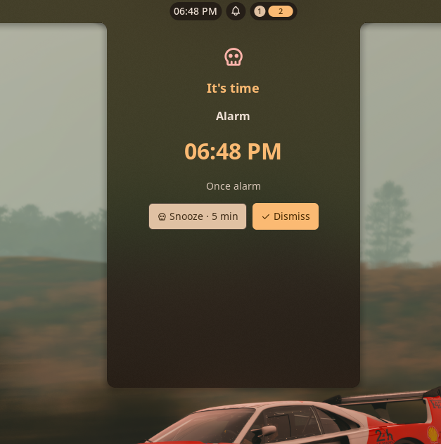
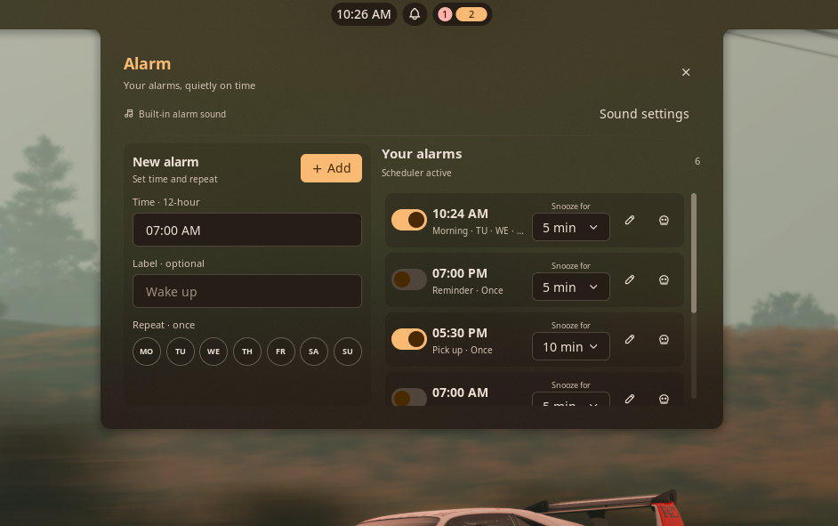
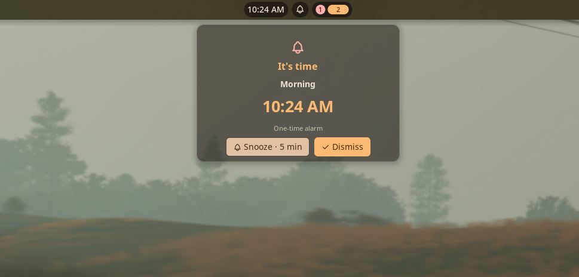

# Alarm Clock

Alarm Clock is a fixed-time alarm manager for Noctalia. Create one-time or recurring alarms, choose individual weekdays, configure snooze per alarm, and use the bundled tone or a custom audio file.



## Screenshots

### Alarm editor



### Ringing window



## Plugin

| Field | Value |
| --- | --- |
| ID | `spont-427/alarm-clock` |
| Entries | Bar widget: `bar`; panels: `panel`, `ringing`; service: `service` |

Alarm Clock focuses on recurring wall-clock schedules and per-alarm settings. The existing Quick Alarm community plugin is aimed at natural-language reminders and short countdown-style entries; this plugin is designed around a persistent list of named daily and weekly alarms.

## Requirements

For playing custom track for alarm, install **at least one** of these commands and make it available on `PATH`. This is only necessary if you are planning to play long custom music track as alarm tone and is not needed for built-in default alarm ring tone:

- `mpv` (recommended)
- `ffplay` (provided by `ffmpeg`)

Both are declared in the manifest because the service detects `mpv` first and falls back to `ffplay`. The bundled short tone uses Noctalia's native sound API and does not require either external player.

On Arch Linux, install one of them:

```sh
sudo pacman -S mpv
# or
sudo pacman -S ffmpeg
```

## Usage

1. Enable **Alarm Clock** and add its **Alarm Clock** bar widget from Noctalia's bar settings.
2. Click the bar widget to open the attached alarm editor. You can also open it with:

   ```sh
   noctalia msg panel-toggle spont-427/alarm-clock:panel
   ```
3. Enter a time in 12-hour format, optionally add a label, and choose repeat days using the `MO` through `SU` buttons. Selecting no days creates a one-time alarm; selecting one or more days repeats on those weekdays.
4. Click **Add alarm**. Use each saved alarm's enable switch, edit action, delete action, and snooze dropdown to manage it. Snooze duration is stored per alarm.
5. To choose a custom sound, open **Settings → Plugins → Alarm Clock → settings** and set **Custom alarm sound**. Leave it empty to use the bundled tone. The selected custom sound is shared by all alarms.
6. When an alarm fires, the persistent ringing panel opens automatically. Choose **Snooze** or **Dismiss** to stop custom audio and handle the alarm.

The ringing panel can also be opened manually with:

```sh
noctalia msg panel-toggle spont-427/alarm-clock:ringing
```

## Settings

| Setting | Type | Default | Description |
| --- | --- | --- | --- |
| `custom_sound` | `file` | `""` | Optional audio file used for all alarms. An empty value selects the bundled tone. Supported extensions are WAV, FLAC, Ogg, Opus, MP3, and AIFF. Custom playback requires `mpv` or `ffplay`. |
| `sound_enabled` | `bool` | `true` | Enables or disables alarm audio. The ringing panel and notifications still appear when audio is disabled. |
| `opaque_ringer` | `bool` | `false` | Use a solid background for the ringing window instead of the default translucent appearance. |

## Notes

- Alarm schedules follow the system's local timezone, including daylight-saving transitions where the timezone database provides them.
- Alarm definitions are stored locally in `noctalia.pluginDataDir()/alarms.json`. The plugin makes no network requests.
- When a custom sound is selected, the service launches `mpv` or `ffplay` as a managed process. It terminates that process on Snooze, Dismiss, deletion or disabling of the ringing alarm, sound changes, and service exit. A small PID marker is stored in the plugin data directory so only the plugin's own player process is stopped.
- If neither external player is installed, custom audio cannot be played; install one of the commands listed under Requirements. The bundled tone remains available through Noctalia's native audio API.
- The plugin's directory name and id are intentionally `alarm-clock` and `spont-427/alarm-clock`, distinguishing it from the existing `quick-alarm` community plugin.
