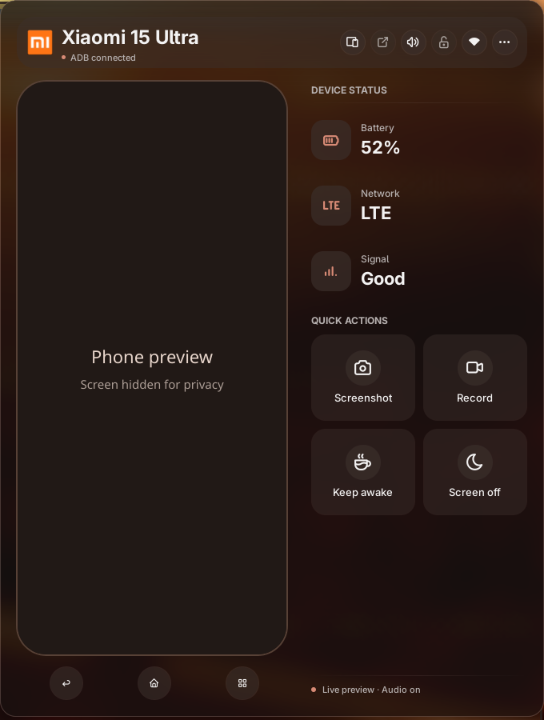

# AndroidConnect

Monitor Android devices, use KDE Connect actions, and control an authorized phone
through a live scrcpy preview inside Noctalia. KDE Connect is optional for ADB
control and mirroring; the panel also supports USB and wireless ADB devices.

## Plugin

| Field | Value |
| --- | --- |
| ID | `demencia89/androidconnect` |
| Entries | Bar widget: `bar`; panel: `panel`; service: `devices`; shortcut: `toggle` |
| Plugin API | 43 or newer, including the current palette roles |

## Requirements

- Linux and `python3` for the companion. It uses only Python's standard library.
- `adb` for authorized device discovery, phone controls, screenshots, recordings,
  and wireless pairing. Enable USB debugging or Wireless debugging on Android
  and accept the computer's authorization prompt on the phone.
- `scrcpy` for mirroring and optional audio. The embedded preview additionally
  needs `ffmpeg` and `fuser` (usually supplied by psmisc).
- A dedicated V4L2 loopback device readable and writable by your user for the
  embedded preview, `/dev/video10` by default. Configure it before opening the
  preview. The plugin does not load kernel modules, run sudo, or reuse an occupied
  device. **Open in window** only needs `adb` and `scrcpy`.
- Optional `busctl` and the KDE Connect desktop daemon/mobile app for battery,
  network status, pairing, Find phone, file sharing, and browsing. File browsing
  also needs KDE Connect's SFTP plugin and its normal SSHFS/FUSE setup;
  `xdg-open` opens the mounted directory.
- Optional `qrencode` for QR pairing; wireless discovery uses `adb mdns services`
  with `avahi-browse` as an optional fallback.
- Optional `xdg-user-dir` to locate Pictures and Videos. Without it, the plugin
  uses `~/Pictures` and `~/Videos`.
- Adwaita Sans is recommended for the panel typography; Fontconfig substitutes
  another font if it is unavailable.

For an unused loopback setup, an administrator can load the module with:

```sh
sudo modprobe v4l2loopback video_nr=10 card_label="scrcpy-panel" exclusive_caps=0
```

If another application already uses virtual cameras, configure an additional
unused device rather than unloading its module. This command is a setup example;
the plugin never runs it.

## Usage

1. Enable AndroidConnect from Noctalia's plugin store after this submission is
   merged, or add the development checkout as a local plugin source.
2. Add **AndroidConnect → bar** in the bar widget picker. Clicking it opens the
   `panel`. The `devices` service starts with the enabled plugin and owns device
   discovery, phone operations, and the preview companion.
3. Optionally add **AndroidConnect → toggle** to the control-center shortcuts.
   This `toggle` shortcut opens the same panel.
4. Select your device with **Devices** in the header. A single authorized ADB-only
   phone is selected automatically; ambiguous devices require an explicit choice.
   KDE Connect and ADB associations can be saved per phone.

Open the panel directly or assign this command to a keybind:

```sh
noctalia msg panel-toggle demencia89/androidconnect:panel
```

The live preview supports taps, drags, keyboard input, and wheel scrolling.
Back, Home, and Recents sit below it. The header provides **Wake and unlock**,
**Devices**, **Open in window**, audio, wireless tools, and **More**.
Wake and unlock asks Android to dismiss the keyguard over authorized ADB;
secure locks still require Android authentication.

Quick actions capture a screenshot, start/stop a recording, keep the phone awake,
or turn its physical screen off while the preview continues. **More** includes
file browsing/sharing, Find phone, text input, diagnostics, and settings. KDE
Connect actions are disabled when the selected KDE Connect device is unavailable.

Use **Wireless** for pairing codes, QR pairing, saved endpoints, and reconnects.
Opening the panel can attempt a bounded reconnect to the selected phone's saved
host. Wireless ADB port changes are rediscovered even when KDE Connect is offline;
the plugin does not guess a different phone from its display name.

The three preview sizes remain saved. Panel width is 680 px; height follows its
content up to the manifest limit. Stop a recording before closing/disabling the
plugin so it can finish downloading. Opening the standalone scrcpy window stops
the embedded preview; reopening the panel returns to embedded mode.

## Settings

Open **Settings → Plugins → AndroidConnect** for these options:

| Setting | Type | Default | Description |
| --- | --- | --- | --- |
| `video_device` | string | `/dev/video10` | Dedicated, accessible V4L2 loopback device for the embedded preview. |
| `auto_mirror` | bool | `true` | Start the preview when the panel opens with an authorized ADB target. |
| `preview_height` | int | `720` | Preview-height setting in pixels, from 240 to 720. The panel size control also remembers its selected preset. |
| `fps` | int | `60` | Capture frame-rate limit, from 1 to 60 frames per second. |
| `hide_when_disconnected` | bool | `false` | Hide the bar widget when no supported phone is connected. |
| `icon_color` | color | `primary` | Theme color used by the bar icon. |

Local preferences also remember selected devices, nicknames, associations,
wireless hosts, and preview size in Noctalia's per-plugin data directory.

## IPC

The `devices` service accepts these events:

```sh
noctalia msg plugin demencia89/androidconnect:devices all toggle
noctalia msg plugin demencia89/androidconnect:devices all refresh
```

`toggle` opens/closes the panel; `refresh` requests device discovery.

## Screenshots



The running-panel screenshot is cropped to the plugin. An opaque cover hides the
phone screen for privacy; no desktop or phone messages are included.

## Notes

- No custom Noctalia shell patch or compositor-specific API is required. The
  runtime was confirmed working on packaged Noctalia 5.4.1 with Umbriel. Older
  development builds that lack plugin API 43 are not supported.
- A Python companion communicates through atomic JSON request files in a private
  directory under `XDG_RUNTIME_DIR`. It publishes structured status to the Luau
  service on stdout. The preview uses a same-user UNIX `SOCK_SEQPACKET` socket and
  sealed shared-memory file descriptors consumed by `ui.pixelStream`.
- Device discovery/control runs the declared commands. USB/wireless ADB and
  scrcpy talk to the selected phone; mDNS/Avahi discover local wireless ADB
  endpoints. KDE Connect actions use the user's session D-Bus through `busctl`;
  its daemon handles the phone connection and SFTP/file transfers. There are no
  analytics, cloud API calls, or remote code downloads.
- The companion stores preferences and a lock file in Noctalia's per-plugin data
  directory. Private runtime files include requests, preview sockets/logs, and QR
  artwork. Pairing secrets are not written to persistent preferences or command
  arguments. Runtime files are removed on companion shutdown.
- Screenshots and completed recordings are saved to Pictures and Videos. Recording
  creates a temporary Android MP4, pulls it to the computer, then removes the
  temporary phone file. User-requested sharing reads the selected local file;
  browsing asks KDE Connect to mount the phone and opens its returned directory.
- Only owned preview, recording, and standalone-window processes are stopped.
  The plugin refuses an occupied loopback device and does not kill another
  application's mirroring session. Stale commands are rejected when the panel
  closes or the selected device changes.
- Plugins run as trusted code in your user session. Device control requires
  authorization on the phone. Fractional scaling, every phone model, and all
  audio/QR pairing combinations have not been comprehensively tested.

Source and regression tests: [AndroidConnect v5](https://github.com/demencia89/noctalia-androidconnect-v5).
This submission packages the v2.4.0 runtime with current palette-role names, community-store metadata, and
artwork as v2.4.1. The v4 QML plugin remains a separate project.

Licensed under GPL-2.0-only; see [LICENSE](LICENSE). Based on WerWolv's original
[Noctalia KDE Connect plugin](https://github.com/WerWolv/noctalia-kde-connect),
with the AndroidConnect extension and native v5 port by demencia89.
