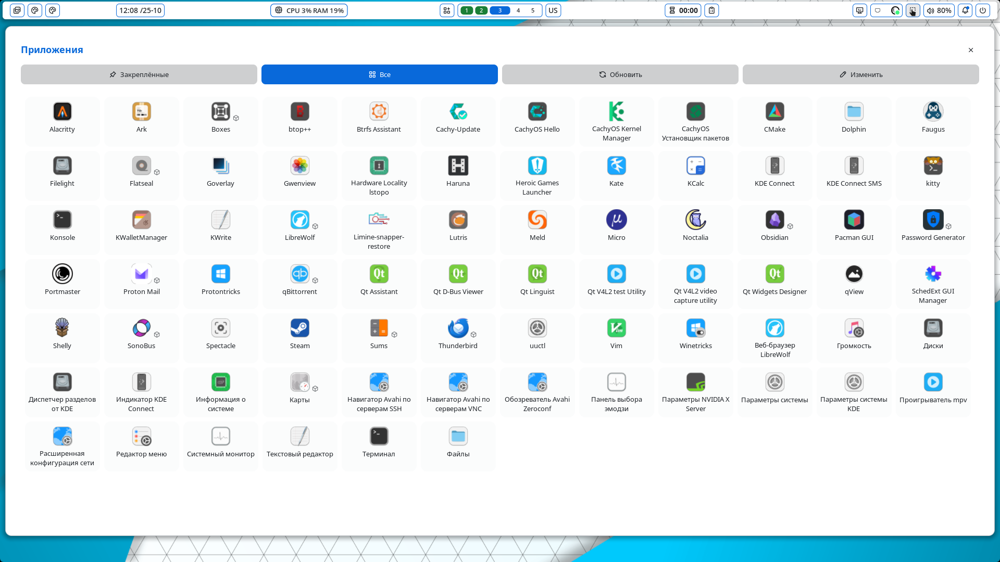

# App Launcher

A launcher panel with a fixed size, Pinned / All tabs and a scrollable app grid. There is no search and no automatic
refresh: it is a plain grid that opens with one click or one key.




## Plugin

| Field | Value |
| --- | --- |
| ID | `xrtsx/app-launcher` |
| Entries | Bar widget: `button`; panels: `launcher`, `launcher_medium`, `launcher_large`, `launcher_xl`; service: `indexer` |

The four panels are the same UI in four fixed sizes: `launcher` (900x780), `launcher_medium` (1100x880),
`launcher_large` (1300x980) and `launcher_xl` (1900x980).

## Requirements

No external commands or services. Needs Noctalia 5 with Luau plugin support (`plugin_api` 24); tested on
Noctalia 5.2.1 under Hyprland.

## Usage

Enable the plugin with `noctalia msg plugins enable xrtsx/app-launcher` (or in Settings -> Plugins), then add the
**App Launcher** bar widget (`button`) to your bar. A click on it opens the panel in the size chosen in the
`panel_size` setting.

To open a panel directly, for example from a keybind:

```sh
noctalia msg panel-toggle xrtsx/app-launcher:launcher
noctalia msg panel-toggle xrtsx/app-launcher:launcher_medium
noctalia msg panel-toggle xrtsx/app-launcher:launcher_large
noctalia msg panel-toggle xrtsx/app-launcher:launcher_xl
```

Hyprland keybind example (one line per key; `SUPER, A` is only an example):

```
bind = SUPER, A, exec, noctalia msg panel-toggle xrtsx/app-launcher:launcher_xl
```

In the panel:

- **Pinned** and **All** switch the grid, which scrolls vertically. Clicking an app launches it.
- **Refresh** re-reads the installed apps. Use it after installing or removing a program.
- **Edit** switches to pin mode: click an app to pin or unpin it, then press **Done**.
- Flatpak apps get a small cube badge next to the icon.

## Settings

| Setting | Type | Default | Description |
| --- | --- | --- | --- |
| `icon_size` | `int` | `48` | App icon size in pixels (24-128). |
| `columns` | `int` | `6` | Number of columns in the grid (2-12). Around 10-12 suits the 1900x980 panel. |
| `panel_size` | `select` | `small` | Panel opened by the bar widget: `small`, `medium`, `large` or `xl`. Applied the next time the panel opens. |

## IPC

Re-read the installed apps from a terminal or a keybind:

```sh
noctalia msg plugin xrtsx/app-launcher:indexer all refresh
```

## Notes

- **Reads:** `.desktop` files from `~/.local/share/applications/`, `/usr/local/share/applications/`,
  `/usr/share/applications/` and the user and system Flatpak export directories. Entries with `NoDisplay` or `Hidden`
  are skipped.
- **Writes:** `pinned.json` in the plugin directory, written when an app is pinned or unpinned.
- **Processes:** launching an app starts its `Exec` command (in a terminal for `Terminal=true` entries), the same way
  a desktop launcher does. Nothing else is spawned.
- **Network:** none.
- The indexer works a few apps at a time so that no call exceeds the per-call CPU budget; the Refresh button shows
  "Refreshing..." until it finishes.
- `panel.luau` ends with `launch_1` ... `launch_400`. Click handlers are passed to the host by global function name
  and globals cannot be created at runtime, so they are declared statically. The panel shows at most 400 apps per tab.
- Only Flatpak apps get a source badge; other package sources (for example AUR) are not marked.
