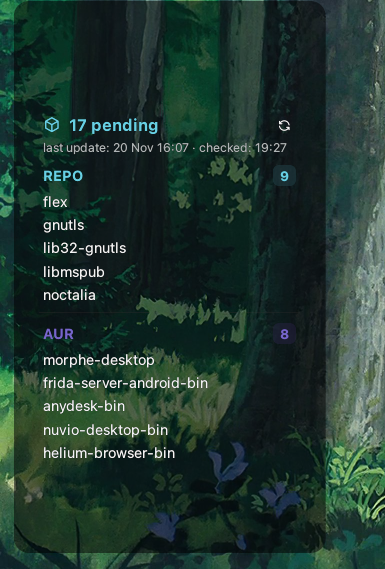
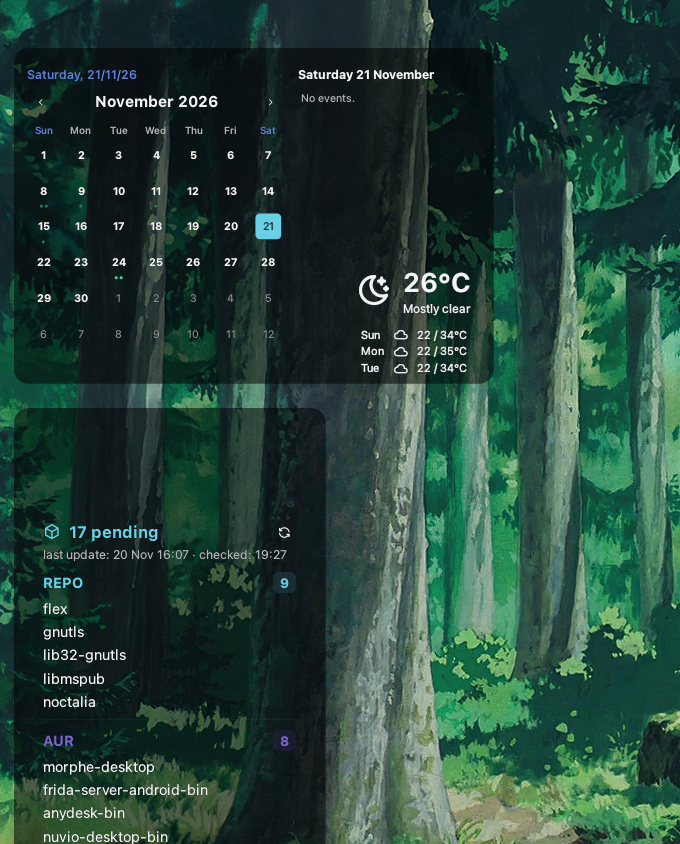

# archup

Noctalia desktop widget that shows pending Arch Linux repo and AUR updates in a compact single-column card.





## Plugin

| Field | Value |
| --- | --- |
| ID | `7sarus/archup` |
| Entries | Desktop widget: `updates-desktop` |

## Requirements

- Noctalia v5 (plugin API 43)
- `pacman-contrib` for `checkupdates`
- `yay` for AUR queries

Install the tools:

```sh
sudo pacman -S pacman-contrib yay
```

## Setup

Clone into your Noctalia plugins directory:

```sh
git clone https://github.com/7sarus/archup.git ~/.local/share/noctalia/plugins/7sarus/archup
```

Enable `7sarus/archup` in Noctalia settings, then place `7sarus/archup:updates-desktop` on your desktop.

## IPC

Force an update check from the terminal:

```sh
noctalia msg plugin 7sarus/archup:updates-desktop all refresh
```

## Behavior

- `checkupdates` syncs against a temporary database to check repo updates without root access.
- `yay -Qua` checks AUR updates.
- The list shows up to 10 pending packages, allocating slots between repo and AUR updates.
- The subtitle shows the time of the last check and the last transaction timestamp from `/var/log/pacman.log`.
- Runtime state saves to `~/.local/state/noctalia/plugins/data/7sarus/archup/state.json`.

## License

MIT
