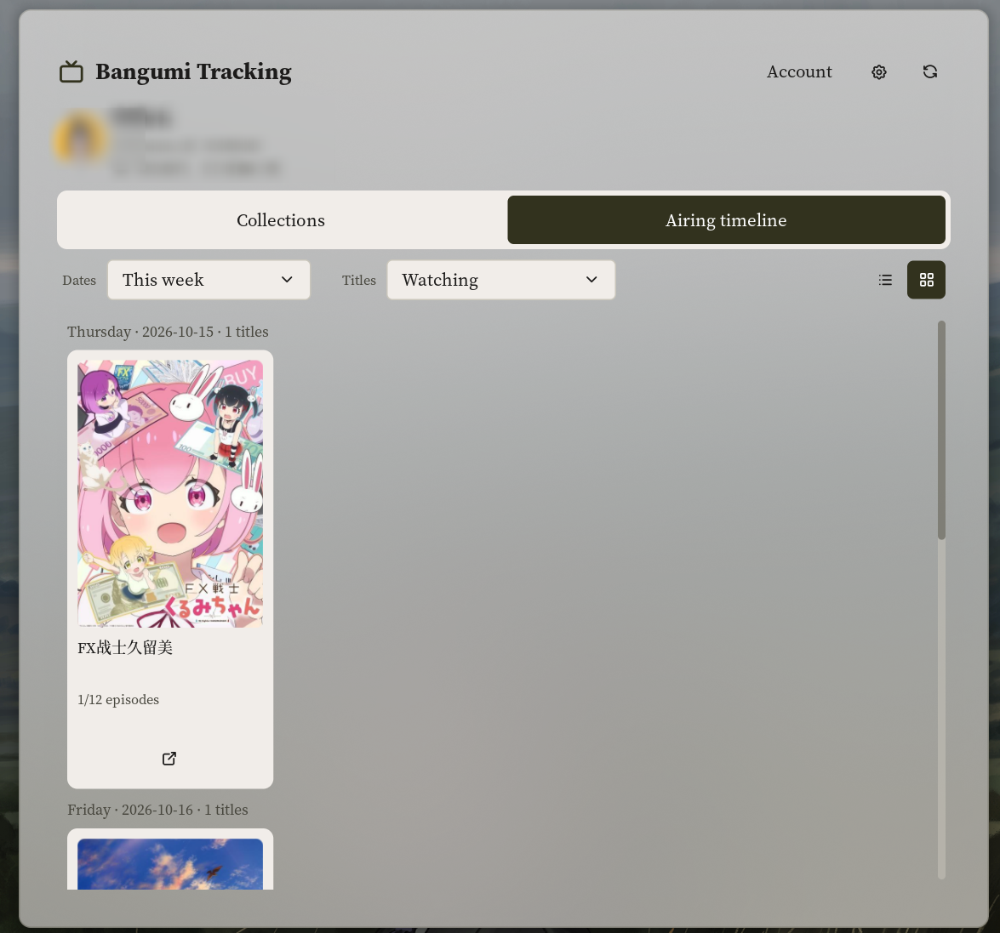
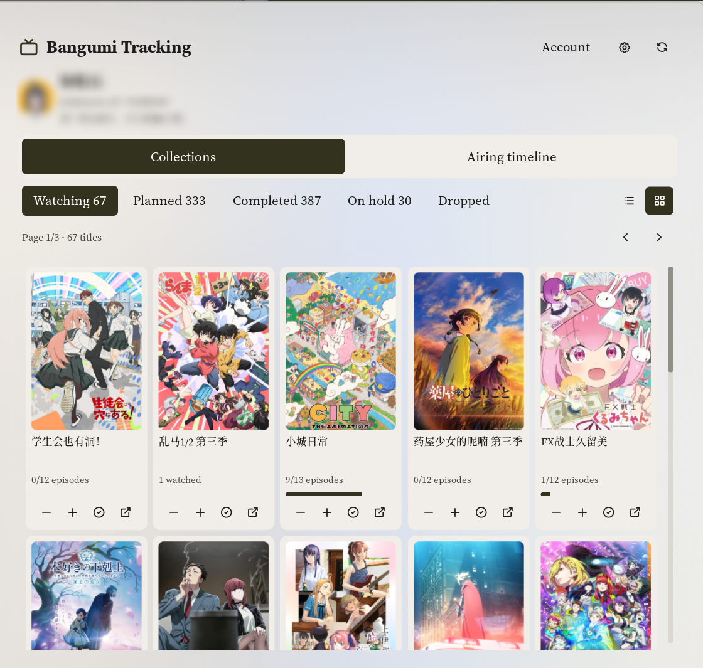

# Bangumi Progress

Track anime from [bgm.tv](https://bgm.tv) on the Noctalia desktop. See newly aired episodes, browse every collection status, and update watched progress without leaving the panel.

> Browser sign-in is optional and requires a maintainer-provided application profile. Application credentials are excluded from Git; the maintainer must choose how to supply a configured release. Personal access tokens and public username access remain available without that profile.

## Plugin

| Field | Value |
| --- | --- |
| ID | `mirei124/bangumi-progress` |
| Entries | Desktop widget: `tracker`; bar widget: `bar`; panel: `library`; service: `api` |

## Requirements

- Network access to `api.bgm.tv` and cover hosts such as `lain.bgm.tv`; browser sign-in also contacts `bgm.tv`.
- Browser sign-in requires a maintainer-provided application profile, `python3`, and `xdg-open` on `PATH`.
- A saved browser sign-in or a [Bangumi personal access token](https://next.bgm.tv/demo/access-token) is required to update progress or read private entries. A username alone provides read-only access to public collections.
- `xdg-open` opens subject and profile pages and the browser sign-in page.

## Usage

Previews show the airing timeline and collection cover grids. Account profile
information is blurred in these user-provided screenshots.




1. Enable **Bangumi Progress** in Settings → Plugins.
2. Enter a personal access token or a Bangumi username in plugin settings. In a build configured for browser sign-in, you can instead open **Account → Sign in with Bangumi** and authorize access in your browser; ordinary users do not register an API application.
3. Add the `tracker` desktop widget and/or the `bar` bar widget to your layout.

The `tracker` desktop widget lists currently watching anime with cover art, watched progress, aired progress, and total episodes. Titles with newly available unwatched episodes are pinned first. Use its paging controls when the list exceeds the configured number of visible entries, and use an entry's open button to visit its Bangumi page.

By default, the `bar` widget displays the number of episodes that became available and remain unwatched since the last progress action. The first calculation establishes a baseline and displays `0`. Its **Bar number** setting can instead show one of the five collection counts, today's Watching/full calendar count, or only the icon:

- Left-click the widget to open the `library` panel.
- Right-click it to open your Bangumi profile.
- Hover over it to see what the selected number means and whether the data is cached.

The `library` panel uses five status buttons to browse Watching, Planned, Completed, On Hold, and Dropped collections. Use the list/grid buttons on the right to choose a list or cover grid. Compact, Balanced and Comfortable density adjust artwork and spacing, with five, four and three grid columns respectively. Both layouts default to 24 titles per page so large collections remain responsive and all entries stay reachable. The plugin remembers your layout locally by default; settings can choose an explicit starting layout, opening view and page size. Newly available unwatched titles are pinned first and marked with a red dot in the Watching collection. Cards show watched progress and keep their action buttons aligned. Use `+` or `-` to change episode progress, the completion button to mark all main-story episodes as watched, and the open button to visit the subject page. The header shows the current profile with optional avatar, username/ID and a two-line bio. Use the settings icon to customize these fields, cover visibility, metadata and progress bars. Open **Account** for sign-in and manual settings; account actions are collapsed by default, while pending sign-in and errors remain visible.

Toggle the panel directly with:

```sh
noctalia msg panel-toggle mirei124/bangumi-progress:library
```

The `api` service runs in the background. It refreshes collections, resolves aired episode counts, downloads covers, persists cache data, and processes progress changes requested by the panel.

## Airing timeline

Open **Airing timeline** in the panel and use its date selector to browse **Today** or **This week**. The
default **Watching** filter matches the public Bangumi calendar against your
loaded Watching collection. **All calendar** shows every matching calendar
entry, including titles you do not follow. Collection browsing remains the
default panel view. Both the date range and title filter use selectors. Days
without matching titles are hidden by default; an entirely empty selection
shows one message. Settings can enable compact empty-day headings and extra
details, and choose the initial date range and filter. Use the list/grid buttons
to switch between rows and cover cards within each date group. Timeline layout
is remembered independently of Collections, with its own starting-layout
setting. The timeline also has its own density and cover-visibility settings;
its density follows Collections by default. Cards divide the available row
width evenly, keeping their artwork within the navigation width.

The timeline is a weekday reference from Bangumi, not a confirmed episode
release schedule. Dates use your local calendar, with Monday as the first day
of the week; Bangumi does not specify a timezone for its weekday data. Each
row can show the subject's premiere date when timeline details are enabled. Titles whose premiere
is later than the displayed day are excluded. An unknown premiere date receives an explicit label when details are shown.
Titles absent from the calendar can be counted as unlisted in the optional
details; they are not assumed to have ended. No episode number, release time,
countdown, or streaming availability is inferred.

Opening the timeline loads the public calendar on demand. Successful data
uses the configured refresh interval; the refresh button and **Retry calendar**
request a fresh copy. Failed refreshes preserve the previous calendar and
show its update time. The timeline reuses existing local covers and downloads
missing artwork for titles in the selected dates and filter, saving it to the
same local cover cache. It does not scan episode lists for the calendar. Its subject
buttons open Bangumi pages without changing collection progress.

Open the timeline directly with:

```sh
noctalia msg panel-open mirei124/bangumi-progress:library timeline
```

## Browser sign-in

When the maintainer has configured this feature, **Sign in with Bangumi** opens the browser and starts a temporary callback listener on `127.0.0.1:47871`. Complete authorization within 180 seconds, or use **Cancel** in the panel. The listener closes when the operation finishes, is cancelled, or times out. Account checking and token refresh show a waiting status without a Cancel button.

If sign-in has already finished when you select **Cancel**, the plugin shows
the connected account and explains that sign-in completed. Use **Disconnect**
to remove that saved login.

An existing personal token remains the default until you explicitly sign in through the browser. After successful browser sign-in, the saved OAuth session takes precedence over the manual token and username. Under **Account**, **Switch account** starts another browser authorization. **Manual settings** opens plugin settings while preserving the current OAuth session; it does not log out. To disconnect browser sign-in, use **Disconnect** and confirm in the panel. Disconnect removes the local OAuth session and uses an already configured manual token or username; without manual settings the plugin becomes signed out. This clears local credentials only and does not claim to revoke access at Bangumi. To revoke access remotely, use Bangumi's own application authorization controls.

### Maintainer setup and release gate

Ordinary users are not asked for a client ID or client secret. The maintainer must register an application once and supply a plugin-root `oauth-client.json` based on `oauth-client.example.json`:

```json
{
  "client_id": "",
  "client_secret": "",
  "redirect_uri": "http://127.0.0.1:47871/callback"
}
```

The example intentionally contains no usable credentials. The service reads `oauth-client.json` from the plugin directory at runtime; it is not a normal user setting. The local profile is Git-ignored to avoid publishing credentials accidentally; how a configured release will supply it still needs to be agreed with the maintainer. Preserve manual PAT access in builds without this file. Changing the application profile requires signing in again.

A client secret shipped to desktop users cannot be kept confidential. Before publishing a configured build, the maintainer needs to choose how to supply application credentials and confirm that Bangumi accepts that desktop distribution model. The plugin supports the registered loopback callback above and uses the expiry returned by Bangumi; it does not assume a fixed token lifetime.

## Settings

Upgrade defaults retain the original collection list, plain rows, account
summary, cover images and metadata. Avatars, expanded profile details, bios,
progress bars and card-style list rows are opt-in. Existing explicit settings
are honored, and remembered layouts stay in the user's data directory rather
than the plugin package. The panel keeps its title and TV icon; its height is
720 logical pixels to leave room for an optional profile header.

Plugin settings:

| Setting | Type | Default | Description |
| --- | --- | --- | --- |
| `access_token` | `string` | empty | Personal access token used to read your own collection, including private entries, and update progress. Takes precedence over `username`; a successfully saved browser sign-in takes precedence over both. |
| `username` | `string` | empty | Bangumi username used to read public collections anonymously when no browser session or personal token is set. |
| `refresh_minutes` | `int` | `30` | Automatic refresh interval and cache lifetime in minutes, from `5` to `1440`. Manual refreshes are not throttled. |

Panel appearance and content settings:

| Setting | Default | Behavior |
| --- | --- | --- |
| `panel_default_view` | `collections` | Open Collections or Airing timeline initially. |
| `collection_layout` | `remember` | Remember the last list/grid choice, or select a starting layout. |
| `timeline_layout` | `remember` | Independently remember or select the timeline's starting list/grid layout. |
| `timeline_density` | `inherit` | Follow collection density, or independently choose Compact, Balanced or Comfortable. |
| `timeline_show_covers` | `true` | Show and locally cache covers for the selected timeline dates and filter. |
| `appearance_density` | `standard` | Compact, Balanced or Comfortable cover sizes and spacing. |
| `collection_row_style` | `plain` | Original plain list rows, or optional cards. |
| `collection_page_size` | `24` | Titles per collection page, from 12 to 60. |
| `show_profile_avatar` | `false` | Opt into displaying and locally caching the account avatar. |
| `show_profile_identity` | `false` | Show expanded username and numeric ID beneath the nickname. |
| `show_profile_bio` | `false` | Display up to two lines of the account bio, when available. |
| `show_collection_covers` | `true` | Display cover images in list and grid layouts. |
| `show_collection_metadata` | `true` | Show ratings and premiere dates in list view. |
| `show_progress_bar` | `false` | Opt into collection progress bars. |
| `timeline_default_range` | `today` | Start with Today or This week. |
| `timeline_default_filter` | `watching` | Start with Watching or All calendar. |
| `timeline_show_empty_days` | `false` | Include compact date headings for days without titles. |
| `timeline_show_details` | `false` | Show premiere dates, update time and missing-schedule counts. |

Desktop widget settings, configured per `tracker` instance:

| Setting | Type | Default | Description |
| --- | --- | --- | --- |
| `show_covers` | `bool` | `true` | Show cover art beside each title. |
| `widget_width` | `int` | `320` | Natural content width in logical pixels, from `220` to `800`. |
| `visible_items` | `int` | `6` | Number of entries displayed per page, from `1` to `20`; this also determines the widget's natural height. |

Bar widget settings, configured per `bar` instance:

| Setting | Type | Default | Description |
| --- | --- | --- | --- |
| `glyph` | `glyph` | `device-tv` | Icon displayed by the bar widget. |
| `count_mode` | `select` | `newly_unwatched` | Newly unwatched episodes (original), icon only, one of the five collection counts, today's Watching schedule, or today's entire calendar. |

Change **Bar number** in the bar widget's settings. Collection counts refer to
titles; today's modes count distinct titles scheduled for the local date,
excluding future premieres. They are calendar references, not confirmation
that a new episode has aired. The original mode counts newly unwatched
episodes. Unknown values stay blank while loading instead of temporarily
showing a different metric. Cached results are identified in the tooltip.

Keep the desktop widget box at its automatic size. Explicitly resizing it in the desktop editor may cause the host to scale its contents; use `widget_width` and `visible_items` instead.

## IPC

Force the `api` service to refresh the Watching collection and every other collection category already loaded in the panel:

```sh
noctalia msg plugin mirei124/bangumi-progress:api all refresh
```

Refresh only the public airing calendar:

```sh
noctalia msg plugin mirei124/bangumi-progress:api all refresh_calendar
```

Clear the service's in-memory viewer, collection, episode-progress, and badge state:

```sh
noctalia msg plugin mirei124/bangumi-progress:api all logout
```

When browser sign-in is active, the `logout` event clears the private OAuth session and in-memory state and invalidates in-flight operations. It does not immediately fall back to a manually configured token. Manual PAT settings are not erased, so restarting the service can restore manual access. Other on-disk cache data is retained. The panel's **Manual settings** action only opens plugin settings and preserves browser sign-in. **Account → Disconnect** requires inline confirmation before removing the local OAuth session; after confirmation the service uses configured manual access, or remains signed out when no manual token or username exists. Closing or reopening the panel, collapsing Account, cancelling, or changing identity clears the pending confirmation.

## Notes

- Browser sign-in starts the local Python helper `scripts/bangumi_oauth.py` as a process and invokes `xdg-open`. The helper uses the fixed `https://bgm.tv/oauth/authorize` and `https://bgm.tv/oauth/access_token` endpoints and verifies identity through `https://api.bgm.tv/v0/me`. It sends authorization codes, application credentials, and refresh tokens only to the token endpoint; access tokens go to `api.bgm.tv`.
- OAuth session data is stored in `pluginDataDir/oauth/oauth-session.json` using atomic writes and owner-only file permissions (`0600`). Credentials are not published in the panel snapshot or logged. The application profile is separate from session storage.
- OAuth access and refresh credentials remain in the private session file. The helper uses the provider's returned expiry and saves a rotated refresh token when one is returned.
- The service sends the active access token to `api.bgm.tv` as a Bearer token. A normal bgm.tv website login cookie cannot authenticate the v0 API.
- It calls `/v0/me`, collection, and episode endpoints on `api.bgm.tv`, and downloads cover images from URLs returned by the API, normally on `lain.bgm.tv`.
- The timeline makes a public `GET https://api.bgm.tv/calendar` without sending a Bearer token. It starts no additional process and performs no remote writes. Public calendar data is saved separately as `calendar.json`; account matching happens in the panel using the current collection.
- Cache data is written under Noctalia's plugin data directory, normally `~/.local/state/noctalia/plugins/data/mirei124/bangumi-progress/`, as `cache.json`, `badge-baselines.json`, `calendar.json`, and files under `covers/`. `collection-layout.txt` and `timeline-layout.txt` store only the respective list/grid preferences.
- Opening the panel can read the public `GET /v0/users/{username}` profile without an authorization header. The response supplies the bio (`sign`) and avatar URL; complete `/v0/me` data is reused when available. Profile JSON and downloaded avatars are cached by account under `profiles/`, using `refresh_minutes`. Disabling the avatar prevents new avatar downloads, and disabling all profile fields skips this optional read. A failed profile or avatar refresh preserves previous data and does not fail collection loading or sign-in. No additional external command or process is started for profiles.
- Collection, identity, and episode caches use `refresh_minutes` (30 minutes by default). Reopening the panel and restarting the service reuse fresh collection data; expired data remains visible during refresh and after a network failure. Same-account OAuth token rotation preserves cached collections; account changes remain isolated. The panel's refresh button and the `refresh` IPC event force a collection refresh.
- Successfully downloaded covers are saved locally and reused across panel opens, layout changes, and restarts. The grid uses medium-size artwork; legacy thumbnails upgrade on a later collection refresh. Other collection categories load their covers when browsed, with both layouts requesting the visible page instead of downloading the entire library at startup. Cover downloads and episode lookups are each limited to two titles concurrently.
- Downloaded cover paths update the view immediately. Cache writes are combined within a one-second window and flushed when the download queue finishes or before changing accounts, rather than rewriting the complete collection cache for every image.
- The service invokes `xdg-open` to open `https://bgm.tv/subject/<id>` and `https://bgm.tv/user/<username>` in the default browser.
- Anime progress is changed episode by episode through `PATCH /v0/users/-/collections/{subject_id}/episodes`. Collection-level `ep_status` updates apply only to books, and the legacy collection update endpoint can reset an anime to Wish.
- With an authenticated session, collection reads use the explicit username returned by `/v0/me`; the `-` self-reference has been observed to return 404 for reads but works for writes.

## License

MIT
