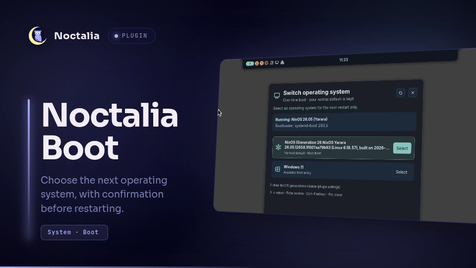

# Noctalia Boot

Select a one-time systemd-boot entry and restart after confirmation and administrator authentication.

## Plugin

| Field | Value |
| --- | --- |
| ID | `swashx-dev/boot` |
| Entries | widget: `boot-button`; panel: `switcher`; shortcut: `switch-os` |

## Requirements

Requires Noctalia plugin API 45 or newer. The standalone repository edition remains compatible with API 24.

Install `noctalia-switch-os` on `PATH`.
The backend is maintained in [Noctalia-Boot](https://github.com/SwashX-dev/Noctalia-Boot) and is distributed separately as a Nix package (version 1.0.1).
Install its package and, where required, its NixOS module using that repository's README.
The community plugin calls the installed backend; it never downloads or executes helper code from the network.
The backend package also includes a standalone plugin. Enable only one frontend, not both the community ID and `local/switch-os`.

## Usage

Install this plugin from the community source and enable `swashx-dev/boot` in Settings → Plugins.
Open its panel with:

```sh
noctalia msg panel-toggle swashx-dev/boot:switcher
```

Add bar widget `swashx-dev/boot:boot-button` or control-center shortcut `switch-os` to open the `switcher` panel.
Choose an operating system, review the confirmation and select Restart now (or Ctrl+Return).
Arrow keys select entries, Enter opens the confirmation, and Ctrl+R refreshes. Plain Enter never confirms a restart.

## Settings

| Setting | Type | Default | Description |
| --- | --- | --- | --- |
| `enabled` | bool | true | Enable boot selection. |
| `show_all_generations` | bool | false | Show older NixOS generations, in addition to default, running and next entries. |

## Notes

Requires UEFI systemd-boot and the repository's NixOS module for the privileged helpers and PolicyKit rules. Unsupported bootloaders show an explanation.
The unprivileged Python frontend uses `pkexec` to invoke fixed installed helpers. They read EFI boot information and `bootctl --json=short list`.
After explicit confirmation and administrator authentication, the helper calls `bootctl set-oneshot` for a validated local entry, verifies it, and requests `systemctl --check-inhibitors=yes reboot`.
Only the next boot changes; the persistent default is never changed. A failed reboot request restores the prior one-time selection.
The frontend writes private job/lock state below `~/.local/state/noctalia-switch-os` and can spawn `notify-send` for failures. No network requests are made.



The screenshot inside the card shows the earlier UI branding. The current panel uses the name Noctalia Boot.
