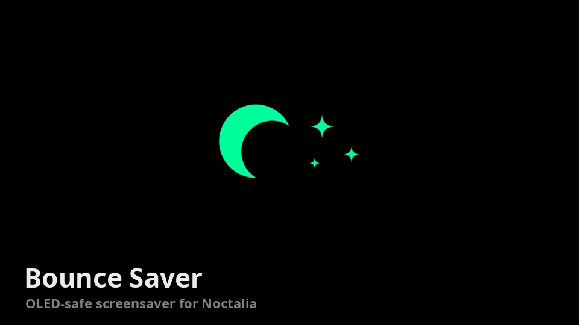

# Bounce Saver

An OLED-safe screensaver: after a few idle minutes every screen goes pure black and a
logo bounces around, the way old DVD players did it. Black pixels on an OLED panel are
switched off, and the logo never stops moving, so nothing stays lit in one place.



## Plugin

| Field | Value |
| --- | --- |
| ID | `teslaoruz/bounce-saver` |
| Entries | Service: `saver` |

## Requirements

Install `quickshell` (it provides the `qs` command). The service draws the screensaver with
it; Noctalia plugins have no idle API or full-screen surface of their own.

niri is optional: with it, the screensaver can tell a fullscreen video apart from a
static page (see Notes).

## Usage

Enable **Bounce Saver** in Settings → Plugins. There is nothing to place on the bar: the
`saver` service runs in the background while the plugin is enabled.

- After the idle time, every output turns black and the logo starts bouncing.
- It moves on a 45° diagonal at constant speed, reflects off every edge like a mirror,
  and takes a new colour on each hit.
- Any key press or mouse movement hides it.

It keeps its own idle timer, so it also runs while Noctalia's caffeine is on. Your own
lock, screen-off and suspend settings in `[idle]` are unchanged: caffeine still blocks
those as before.

## Settings

| Setting | Type | Default | Description |
| --- | --- | --- | --- |
| `timeout` | `int` | `120` | Seconds without keyboard or mouse input before the screensaver starts (10 to 3600). |
| `logo` | `file` | empty | Image that bounces: `.svg`, `.png` or `.webp`. White art on a transparent background tints best, because the logo is recoloured on every hit. Empty uses the built-in crescent moon. |

## Notes

- **Processes:** the service runs one long-lived `qs -p <plugin dir>/shell.qml` and checks
  every 30 s that it is still running, restarting it if not. Disabling the plugin ends it.
  While idle, `shell.qml` runs `niri msg -j outputs`, `niri msg -j workspaces` and
  `niri msg -j windows` every 2 s.
- **Files and network:** none. It writes nothing and makes no network calls.
- **Apps that keep the screen awake:** Bounce Saver ignores idle inhibitors and instead
  skips any screen that shows a fullscreen window, so fullscreen video keeps playing (also
  in X11 players, which cannot inhibit idle) but a static music page does not stay on
  screen for hours. niri reports no fullscreen flag, so a window exactly the
  size of its output on an active workspace counts as fullscreen. Without niri the check
  cannot run and the screensaver always starts, the OLED-safe choice.
- **Compositors:** needs layer-shell and `ext-idle-notify-v1`. Tested on niri.

## Without Noctalia

`shell.qml` also runs on its own, configured with environment variables:

```sh
BOUNCE_TIMEOUT=120 BOUNCE_LOGO=/path/to/logo.svg qs -p /path/to/bounce-saver/shell.qml
```

niri autostart:

```kdl
spawn-at-startup "qs" "-p" "/path/to/bounce-saver/shell.qml"
```

Needs Quickshell 0.2+ (`IdleMonitor`) and Qt 6.5+ (`MultiEffect`, `FrameAnimation`).
