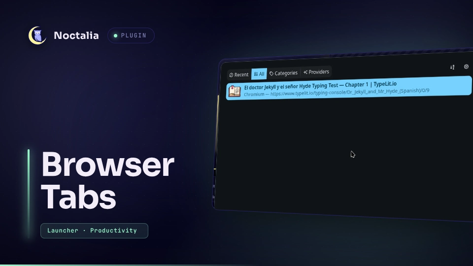

# Browser Tabs

Search and jump to any open browser tab from the Noctalia launcher, across
every running browser at once (Chromium, Firefox, Brave, Zen, and others).

## Plugin

| Field | Value |
| --- | --- |
| ID | `fennstef/browser-tabs` |
| Entry | Launcher provider: `browser-tabs` |
| Launcher Prefix | `/bt` |

## Requirements

Install [`tabctl`](https://github.com/slastra/tabctl) and its mediator
(`tabctl-mediator`), and the tabctl browser extension in each browser you want
to search. After installing, run `tabctl install` once to register the native
messaging manifests, then confirm each browser is connected with
`tabctl status`.

## Usage

Open the Noctalia launcher and type `/bt <query>` to search open tabs by title
and URL across every running, tabctl-connected browser. Selecting a result
activates that tab in its browser and, on niri, Hyprland, or sway, switches to
the workspace containing that browser's window.

## Notes

- Tab data comes from `tabctl list --format json`, re-run on every keystroke
  (debounced 150ms); activating a result runs `tabctl activate <id>`.
- Result favicons are fetched from Google's public favicon service
  (`https://www.google.com/s2/favicons`) by domain and cached in the plugin's
  data directory; browsers without a matching cached favicon fall back to a
  generic per-browser glyph.
- Workspace-follow on activation is best-effort: it currently only runs on
  niri, Hyprland, and sway (detected via `NIRI_SOCKET`,
  `HYPRLAND_INSTANCE_SIGNATURE`, `SWAYSOCK`). On other compositors, the tab
  still activates inside its browser via tabctl, but the workspace does not
  switch automatically.
