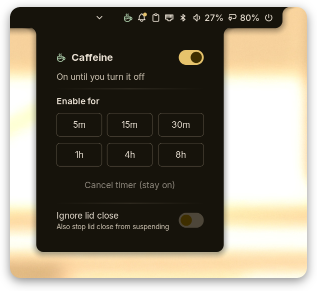

# Caffeinate Plus

Keeps your session awake until you turn it off, lock the screen, or a timer runs out. It adds timed presets, a countdown in the bar, and an optional lid-close inhibit to Noctalia's built-in caffeine. A port of the [Caffeine Spoon](https://github.com/jonfriesen/caffeine-spoon) for Hammerspoon.



## Plugin

| Field | Value |
| --- | --- |
| ID | `jonfriesen/caffeinate-plus` |
| Entries | Bar widget: `caffeine`; panel: `panel`; service: `service`; shortcut: `toggle` |

## Requirements

- `noctalia` on `PATH`. The plugin drives the built-in caffeine through `noctalia msg`.
- `systemd-inhibit` and `grep`, used to read whether caffeine is on.
- `systemd-run`, `systemctl`, `sh`, `date`, `stat` and `sleep`, used for the optional lid-close inhibit.
- A session managed by `systemd-logind`, with a working user service manager.

## Usage

Add the **Caffeinate Plus** widget to a bar (`caffeine`).

- **Left-click** toggles caffeine.
- **Right-click** opens the panel.
- **Scroll up or down** adds or removes time. The step is the *Scroll step* setting. Scrolling up with no timer running starts one.
- While a timer runs, the widget shows the time left next to the icon.

The panel holds:
- an on/off switch;
- the time remaining;
- one button per preset (5m, 15m, 30m, 1h, 4h, 8h by default);
- **Cancel timer (stay on)**;
- **Ignore lid close**.

Open the panel from a keybind with:

```sh
noctalia msg panel-toggle jonfriesen/caffeinate-plus:panel
```

To get the Control Center tile (`toggle`), add **Caffeinate Plus** in Settings → Control Center → Shortcuts. Clicking the tile toggles caffeine, and right-clicking it opens the panel.

How a session behaves:
- **Choosing a preset** replaces any running timer, and toggling by hand cancels it.
- **A session ends** when the timer runs out, when you lock the screen, or when the plugin is disabled.
- **A timer takes over caffeine.** When it runs out, or the screen locks first, caffeine turns off, even if it was already on before the timer started (for example from the built-in caffeine tile).
- **Without a timer, caffeine is turned off only if this plugin turned it on.** Caffeine that was already on stays on when you lock the screen or disable the plugin.
- **Cancel timer (stay on)** keeps caffeine on and hands it back: if it was on before the timer, the plugin leaves it alone again.

While it's on, caffeine holds off the whole idle chain: screen-off, lock and suspend.

## Settings

| Setting | Type | Default | Description |
| --- | --- | --- | --- |
| `presets_minutes` | `string_list` | `5, 15, 30, 60, 240, 480` | Durations offered in the panel, in minutes. Entries that aren't positive numbers are ignored. |
| `scroll_step_minutes` | `int` | `15` | Minutes added or removed per scroll step over the bar widget, 1 to 120. |
| `cancel_on_lock` | `bool` | `true` | End the session when the screen locks. |
| `lid_inhibit` | `bool` | `false` | Default for **Ignore lid close**. While a session runs, closing the lid won't suspend. The panel switch overrides it until this setting changes. |
| `show_remaining` (widget) | `bool` | `true` | Show the countdown next to the bar icon. It is always hidden on vertical bars. |

## IPC

```sh
noctalia msg plugin jonfriesen/caffeinate-plus:service all toggle
noctalia msg plugin jonfriesen/caffeinate-plus:service all enable
noctalia msg plugin jonfriesen/caffeinate-plus:service all disable
noctalia msg plugin jonfriesen/caffeinate-plus:service all for 90         # on for 90 minutes
noctalia msg plugin jonfriesen/caffeinate-plus:service all add -15        # add or remove minutes
noctalia msg plugin jonfriesen/caffeinate-plus:service all cancel-timer   # keep caffeine on, drop the timer
noctalia msg plugin jonfriesen/caffeinate-plus:service all lid on         # on, off, or no payload to flip
noctalia msg plugin jonfriesen/caffeinate-plus:service all status         # writes the state to the log
```

- `disable` always turns caffeine off, even if it was on before the plugin was asked.
- `add` with no timer running starts one if the number is positive.

## Notes

- **No network access.**
- **Processes it runs**, all as the current user:
  - `noctalia msg caffeine-enable` and `caffeine-disable`, to turn caffeine on and off.
  - `systemd-inhibit --list` piped to `grep`, every 5 seconds. Noctalia's caffeine holds a logind idle inhibitor named `Caffeine`, and this is how the plugin reads whether it's on.
  - `noctalia msg status`, every 2 seconds while a session runs, to detect a screen lock.
  - With **Ignore lid close** on: `systemd-run` starts the transient user unit `caffeinate-plus-lid.service`, which runs `systemd-inhibit --what=handle-lid-switch --mode=block` around a small `sh` loop. The loop exits, releasing the lid, once the heartbeat file below is more than 30 seconds old. `systemctl --user is-active` checks that unit every 5 seconds while the lid should be held, and the plugin starts it again if it has gone away (for example after a suspend long enough for the heartbeat to go stale). `systemctl --user stop` stops it.
- **Files written:** in the plugin's data directory, `state.json`, so a session survives a plugin reload, and `lid-heartbeat`, touched every 10 seconds while the lid is held. The service stops the lid unit and removes the heartbeat whenever it exits for anything other than a reload, so even if noctalia crashes or is killed the lid is released within about 30 seconds. `state.json` is deleted when the plugin is disabled or uninstalled.
- **Lid-close limits:** the inhibitor doesn't block a suspend you ask for yourself (power menu, `systemctl suspend`), and the plugin doesn't change `logind.conf`. To release it, turn off **Ignore lid close** or end the session; while a session runs, the plugin restarts a unit that was stopped by hand. If noctalia isn't running, `systemctl --user stop caffeinate-plus-lid.service` releases it.
- **Timer:** it uses a wall-clock end time, so time spent suspended counts toward it.
- **Compositors:** the plugin doesn't depend on the compositor. It has been tested on Umbriel.

## License

MIT. The timer, session and ownership logic is ported from my changes to the Caffeine Spoon. The original Spoon is by Chris Jones and Caffeine contributors (MIT), and their copyright notice is kept in `LICENSE`. The lid inhibitor follows [bagusk99/super-caffeine](https://github.com/noctalia-dev/community-plugins/tree/main/super-caffeine) (MIT).
