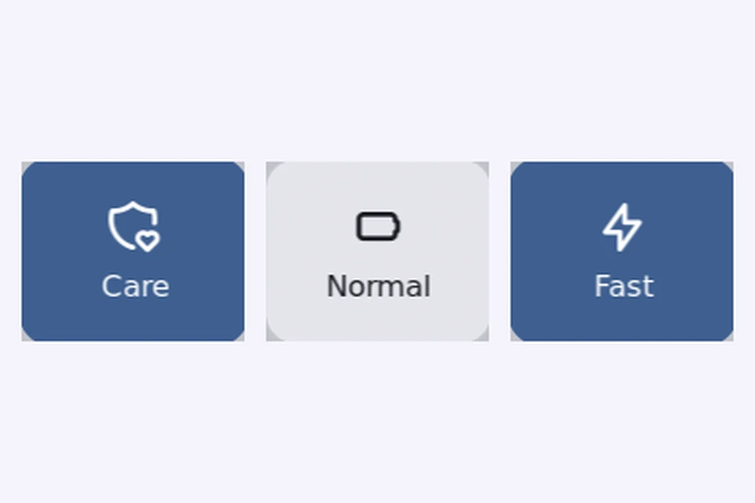

# Charge Mode

**Charge Mode** is a Control Center shortcut plugin for [Noctalia](https://docs.noctalia.dev) (v5) that cycles the
battery charge type through the kernel's standard `charge_types` power-supply attribute:
**Care** (`Long_Life`) → **Normal** (`Standard`) → **Fast charge** (`Fast`).

The kernel exposes these as one mutually exclusive charge type, so the tile cycles all three instead of pretending
they are independent switches. It covers Lenovo Legion and IdeaPad laptops, and any other laptop whose `ideapad-laptop`
or vendor driver publishes `charge_types`.

It replaces the older `conservation_mode` sysfs attribute most tutorials and tools still write to: the kernel marks
that attribute deprecated (writing it logs `conservation_mode attribute has been deprecated, see charge_types`) and
`charge_types` covers conservation *and* fast charge through one interface.


## Plugin

| Field | Value |
| --- | --- |
| ID | `neoscaler/charge-mode` |
| Entries | Shortcut: `charge` |

## Requirements

- Linux kernel **6.19 or newer** for the three states: `charge_types` exists since 6.17, but the `Fast` value (rapid
  charge) was only added to `ideapad-laptop` in 6.19. Kernels before 6.17 expose only the deprecated
  `conservation_mode` attribute, so the tile stays disabled and shows `N/A`.
- The `pkexec`, `sudo`, `sh`, `chown` and `udevadm` commands for the one-time setup.

## Usage

Add the `charge` shortcut under Settings → Control Center shortcuts. Each click advances to the next charge type;
the label and icon show the type the firmware reports after the write.

| Charge type | Label | Icon |
| --- | --- | --- |
| `Long_Life` | Care (caps charging below 100%) | `shield-heart` |
| `Standard` | Normal | `battery` |
| `Fast` | Fast | `bolt` |



Conservation and fast charge are mutually exclusive in the firmware: enabling one switches the other off. The kernel
sequences those writes, so cycling the tile is always safe.

## One-time setup, then no prompts

Writing `charge_types` needs root. The first click that cannot write runs `setup.sh` once: it writes
`/etc/udev/rules.d/99-charge-mode.rules`, which hands the attribute to your user via `chown`, and applies it
immediately — no logout, no reboot. Every later click writes directly.

The setup prompt appears once. If `pkexec` cannot show a prompt because no polkit agent is running, the plugin falls
back to a terminal with `sudo` (Noctalia can supply an agent itself: set `shell.polkit_agent = true`). Cancelling the
prompt counts as a no: no terminal opens, only the error notification appears.

To do it by hand, or on a system with an immutable `/etc` (NixOS), install the rule yourself:

```sh
echo 'ACTION=="add|change", SUBSYSTEM=="power_supply", ATTR{type}=="Battery", TEST=="charge_types", RUN+="/bin/chown '"$USER"' /sys%p/charge_types"' \
  | sudo tee /etc/udev/rules.d/99-charge-mode.rules
sudo udevadm control --reload-rules
sudo udevadm trigger --action=change --subsystem-match=power_supply
sudo udevadm settle
```

### NixOS

```nix
{
  services.udev.extraRules = ''
    ACTION=="add|change", SUBSYSTEM=="power_supply", ATTR{type}=="Battery", TEST=="charge_types", RUN+="${pkgs.coreutils}/bin/chown <you> /sys%p/charge_types"
  '';
}
```

## Notes

- The plugin only touches `/sys/class/power_supply/*/charge_types`. It writes nothing outside sysfs. The only process it
  ever spawns is `setup.sh` through `pkexec` (or `sudo` in a terminal when no polkit agent answers); normal clicks
  write the attribute directly and spawn nothing.
- The udev rule itself runs `/bin/chown <you> /sys%p/charge_types` on every battery add/change event, so the permission
  survives reboots.
- The battery is discovered by scanning `/sys/class/power_supply`, so `BAT0`, `BAT1` and friends all work.
- Whether `Fast` is accepted can depend on firmware state (charger attached, battery temperature, state of charge).
  The plugin re-reads the attribute after every write and shows the real value.
