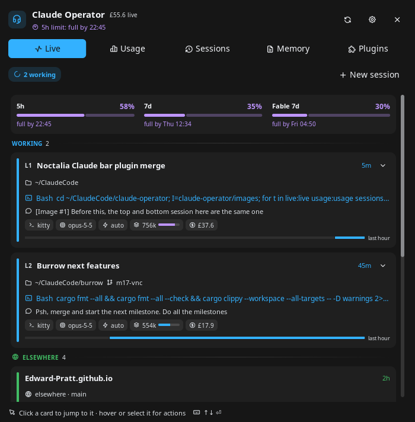
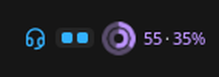
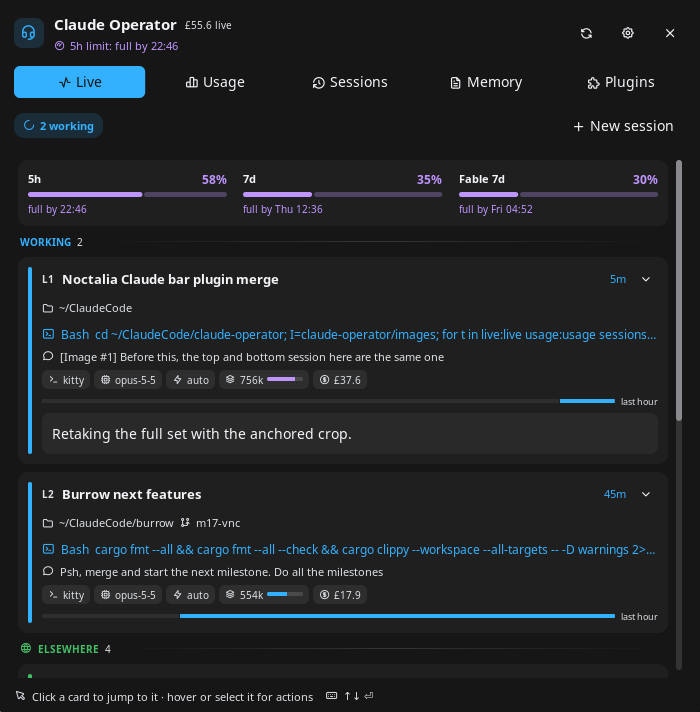
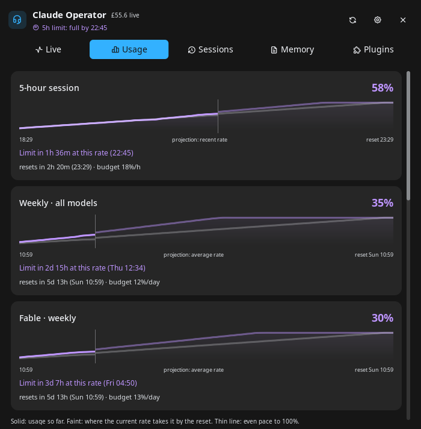
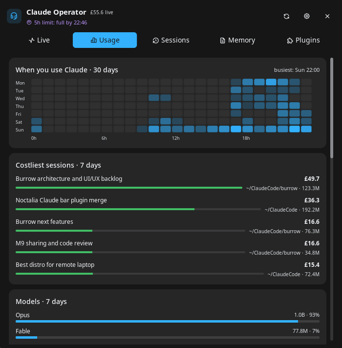
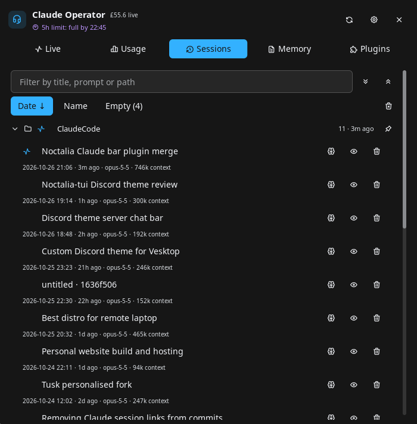
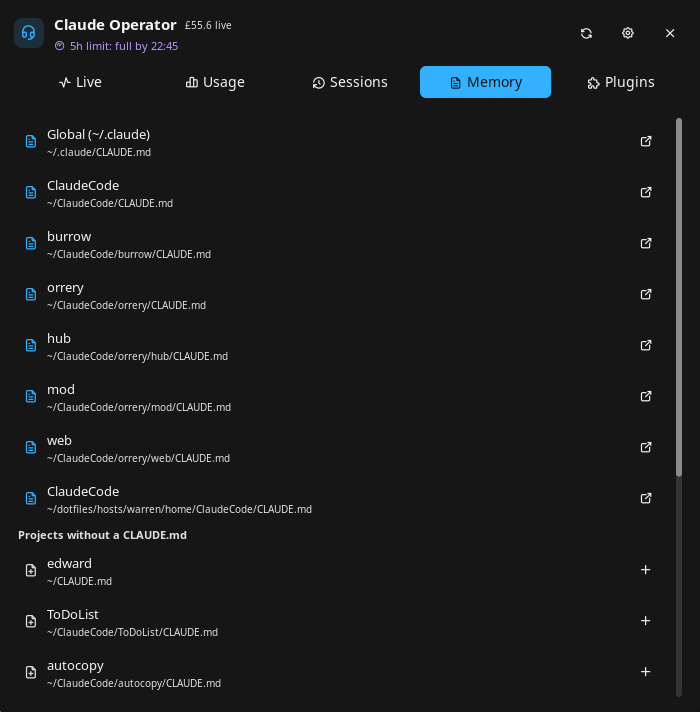
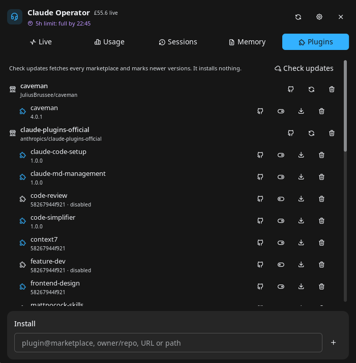

# Claude Operator

Every Claude Code session on one switchboard. Each session is a lit line: the bar's lamps
show which are working and which need you (blinking), and one gauge shows your plan
windows and where your current rate takes them. The panel lets you read Claude's last
reply without switching windows, jump to any session's terminal, resume and search every
saved session, forecast your limits, see when and where your usage goes, and manage
CLAUDE.md files and Claude Code plugins. A desktop widget puts the board on a second
monitor.



*The Live tab: each running session is a numbered line with its lamp, current tool, last
prompt, cost and last hour.*

Claude Operator merges [claude-cockpit](https://github.com/noctalia-dev/community-plugins/tree/main/claude-cockpit)
(nightwatch75) and [claude-sessions](https://github.com/noctalia-dev/community-plugins/tree/main/claude-sessions)
(lfdominguez) into one plugin with one data service, and fixes several bugs they had.

## Plugin

| Field | Value |
| --- | --- |
| ID | `edward/claude-operator` |
| Entries | Bar widget: `widget`; desktop widget: `desktop`; panel: `panel`; service: `service`; launcher provider: `search` |
| Launcher Prefix | `/co` |

## Requirements

- Noctalia 5.4.0 or newer (`plugin_api = 43`).
- Claude Code 2.1 or newer, logged in. It writes the per-session state files this
  plugin reads, and its OAuth token gives the plan limits.
- `claude` itself, found on `PATH` or in `~/.local/bin`, for resuming sessions and the
  Plugins tab.
- `bash`, `jq` and `curl`.
- Standard tools every distribution ships: `find`, `grep`, `sed`, `awk`, `tac`, `stat`,
  `sort`, `head`, `tail`, `tr`, `cut`, `xargs`, `date`, `basename`, `dirname`, `readlink`, `cat`,
  `mkdir`, `mv`, `rm`, `pgrep`, `kill`.
- `xdg-open` to open folders, transcripts and claude.ai links.
- Optional: kitty with remote control, to land on the exact tab of a session and to open
  new or resumed sessions as kitty tabs. Add to `kitty.conf` and restart kitty:

  ```conf
  allow_remote_control socket-only
  listen_on unix:@kitty-{kitty_pid}
  ```

- Optional, to jump to a session's window: Hyprland (`hyprctl`, Lua or classic config),
  niri (`niri`), sway (`swaymsg`) or Umbriel (`umbriel`), the compositors whose window list
  names each window's process. On GNOME, KDE, river, labwc and others everything else
  works, and clicking a card says it cannot find the window. Without a compositor window
  list, new sessions still open as tabs in the newest kitty.
- Optional: tmux. A session inside tmux gets its pane selected, then the terminal of the
  attached client is focused (the most recently active one).
- Any terminal works. Cards name it: kitty, Alacritty, WezTerm, Ghostty, Konsole, foot,
  VTE terminals, or whatever sets `TERM_PROGRAM`, prefixed with `tmux ·` inside tmux.
- GNU coreutils, findutils, grep and sed, as on every mainstream distribution (the
  scripts use `find -printf`, `stat -c` and `date -d`); BusyBox alone is not enough.
- Optional: `code` or `zed` to open CLAUDE.md files, or set **Editor command**.

## Usage

### Bar widget



Add **Claude Operator** from the bar's widget picker. It shows:

- The glyph, which turns into a red bell while a session waits for a permission or an
  answer (on this machine or, through Remote Control, on another one).
- A lamp board: one lamp per running session, red and blinking while it needs you, accent
  while working, dim when idle. After 8 it shows `+N`. Set **Bar style** to *Counts* for
  `waiting busy/total` instead.
- One nested gauge for the plan windows (pick them with **Bar limits**): the 5-hour
  window inside the 7-day one, each with a solid arc for what is used and a faint arc for
  where the current rate takes it by the reset; then their percentages, inside out
  (`46·34%`). **Bar limits style** also offers bars or plain percentages. A window turns
  to the warning colour when the current rate takes it past 85% (or to 100% before the
  reset), and red when the limit is under an hour away (5-hour window) or a day away
  (weekly), or reached. Numbers kept from before an expired token are dimmed.

Hover it for every session, the plan, where each window is heading, and the cost of
today and the last 7 days. Click it to open the panel.

### Panel

```sh
noctalia msg panel-toggle edward/claude-operator:panel
```

It opens attached to the bar. To float it instead, set **Placement** to *Floating* (and
**Position** to where you want it) in the panel section of the plugin's settings, which
noctalia provides for every plugin panel.

The header always leads with the most urgent thing on the board: a session that needs
you, a limit about to be hit, or how many lines are working.

- **Live**: plan limits, then running sessions grouped into *Needs you*, *Working* and
  *Idle*. Each session is a numbered line (`L1`, `L2`…) with a lamp down its edge that
  blinks while it needs you. A card shows the title, folder and branch, the tool it is
  running or what it waits for, todo progress, your last prompt, chips for terminal,
  model, permission mode, context use, cost, subagents, helpers (Claude sessions started
  from inside this one, such as a hook's review run) and last turn time, and a strip of
  its last hour (working, waiting, idle). The chevron opens Claude's last reply, rendered,
  and the questions of a pending AskUserQuestion, so you can see what it wants without
  switching windows. Click a card to jump to its terminal. Hover it, or select it with the keyboard, for its actions: open on claude.ai
  (Remote Control), open a shell there, open the folder, copy a resume command, open
  the transcript, and stop the session (click twice). *Elsewhere* lists your Remote
  Control sessions on other machines. *Recent* lists closed sessions to resume.
  **New session** starts Claude in a pinned or recent project. Click the limits strip to
  open Usage.
  

- **Usage**: each plan window as a forecast graph: usage so far, then (faint) where the
  current rate takes it by the reset, against an even-pace line to 100%. Under it: when you
  would hit the limit at this rate (or roughly where you will end up), the reset time, and
  the budget per hour or day that would last until the reset. The 5-hour window uses the
  last hour's rate once there is enough of it; weekly windows use their average so far,
  after the first 6 hours. Then estimated cost and tokens for today, 7 days, 30 days and
  all time (kept after Claude Code deletes old transcripts, so it grows from install), the
  last 7 days day by day, a 30-day weekday-by-hour heatmap of when you use Claude,
  the five costliest sessions and the models used.
  
  

- **Sessions**: every saved session, grouped by project (worktrees read as
  `repo › worktree`), pinned projects first. Runs started through the Agent SDK (a hook
  or script calling `claude`) are left out, here and in Recent and the launcher. Filter by title, prompt or path, sort by date
  or name, show only empty sessions. The pin on a project keeps it at the top here and in
  **New session**. Click a session to resume it. Each row can open or create the
  project's CLAUDE.md, preview the prompt, or delete the session. The bin button deletes
  every empty session; running ones are always kept.
  

- **Memory**: the global `~/.claude/CLAUDE.md`, every CLAUDE.md under your home folder,
  and a row to create one for each project that has sessions but no file.
  

- **Plugins**: installed Claude Code plugins by marketplace, plus bare skill folders in
  `~/.claude/skills`. Enable, disable, update or uninstall a plugin; refresh or remove a
  marketplace; **Check updates** marks newer versions without installing them, and
  **Update all** refreshes every marketplace and updates every user-scope plugin. The
  install box takes `plugin@marketplace`, `owner/repo`, a git URL or a path. Restart
  Claude Code to apply plugin changes.

  

Keys: `↑` / `↓` select a card or row (hold to repeat), `Return` activates it, `Esc`
closes. Letters always go to the text fields.

### Launcher

Type `/co` and part of a session title or project path, for example `/co burrow`. Live
sessions come first: activating one jumps to its terminal. Then Remote Control sessions
elsewhere, which open on claude.ai, then recent sessions, then every other saved session,
all of which resume in a terminal.

### Desktop widget

Add **Claude Operator** in the desktop widgets editor (`noctalia msg desktop-widgets-edit`),
for example on a second monitor. It shows a large gauge with each plan window's outlook,
the first five lines (click one to jump to its terminal) and the status line.

## Settings

| Setting | Type | Default | Description |
| --- | --- | --- | --- |
| `notify_waiting` | `bool` | `true` | Notify when a session starts waiting for a permission or an answer. |
| `notify_finished` | `bool` | `true` | Notify when a session goes from working to idle. |
| `notify_limits` | `bool` | `true` | Notify once per window when the current rate reaches the 5-hour limit within the hour, or a weekly limit within a day. |
| `finished_min_minutes` | `int` | `2` | Only notify about finished turns at least this many minutes long. |
| `show_elsewhere` | `bool` | `true` | List your live Remote Control sessions on other machines, checked once a minute. |
| `hide_idle_hours` | `int` | `0` | Hide live sessions idle longer than this many hours. `0` shows all. |
| `recent_count` | `int` | `8` | Closed sessions offered under Recent and in the launcher. `0` turns Recent off. |
| `limits_refresh_minutes` | `int` | `5` | Minutes between plan-limit and usage refreshes (2–30). |
| `currency` | `select` | `usd` | Currency for cost estimates: `usd`, `eur`, `gbp`, `jpy`, `cny`, `chf`, `aud`, `cad`, `inr`. |
| `currency_api_url` | `string` | `https://api.frankfurter.dev/v1/latest` | Exchange-rate API for non-USD currencies. *(Advanced)* |
| `terminal` | `string` | empty | Terminal for new and resumed sessions, e.g. `ghostty`. Empty opens a kitty tab when kitty remote control is on, else Noctalia's terminal. |
| `editor_command` | `string` | empty | Command that opens a CLAUDE.md. Empty tries `code`, then `zed`. |
| `work_root` | `folder` | empty | Project paths under this folder are shown relative to it. |
| `glyph` | `glyph` | `headset` | Bar widget glyph. |
| `bar_style` | `select` | `dots` | `dots`: one dot per session. `counts`: waiting count, then busy/total. |
| `bar_limits` | `select` | `5h_7d` | Windows on the bar: `5h`, `7d`, `5h_7d`, `all` (includes per-model weeks such as Fable) or `none`. |
| `bar_limits_style` | `select` | `gauge` | How the windows are drawn: `gauge` (nested rings), `bar` or `text`. |

## IPC

```sh
# Refresh limits, usage, Recent, Remote Control and the session index now
noctalia msg plugin edward/claude-operator:service all refresh

# Switch the panel to a tab: live, usage, sessions, claudemd or plugins
noctalia msg plugin edward/claude-operator:panel all tab sessions

# Toggle the panel from the widget on the focused output (for a keybind)
noctalia msg plugin edward/claude-operator:widget focused click
```

## Notes

### What it reads

| What | Where from | How often |
| --- | --- | --- |
| Running sessions | `<config dir>/sessions/<pid>.json`, written by Claude Code. Files of crashed sessions, or whose pid was reused, are skipped. The `.key` files beside them are never read. | every 2 s, in Luau, no processes |
| Session details | The session's transcript in `<config dir>/projects/`, by `scripts/details.sh` | only when the transcript changes |
| Terminal | The session process's environment (`/proc/<pid>/environ`), checked once for `TERM_PROGRAM`, `TMUX` and a few terminal-specific variables (`KITTY_WINDOW_ID`, `ALACRITTY_WINDOW_ID`, ...). Only the terminal's name is kept. Focusing reads `KITTY_*`, `TMUX` and `TMUX_PANE` again. | once per session |
| Accounts | `~/.claude`, plus the `CLAUDE_CONFIG_DIR` of running `claude` processes (or a dir bind-mounted over `~/.claude`, from `/proc/<pid>/mountinfo`), by `scripts/running.sh`. The account email comes from `.claude.json`. | every minute |
| Recent sessions, usage history | Transcripts in `<config dir>/projects/` | every minute / every `limits_refresh_minutes` |
| Session browser | Transcripts, summarised once per size and mtime into the data dir | when the Sessions tab opens or refreshes |
| CLAUDE.md files | Your home folder, skipping VCS, dependency and cache dirs, hidden tool dirs, Claude Code worktrees and remote mounts | when the Memory tab opens or refreshes |

### Network

- `https://api.anthropic.com/api/oauth/usage`: plan limits, every
  `limits_refresh_minutes`, with the account's own OAuth token from
  `<config dir>/.credentials.json`.
- `https://api.anthropic.com/v1/code/sessions`: your Remote Control sessions on other
  machines, once a minute per account, if `show_elsewhere` is on. This is the internal
  endpoint Claude Code uses for its own session list, not a public API, so an update
  can break it; the *Elsewhere* group then disappears and the reason goes to the log.
- The LiteLLM price table on `raw.githubusercontent.com` and the exchange-rate API, once
  a day, with no credentials.

The OAuth token is only read, never refreshed or written: Claude Code owns it. It is
passed to `curl` on stdin, so it never appears in the process list, and it never
reaches the plugin's Luau code or the log. While it is expired (Claude Code refreshes
it on its next start), the last known limits stay visible, dimmed, with their age.

### Files written

In the plugin data dir (`~/.local/state/noctalia/plugins/data/edward/claude-operator/`):
`pricing.json` (prices and exchange rates), `limits.json` (last known limits and their
samples over each window), `accounts.json` (config dirs seen), `pins.json` (pinned
projects), `sessions/` (session index cache), `usage/` (usage history cache), `gauges/`
(gauge images) and `heat/` (the heatmap image). Nothing is written under `~/.claude`.

### Processes and deletes

It runs its own `scripts/` through `bash`, `kitty @`, `tmux`, `hyprctl`, `niri msg`,
`swaymsg` or `umbriel` to focus windows, panes and tabs (window ids and pids only), `claude --resume` and
`claude plugin`, your editor, and `xdg-open`. Stopping a session sends it `kill -TERM`.
Deleting a session removes its transcript and its subagent folder, always after an
inline confirm.

### Cost

Costs are estimates from token counts and public per-model prices, for subscription
users a measure of value rather than a bill.

### Troubleshooting

- **Clicking a kitty session does not switch tabs**: kitty remote control is off for
  that kitty. Add the two lines above and restart kitty.
- **Limits are dimmed with "OAuth token expired"**: start Claude Code once; it refreshes
  the token and the next refresh picks it up.
- **"rate limited by Anthropic, next try …"**: the usage endpoint allows few calls per
  token, shared with anything else that polls it (Claude Code statusline tools, other
  usage plugins). The plugin waits as long as the server asks, or backs off from 10
  minutes to an hour, and shows the last known numbers meanwhile. Disable other plugins
  that poll the same limits.
- **Plugins tab shows an error**: the message and the log line (`claude-operator:
  claude plugin …`) say which `claude plugin` call failed and why.
- **Logs**: `~/.cache/noctalia/noctalia.log`, lines starting `claude-operator:`.

## License

MIT. Portions derived from claude-cockpit (nightwatch75), claude-sessions (lfdominguez)
and noctalia-v5-claudecode (jrohland), all MIT; see [LICENSE](LICENSE).
