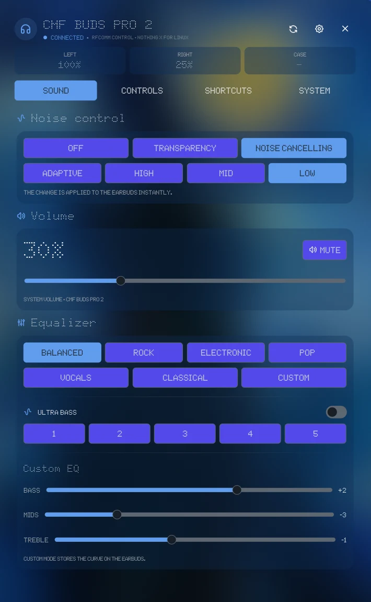

# CMF Buds

Native control for **Nothing CMF Buds Pro 2** (model `B172`) from the Noctalia bar, without the Nothing X mobile app.

The plugin talks the vendor **RFCOMM** protocol directly through a Python daemon and exposes what the earbuds can change: active noise control, system volume, equalizer, Ultra Bass, case-dial gestures, spatial audio, in-ear detection, low-latency mode, dual connection, battery, ring my buds, and the fit test.

## Plugin

| Field | Value |
| --- | --- |
| ID | `faminec/cmf-buds` |
| Entries | Bar widget: `widget`; panel: `panel`; service: `service` |

## Requirements

| Command | Package | Required | Used for |
| --- | --- | --- | --- |
| `python3` | `python` | Yes | Runs the daemon and the RPC client (`bin/budsctl.py`). |
| `bluetoothctl` | `bluez-utils` | Yes | Discovers the paired device and manages its Bluetooth connection. |
| `pactl` | `pipewire-pulse` or `pulseaudio-utils` | Yes | Reads and sets the system sink volume and mute state. |
| `notify-send` | `libnotify` | No | Shows the toast for local shortcuts whose *Enable notification* toggle is on. Without it the shortcut still runs. |
| `hyprctl` | `hyprland` | No | Only resolves the `{output}` placeholder in a local shortcut command, on Hyprland. |
| `dbus-monitor` | `dbus` | No | Watches the media-control buttons of the earbuds over D-Bus (the wheel and the media keys). Without it the case dial and the media keys do not reach the plugin. |

The Nothing/CMF earbuds must already be paired in BlueZ. The plugin opens an RFCOMM channel to the earbuds (Bluetooth classic); it does not pair devices for you.

## Usage

1. Pair your CMF Buds Pro 2 with the computer using BlueZ.
2. Enable the plugin in Noctalia. The `service` entry starts and keeps the RFCOMM daemon alive.
3. Add the `widget` bar entry. Left click opens the panel, the mouse wheel adjusts system volume, and right click cycles ANC (Off → Transparency → ANC).
4. Use the panel tabs (Sound, Controls, Shortcuts, System) to configure the earbuds and local shortcut actions.

Open the panel directly:

```sh
noctalia msg panel-toggle faminec/cmf-buds:panel
```

## Screenshots



## Settings

| Setting | Type | Default | Description |
| --- | --- | --- | --- |
| `device_name` | `string` | `CMF Buds Pro 2` | Bluetooth device name to match when discovering the earbuds. |
| `device_mac` | `string` | `""` | Bluetooth MAC address to prefer. Leave empty to auto-detect a paired Nothing/CMF device. |
| `glyph` | `glyph` | `headphones-filled` | Icon shown in the bar widget. |
| `volume_step` | `int` | `1` | Volume percentage change per mouse-wheel step on the bar widget (1–25). |
| `wheel_adjust` | `bool` | `true` | Allow the mouse wheel on the bar widget to adjust volume. |
| `poll_seconds` | `int` | `20` | How often the daemon polls earbud state, in seconds (20–300). |

## IPC

Panel entry (`faminec/cmf-buds:panel`):

```sh
# Refresh state from the daemon
noctalia msg plugin faminec/cmf-buds:panel all refresh

# Switch the active panel tab: sound | controls | actions | system
noctalia msg plugin faminec/cmf-buds:panel all tab sound
```

Bar widget entry (`faminec/cmf-buds:widget`):

```sh
# Toggle the panel
noctalia msg plugin faminec/cmf-buds:widget all toggle

# Refresh the widget state
noctalia msg plugin faminec/cmf-buds:widget all refresh

# Set ANC mode: off | transparency | anc
noctalia msg plugin faminec/cmf-buds:widget all anc anc

# Connect to the earbuds
noctalia msg plugin faminec/cmf-buds:widget all connect
```

## Notes

- **Compositor/platform:** the plugin is Linux-only and depends on BlueZ/RFCOMM and a Pulse-compatible audio stack (`pactl`). It is not compositor-specific beyond Noctalia's normal plugin environment.
- **No network access:** all communication is local (Bluetooth RFCOMM to the earbuds and local process/IPC communication). The plugin does not download or execute remote code.
- **Files written:** runtime state and IPC data are stored under the Noctalia plugin data directory (typically `~/.local/state/noctalia/plugins/data/faminec/cmf-buds/`): `state.json` (daemon/UI state), `daemon.sock` (local RPC socket), and `daemon.log`.
- **Processes spawned:** `python3` runs `bin/budsctl.py` in `daemon`, `rpc`, and `stop` modes; the daemon uses `bluetoothctl` and `pactl`, and the local shortcut engine uses `pactl`, `hyprctl` and `notify-send` as listed under [Requirements](#requirements). Local shortcut actions configured in the panel run user-defined shell commands through `/bin/sh -c`.
- **Multipoint volume limitation:** volume is per audio source. When audio is playing from another connected device (e.g. a phone), the plugin can only control the PC sink via `pactl`/AVRCP; it cannot change the other device's volume because the Nothing RFCOMM protocol exposes no volume-set command.
- **License:** MIT (see `plugin.toml`).
