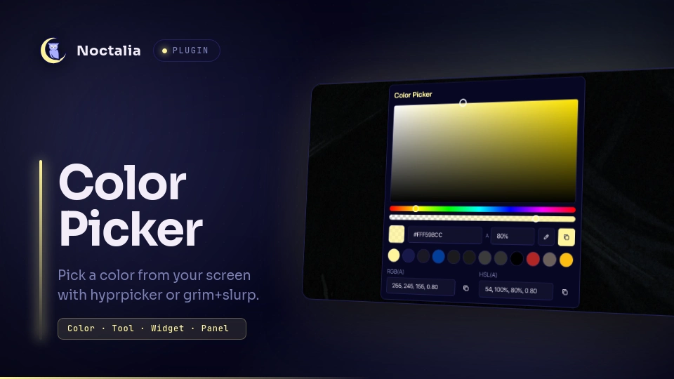

# Color Picker



---

A screen color picker for Noctalia v5. Pick any pixel on your screen with [hyprpicker](https://github.com/hyprwm/hyprpicker) or, as a fallback on wlroots-based compositors, with [grim](https://github.com/emersion/grim) + [slurp](https://github.com/emersion/slurp). Then fine-tune the color in a panel with a full color picker, alpha support, editable HEX / RGB / HSL fields and a persistent history.

**New in Version 2.0:**
- **Native UI:** A brand new, fully native user interface for the color picker panel.
- **Color History:** A persistent history feature that automatically saves your 12 most recently picked colors.
- **`grim` + `slurp` Backend Support:** You can now explicitly choose between `hyprpicker` and `grim_slurp` in the plugin settings. `grim + slurp` is now a fully supported fallback for wlroots-based compositors, featuring robust exact (0,0) pixel mapping directly via `od`, circumventing HiDPI artifact scaling without depending on Python or ImageMagick.
- **Advanced Input Fields:** Complete rewrite of the UI logic and data parsers. Editable HEX, RGB, and HSL input boxes now dynamically update the rest of the UI and support alpha implicitly or explicitly.

## Plugin

| Field      | Value |
| ---------- | ----- |
| ID         | `oldirtty/color_picker` |
| Plugin API | `43` |
| Entries    | Service: `service`; bar widget: `widget`; panel: `panel` |

## Requirements

This plugin requires `hyprpicker` OR `grim` + `slurp` to function. Ensure you have installed your preferred tool and selected it in the plugin settings (`picker_tool`).

| Backend | Notes |
| ------- | ----- |
| [hyprpicker](https://github.com/hyprwm/hyprpicker) | Preferred backend. Zoom lens, live preview of the color in your main colorspace and optional cursor capture. |
| [grim](https://github.com/emersion/grim) + [slurp](https://github.com/emersion/slurp) | Fallback for setups without hyprpicker, e.g. wlroots-based compositors such as labwc or sway. Single-pixel crosshair, no zoom lens and no live preview; the `hyprpicker-*` settings do not apply. |

If the chosen backend tool is not installed, the plugin will show an error notification advising you to either install it or switch the tool in the settings.

## How it works

The headless `service` owns the picker backend. When a pick is requested it:

1. Runs the selected tool (`hyprpicker` or `grim + slurp`) and reads the picked pixel.
2. Copies the color to the clipboard in your main colorspace.
3. Updates the selected color and the history.

The history keeps the 12 most recent colors, together with their opacity, and is saved in the plugin's data directory. It is restored on restart, along with the last selected color. The widget and the panel talk to the service through IPC.

## Usage

Bar widget:

| Action      | Behavior |
| ----------- | -------- |
| Left click  | Toggle the panel. |
| Right click | Pick a color directly: it is copied, added to the history and a notification is shown, without opening the panel. |

Panel:

| Control | Behavior |
| ------- | -------- |
| Color area, hue and alpha sliders | Fine-tune the selected color and its opacity. |
| Preview swatch | Shows the current color. A checkerboard shows through when the opacity is below 100%. |
| Main colorspace row | Editable fields for the colorspace set in `main-colorspace`: `HEX` + `A`, `R` `G` `B` + `A`, or `H` `S` `L` + `A`. Press Enter to apply a field. |
| Eyedropper button | Closes the panel, lets you pick a color from the screen, then reopens the panel with it. |
| Copy button | Copies the current color in the main colorspace, including alpha when it is below 100%. |
| Recent colors | Click a swatch to restore its color and opacity. |
| Other two colorspaces | Two columns below the recent colors, each with an editable text field and its own copy button. |

The color you started from is added to the history when you begin editing it in the panel.

Accepted text formats in the fields:

| Colorspace | Format |
| ---------- | ------ |
| HEX | `#RRGGBB` or `#RRGGBBAA` (the `#` is optional) |
| RGB | `r, g, b` or `r, g, b, a` |
| HSL | `h, s%, l%` or `h, s%, l%, a` (the `%` signs are optional) |

Alpha can be given as `0`–`1` or as a percentage.

## Settings

| setting                      | type     | default        | description |
| ---------------------------- | -------- | -------------- | ----------- |
| `picker_tool`                | `select` | `"hyprpicker"` | Tool used to pick colors from the screen. Available options: `hyprpicker` or `grim_slurp`. |
| `main-colorspace`            | `select` | `"hex"`        | Main colorspace (`hex`, `rgb` or `hsl`). It is the format copied to the clipboard after a screen pick, the row shown first in the panel and the format shown by hyprpicker's live preview. |
| `circular-swatch`            | `bool`   | `true`         | Use circular swatches for recent colors. Disable to follow the shell's corner roundness. |
| `lowercase-hex`              | `bool`   | `false`        | Lowercase hex code in the text copied after a screen pick. |
| `notify-on-copy`             | `bool`   | `true`         | Send a notification when a color is copied, either from a screen pick or from the panel's copy buttons. |
| `hyprpicker-no-zoom`         | `bool`   | `false`        | Turns off the magnifying zoom lens while picking. (Visible only if `picker_tool` = hyprpicker) |
| `hyprpicker-scale`           | `int`    | `10`           | Zoom lens magnification, from `1` to `10`. (Visible only if `picker_tool` = hyprpicker) |
| `hyprpicker-radius`          | `int`    | `100`          | Zoom lens circle radius in pixels, from `1` to `1000`. (Visible only if `picker_tool` = hyprpicker) |
| `hyprpicker-disable-preview` | `bool`   | `false`        | Turns off the live color preview while picking. (Visible only if `picker_tool` = hyprpicker) |
| `hyprpicker-cursor`          | `bool`   | `false`        | Includes the cursor in the frozen screen preview. (Visible only if `picker_tool` = hyprpicker) |
| `glyph`                      | `glyph`  | `"palette"`    | Glyph of the bar widget. |

## IPC

```bash
# Toggle the panel
noctalia msg panel-toggle oldirtty/color_picker:panel

# Sample a color without opening the panel
noctalia msg plugin oldirtty/color_picker:service all pick
```

## FAQ & Notes

* **Timeout:** The picker runs through Noctalia's `runAsync`, whose timeout is capped at 60 seconds. If no color is picked within that time, the picker is terminated.
* **Why does grim + slurp freeze the screen first?** Like hyprpicker, the plugin captures the screen with grim before slurp opens, then reads the pixel you click from that frozen image. The color is the one that was on screen when the pick started, layer-shell surfaces such as the bar included, and there is no delay after the click.
* **HSL with hyprpicker:** hyprpicker reports HSL as whole numbers, so with `main-colorspace = "hsl"` the picked color can be off by a couple of units per RGB channel. HEX and RGB are exact. Also, when it is not attached to a terminal, hyprpicker prints through `printf`, which swallows the `%` signs of its default HSL template. The plugin therefore asks for plain `H S L` values, and hyprpicker's live preview shows them without `%` signs.
* **Credits:** The `grim + slurp` fallback workflow concept draws heavy inspiration from [wl-color-picker](https://github.com/jgmdev/wl-color-picker), adapted seamlessly into a native Noctalia `runAsync` shell pipe to circumvent external package dependencies.
