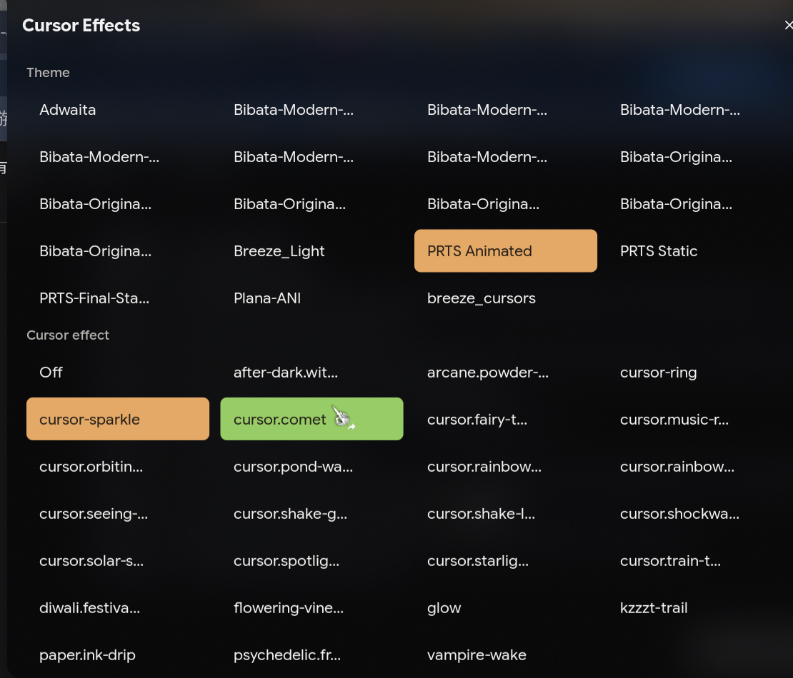

# Cursor Effects

Switch Umbriel cursor themes and cursor shader effects from a Noctalia panel, without
editing `~/.config/umbriel/config.toml` by hand.

## Plugin

| Field | Value |
| --- | --- |
| ID | `h465855hgg/cursor-effects` |
| Entries | Bar widget: `cursor-effects`; panel: `panel` |

## Requirements

- `umbriel` on `PATH` — the panel sends IPC messages to the running compositor.
- `python3` 3.11 or newer — the panel runs `bin/cursor_effects.py` to edit the config file

The plugin only makes sense on Umbriel.

## Usage

Add the **Cursor Effects** bar widget, or open the panel directly:

```sh
noctalia msg panel-toggle h465855hgg/cursor-effects:panel
```

The panel shows two grids:

- **Theme** — every Xcursor theme found in `~/.local/share/icons`,
  `~/.icons` and `/usr/share/icons`
- **Cursor effect** — every cursor shader preset found in
  `~/.config/umbriel/shaders/community/cursor/*/effect.toml`, plus `Off`

Picking a row writes the selection to `~/.config/umbriel/config.toml`, reloads Umbriel
and applies the cursor effect immediately.

## Notes

Files written:

- `~/.config/umbriel/config.toml` — `[input.cursor] theme` and `[effects] cursor`;
  the chosen effect's `effect.toml` is appended to `[include] files` when missing.

Commands spawned:

- `umbriel msg config-reload`
- `umbriel msg effect-cursor-set <name>`

No network access.


