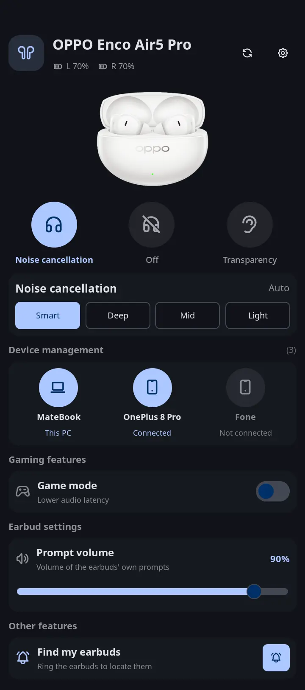

# EncoBuds

Battery, listening mode, game mode, prompt volume, find-my-earbuds and
dual-device control for OPPO, OnePlus and realme Enco earbuds, directly in the
Noctalia bar and panel.

The reverse-engineered Bluetooth RFCOMM protocol lives in the EncoBuds CLI
(`~/.agent/EncoBuds`). This plugin is only a Noctalia front end: it never
opens an RFCOMM socket itself.



## Plugin

| Field | Value |
| --- | --- |
| ID | `imfiiish/encobuds` |
| Bar widget | `bar` |
| Panel | `panel` |
| Service | `service` |

`service` owns the only CLI process. It polls `encobuds --json status` on the
configured interval, publishes one snapshot on `encobuds.state`, and executes
commands published on `encobuds.cmd`.

`bar` shows a mode-dependent glyph, the listening mode and the lowest earbud
battery. Left click opens the panel, right click cycles the listening mode, and
scrolling cycles once per gesture when enabled.

`panel` is laid out like the HeyMelody device page: product render, L/R/case
battery, listening-mode buttons, ANC level chips, remembered
devices, game mode, prompt volume and find-my-earbuds.

Open the panel from a keybind or terminal:

```sh
noctalia msg panel-toggle imfiiish/encobuds:panel
```

## Requirements

- `python3` 3.10 or newer, using the distribution Python (the
  python-build-standalone interpreter lacks `socket.AF_BLUETOOTH`)
- `bluez-utils` for `bluetoothctl` and the BlueZ RFCOMM stack
- Earbuds that are paired and connected in the system Bluetooth settings

Install the CLI from <https://github.com/imfiiish/encobuds>, or keep a local
checkout at `~/.agent/EncoBuds`. The service looks for `encobuds` on `PATH` and
in `~/.local/bin`; set the **CLI command** plugin setting to override it.

## Usage

Add the **EncoBuds** bar widget in **Settings → Bar → Widgets**.

- **Left click** opens the panel.
- **Right click** cycles off → smart ANC → transparency.
- **Scroll** cycles the listening mode once per gesture (can be disabled in the
  widget settings).

Inside the panel:

- Pick a listening mode with the three large buttons.
- Pick a specific ANC level with the chips below the mode buttons.
- Connect or disconnect a remembered device in **Device management**.
- Toggle **Game mode**, change **Prompt volume**, or ring the earbuds with
  **Find my earbuds**. Ringing stops automatically after 15 seconds.

## Settings

Plugin-level settings are shared by the service, widget and panel:

| Setting | Type | Default | Description |
| --- | --- | --- | --- |
| `command` | string | empty | Path to the `encobuds` executable. Empty auto-detects the project checkout, user/system installs, then `PATH`. |
| `mac` | string | empty | Override the earbuds' Bluetooth address. Empty uses the CLI config or the Bluetooth device list. |
| `channel` | int | `0` | Force an RFCOMM channel. `0` lets the CLI discover it over SDP. |
| `refresh_seconds` | int | `30` | Seconds between status polls (5–300). |
| `show_devices` | bool | `true` | Show the device-management section in the panel. |
| `device_name` | string | empty | Panel title override. Empty uses the detected model. |
| `show_product_image` | bool | `true` | Show the Enco Air5 Pro render in the panel. |

Widget-level settings:

| Setting | Type | Default | Description |
| --- | --- | --- | --- |
| `show_mode` | bool | `true` | Show the listening-mode short name. |
| `show_battery` | bool | `true` | Show the lowest earbud battery. |
| `hide_when_offline` | bool | `false` | Hide the whole widget while the earbuds are disconnected. |
| `scroll_cycle` | bool | `true` | Cycle the listening mode on scroll. |

## IPC

Send commands to the service:

```sh
noctalia msg plugin imfiiish/encobuds:service all refresh
noctalia msg plugin imfiiish/encobuds:service all cycle
noctalia msg plugin imfiiish/encobuds:service all mode deep
noctalia msg plugin imfiiish/encobuds:service all game on
noctalia msg plugin imfiiish/encobuds:service all find on
noctalia msg plugin imfiiish/encobuds:service all volume 6
noctalia msg plugin imfiiish/encobuds:service all connect Fone
noctalia msg plugin imfiiish/encobuds:service all disconnect Fone
```

`mode` accepts `off`, `anc`, `deep`, `mid`, `light`, `smart` and `trans`.
`game` and `find` accept `on` or `off`. `volume` uses the earbuds' 2–10
levels, shown as 20%–100% in the panel.

## CLI discovery

With an empty `command` setting, the service tries:

1. `~/.agent/EncoBuds/encobuds` with `python3`
2. `~/.local/bin/encobuds`
3. `/usr/local/bin/encobuds`
4. `encobuds` on `PATH`

## State

`encobuds.state` is a JSON snapshot:

```json
{
  "phase": "online",
  "mode": 7,
  "battery": {
    "left": { "level": 100, "charging": false },
    "right": { "level": 100, "charging": false }
  },
  "game": false,
  "volume": 8,
  "devices": [
    { "name": "MateBook", "mac": "…", "connected": true, "current": true }
  ],
  "product": "06C410",
  "firmware": "…",
  "busy": null,
  "error": null,
  "ringing": false,
  "updatedAt": 1764300000000
}
```

`phase` is `loading`, `online`, `offline` (not connected or no address) or
`error` (the CLI failed or timed out).

## Install

This directory is part of the local Noctalia plugin source
`~/.agent/noctalia-plugins`. Enable **EncoBuds** in **Settings → Plugins**, then
add the widget to a bar:

```toml
[widget.encobuds]
type = "imfiiish/encobuds:bar"
```

Changes to `.luau` files hot-reload; manifest changes need a config reload.

## Assets

`assets/enco-air5-pro.png` is the product render from the
[OPPO Enco Air5 Pro product page](https://www.oppo.com/en/accessories/enco-air5-pro/).
It is used only to identify the device in the panel.
