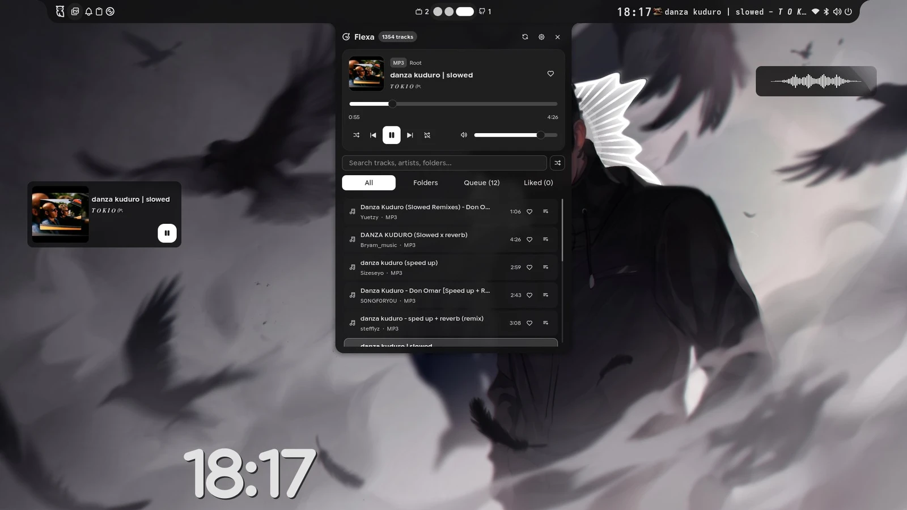

# Flexa

A self-contained folder music player for Noctalia. Point it at any local music directory and play tracks directly from the bar widget and floating player panel without installing a separate music player application.

## Plugin

| Field | Value |
| --- | --- |
| ID | `nirikshak01/flexa` |
| Entries | Bar widget: `bar`; panel: `player`; service: `service` |

## Screenshots



## Requirements

Install `mpv` and `python3` on `PATH`.

Optional: install `ffmpeg` and `ffprobe` on `PATH` to read embedded audio metadata tags, durations, and album cover artwork (Flexa falls back to filename parsing and folder cover images when unavailable).

## Usage

1. Enable `nirikshak01/flexa` in Noctalia Settings and add the `bar` widget to your bar if desired.
2. Open Flexa's plugin settings and set **Music folder** (`musicDirectory`) to your audio folder (defaults to `~/Music`).
3. Click the bar widget or toggle the panel directly via IPC:

```sh
noctalia msg panel-toggle nirikshak01/flexa:player
```

From the bar widget:
- **Left-click** toggles the player panel.
- **Right-click** toggles play/pause.
- **Middle-click** skips to the next track.
- **Scroll** adjusts playback volume.

Inside the panel, search across tracks, artists, and folders, browse by subfolder, manage the playback queue, or like tracks into your Liked tab.

## Settings

| Setting | Type | Default | Description |
| --- | --- | --- | --- |
| `musicDirectory` | `folder` | `~/Music` | Folder containing your audio files (`~/` paths supported). |
| `recursiveScan` | `bool` | `true` | Include audio files inside nested subfolders. |
| `defaultVolume` | `int` | `80` | Initial volume (`0`–`100%`) used when no saved session volume exists. |
| `rememberLastTrack` | `bool` | `true` | Restore the last played track, volume, shuffle, and repeat mode on startup. |
| `extractArtwork` | `bool` | `true` | Cache embedded album artwork into the plugin data directory using `ffmpeg`. |
| `showBarControls` | `bool` | `false` | Show inline play/pause and next-track buttons inside the bar widget. |
| `showBarTitle` | `bool` | `false` | Display the current track title next to the Flexa icon in the bar. |
| `showBarArtwork` | `bool` | `false` | Replace the bar music icon with the current track's album art when playing. |
| `barMaxWidth` | `int` | `220` | Maximum track title width in logical pixels (`80`–`500`). |

## IPC

Control playback or trigger actions from compositor keybinds using `service`:

```sh
noctalia msg plugin nirikshak01/flexa:service all play-pause
noctalia msg plugin nirikshak01/flexa:service all next
noctalia msg plugin nirikshak01/flexa:service all prev
noctalia msg plugin nirikshak01/flexa:service all shuffle
noctalia msg plugin nirikshak01/flexa:service all repeat
noctalia msg plugin nirikshak01/flexa:service all volume-up 5
noctalia msg plugin nirikshak01/flexa:service all volume-down 5
noctalia msg plugin nirikshak01/flexa:service all mute
noctalia msg plugin nirikshak01/flexa:service all rescan
noctalia msg plugin nirikshak01/flexa:service all toggle-panel
```

## Notes

- **Processes spawned:** Runs `python3 flexa_backend.py serve <dataDir>` as a managed stream via `noctalia.runStream`, which in turn manages a single headless `mpv` instance (`--no-video --idle=yes`) over a private PID-scoped Unix IPC socket. When `ffmpeg` and `ffprobe` are present, background probing reads audio tags and extracts embedded cover art.
- **Filesystem access:** Reads audio files and folder cover images (`cover.*`, `folder.*`, `album.*`) from `musicDirectory`. Writes only inside Noctalia's per-plugin data directory (`noctalia.pluginDataDir()`): `startup_config.json`, `meta_cache.json`, `session.json`, `view.json`, `covers/*.jpg`, `mpv.<pid>.sock`, and `cmd.<pid>.sock`.
- **Network access:** None. Flexa operates completely offline.
