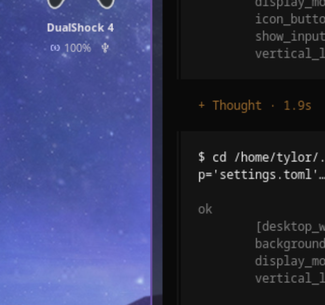
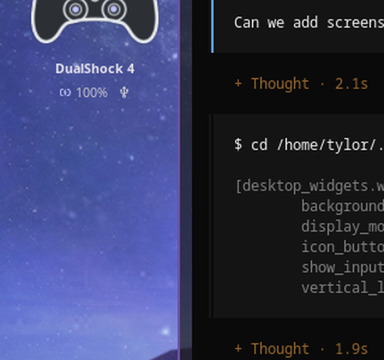
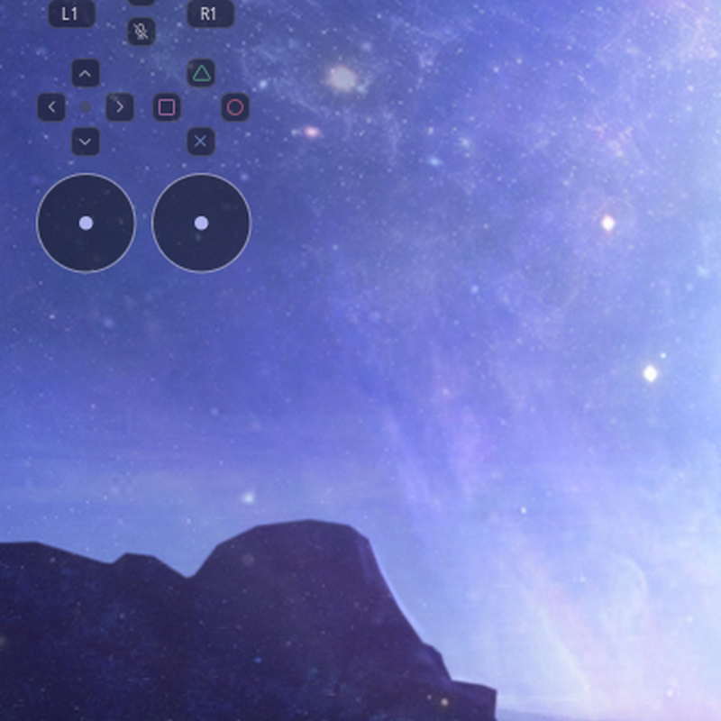

# Gamepad Display — Technical Reference

A live controller display for Noctalia Shell. The desktop widget shows the pad
you are actually using, its model-specific artwork, battery and connection
state, and every button, stick, trigger and D-pad direction as you use them.

Built for KineticWE's `noctalia-kwe` v5 build (tested live on 5.3.0) and the
upstream Noctalia v5 plugin API.

## Plugin

| Field | Value |
| --- | --- |
| ID | `tylorismusic/gamepad-display` |
| Display name | `Gamepad Display` |
| Version | `1.3.0` |
| Entries | Services `battery` + `listener`, desktop widget `inputs` |
| Plugin API | 17 |
| Licence | MIT |

## Display modes

| Battery only | Compact | Full |
| --- | --- | --- |
|  |  |  |

## Supported controllers

| Model | USB / Bluetooth IDs | Artwork and buttons | Notes |
| --- | --- | --- | --- |
| DualSense | `054c:0ce6` | DualSense art, PlayStation glyphs | USB and Bluetooth |
| DualSense Edge | `054c:0df2` | DualSense art, PlayStation glyphs | USB and Bluetooth |
| DualShock 4 | `054c:05c4`, `054c:09cc` | DS4 art, PlayStation glyphs | USB recommended (see below) |
| 8BitDo Ultimate 2C | `2dc8:301b` (BT), `2dc8:310a` (USB receiver) | Xbox art, A/B/X/Y letters | Bluetooth and 2.4 GHz receiver |
| Generic XInput-style pad | any evdev pad with `ABS_X` | Xbox art, A/B/X/Y letters | Capability-driven axis mapping |

Virtual pads (Sunshine, `libvirtualhid`, `uinput`, Steam virtual controllers) and
the extra motion/touchpad nodes Sony pads expose are ignored, so a streaming
session cannot hijack the widget.

When several pads are connected, the one you touched last is shown. Plugging a
pad in also takes it over. Until something is touched, Sony pads win over
8BitDo, which wins over generic XInput pads.

## Features

- **Live input state** — face buttons, shoulders, analog triggers, both sticks
  with press (`L3`/`R3`), D-pad, and the extra `Create`, `Options`, `PS`,
  touchpad-click and mute buttons. Updates at up to 50 Hz while you play.
- **Model-specific artwork** — DualSense/Edge, DualShock 4 and Xbox-style
  drawings are generated from SVG templates into the plugin data directory and
  recoloured from your settings.
- **Correct face labels** — PlayStation shapes for Sony pads, Xbox `A/B/X/Y`
  letters for 8BitDo and XInput pads.
- **Capability-driven mapping** — stick and trigger axes are read from each
  device's evdev capabilities, so the 8BitDo's non-standard
  `ABS_Z`/`ABS_RZ`/`ABS_GAS`/`ABS_BRAKE` layout works without a special case.
  On that layout `ABS_BRAKE` is the left trigger and `ABS_GAS` the right one,
  matching the pedal convention; verified on an Ultimate 2C over Bluetooth.
- **8BitDo and XInput face buttons** — Xbox-layout pads report physical X
  (left) as `BTN_NORTH` and Y (top) as `BTN_WEST`, the opposite of the
  PlayStation positions, so those codes are swapped automatically. Sony pads
  keep their triangle/square layout and shapes.
- **Battery in the header** — percentage plus charging and USB/Bluetooth
  glyphs, read from kernel `power_supply` (Sony) or BlueZ `Battery1`
  (Bluetooth pads). XInput receivers without a battery node simply omit it.
- **Centered header** — controller art, model name and battery sit centered
  above the input rows; the widget is labelled **Gamepad Display** in the
  desktop-widget picker.
- **Three display modes** (the `display_mode` setting):
  - `battery` — header and controller artwork only (minimal footprint).
  - `compact` — artwork with lit face buttons, D-pad, L1/R1 and L3/R3, plus
    trigger bars above it (no separate input grid).
  - `full` — the complete input display: triggers, buttons, sticks and D-pad.
- **Button lighting in compact mode** — the face buttons, D-pad directions,
  L1/R1 and L3/R3 light up on the controller artwork. They are baked into the
  SVG as cached variants keyed on the 12 digital inputs, so a press only swaps
  a file path instead of regenerating artwork inside Noctalia's per-render CPU
  budget.
- **No hidraw contention** — the input reader only uses `/dev/input/event*`,
  so it runs alongside `ds4u`, Steam Input, and the plugin's own battery
  service without competing for HID reports.
- **Low-battery notifications** — optional, handled by the separate battery
  service at a configurable threshold.

## Architecture

Two headless services and one desktop widget:

| Entry | File | Job |
| --- | --- | --- |
| Service `battery` | `battery.luau` | Runs `code/ds_battery_daemon.py`; DualSense battery, charging state, `ds4u` integration and low-battery notifications |
| Service `listener` | `inputs.luau` | Runs `code/ds_inputs_daemon.py --stream`; publishes live input state |
| Desktop widget `inputs` | `inputs_card.luau` | Renders the card and generates the controller artwork |

State flow:

```text
/dev/input/event* ──► ds_inputs_daemon.py ──► JSON lines ──► inputs.luau
                                                              │
                                                              ▼
                                                    noctalia.state "inputs"
                                                              │
                                                              ▼
                                                       inputs_card.luau
```

The input daemon also keeps a state file fresh, so the widget can pick up the
current pad after a shell restart. The daemons are single-instance: a lock file
prevents a stale copy from surviving a shell restart.

The battery service is independent. It still speaks `ds4u` IPC and hidraw for
Sony battery reads and notifications, but the widget's battery readout comes
from the input service so it also works for 8BitDo and XInput pads.

## Requirements

- Noctalia Shell v5 with plugin API 17 or newer (`noctalia-kwe` tested)
- `python3` (Python 3, standard library only — no pip packages)
- Read access to the kernel evdev nodes (`/dev/input/event*`)
- Optional: [`ds4u`](https://git.yokai.digital/deadYokai/ds4u) for Sony battery
  IPC and profile/rumble features
- Optional: the udev rule below if you want the battery service to read
  DualSense hidraw nodes directly

### Input permissions

Most desktops grant the active seat access to input devices automatically via
`uaccess` ACLs. If the widget stays on “Waiting for controller”, check the
nodes and test one:

```bash
ls -l /dev/input/event*
sudo evtest /dev/input/eventN   # pick the gamepad node
```

If your user cannot open the node, add yourself to the `input` group and log
back in:

```bash
sudo usermod -aG input "$USER"
```

The input reader never opens hidraw, so no controller-specific udev rule is
needed for the live display.

### Optional DualSense hidraw rule (battery service)

Only needed for the battery service's direct HID reads and `ds4u` coexistence:

```bash
sudo tee /etc/udev/rules.d/70-dualsense.rules >/dev/null <<'EOF'
SUBSYSTEM=="hidraw", ATTRS{idVendor}=="054c", ATTRS{idProduct}=="0ce6", MODE="0664", GROUP="input", TAG+="uaccess"
SUBSYSTEM=="hidraw", ATTRS{idVendor}=="054c", ATTRS{idProduct}=="0df2", MODE="0664", GROUP="input", TAG+="uaccess"
EOF
sudo udevadm control --reload-rules
sudo udevadm trigger --subsystem-match=hidraw
```

Unplug/replug USB pads or reconnect Bluetooth afterwards.

## Install

From the app directory (`apps/lgl-dualsense` in the repository):

```bash
./install-kwe.sh    # noctalia-kwe
./install.sh        # upstream Noctalia
```

The scripts symlink the plugin into
`~/.local/share/noctalia-kwe/plugins` or `~/.local/share/noctalia/plugins`,
reload the config and enable `tylorismusic/gamepad-display` when the shell is running.

If the widget was added before, place it again from the desktop-widget editor.
Re-enabling a plugin can reset its saved placement, so re-check the box position
after toggling the plugin.

Manual install:

```bash
ln -sfn /path/to/lgl-dualsense-fork ~/.local/share/noctalia-kwe/plugins/gamepad-display
noctalia-kwe msg config-reload
noctalia-kwe msg plugins enable tylorismusic/gamepad-display
```

Then open **Settings → Desktop → Toggle Editor** and add **Gamepad Display**.

A box of roughly **240 × 152** logical pixels shows the full card at 100% scale
on a 1080p output. The widget scales its content down if the box is smaller.

## Usage

1. Open **Settings → Plugins**, find **Gamepad Display** and enable it. Both
   services (`battery` and `listener`) start with the plugin; no separate step
   is needed.
2. Open **Settings → Desktop → Toggle Editor** and add **Gamepad Display**.
   Place the box where you want it and choose a `display_mode`.
3. Connect or wake a controller. The last pad you touch is the one shown; the
   battery service can post a low-battery notification when enabled.

The widget (`inputs`) is the only user-facing entry - there is no bar widget,
panel, shortcut or launcher provider. The `battery` and `listener` services run
headless; `battery` uses the shared `low_threshold` and `notify_low` settings.

## Settings

Plugin-level (shared by the battery service and widget):

| Key | Default | Description |
| --- | --- | --- |
| `low_threshold` | `20` | Show the low-battery state and notify at or below this percentage |
| `notify_low` | `true` | Send a desktop notification when the battery first reaches the threshold |

Desktop widget:

| Key | Default | Description |
| --- | --- | --- |
| `accent_color` | `primary` | Stick dots, trigger fills and pressed highlights |
| `text_color` | `on_surface` | Model name and labels |
| `muted_text_color` | `on_surface_variant` | Battery text, unpressed glyphs and hints |
| `show_battery` | `true` | Show the battery percentage and charging glyph in the header |
| `illustration_color` | `#e8ebef` | Controller line-art colour |
| `controller_body_color` | `#2c3035` | Controller body fill |
| `controller_body_opacity` | `1.0` | Body fill opacity (`0` = line art only) |
| `controller_stroke_width` | `2.8` | Outline and button-edge thickness (`0.5`–`8`) |
| `vertical_layout` | `false` | Stack the triggers above L1/R1 and the sticks below the face buttons instead of the wide side-by-side layout |
| `display_mode` | `full` | `battery` (header + artwork only), `compact` (lit buttons on the artwork + trigger bars) or `full` (complete input display) |

Colour settings accept a `#rrggbb` value or a Noctalia palette role such as
`primary`, `on_surface` or `on_surface_variant`. Palette roles follow the live
theme; the generated artwork is rewritten when a colour changes.

## Diagnostics

Runtime state:

```text
$XDG_RUNTIME_DIR/noctalia-dualsense-inputs.json   # model, connection, battery, buttons, sticks
$XDG_RUNTIME_DIR/noctalia-dualsense-inputs.lock
$XDG_RUNTIME_DIR/noctalia-dualsense-battery.json
$XDG_RUNTIME_DIR/noctalia-dualsense-battery.lock
```

Read the live state:

```bash
jq . "$XDG_RUNTIME_DIR/noctalia-dualsense-inputs.json"
```

Run the input daemon manually (stop the service first, otherwise the lock makes
the manual copy exit):

```bash
python3 code/ds_inputs_daemon.py            # keep the state file fresh
python3 code/ds_inputs_daemon.py --stream   # print one JSON line per frame
python3 code/ds_inputs_daemon.py --demo     # fake pad for layout work
```

Service logs:

```bash
journalctl --user -f | grep -i dualsense
```

## Troubleshooting

| Symptom | Fix |
| --- | --- |
| “Waiting for controller” | Check `/dev/input/event*` permissions with `evtest`; the daemon rescans every 2 seconds |
| Wrong controller shown | Touch or press the pad you want; the last active pad wins |
| No battery on an 8BitDo USB receiver | The xpad receiver exposes no battery node; Bluetooth mode reports battery through BlueZ |
| DualShock 4 over Bluetooth not detected | Use USB; the DS4 does not answer BlueZ's generic SDP browse reliably |
| Sony battery missing | Install the hidraw udev rule and reconnect, or install `ds4u` |
| Widget blank after a config change | `noctalia-kwe msg config-reload`; manifest changes need `plugins disable` + `plugins enable` |
| Widget says Python is missing | Install `python3`; the plugin uses only the standard library |
| Plugin disabled itself after install | Enable `tylorismusic/gamepad-display` in Settings → Plugins |

## Fork notes

Published fork: <https://github.com/tylorismusic-commits/lgl-noctalia-widgets>

This fork extends the upstream LGL DualSense card with:

- DualShock 4 (USB) and 8BitDo Ultimate 2C (Bluetooth + USB receiver) support
- a kernel-evdev input reader that never touches hidraw
- capability-driven axis mapping and the Xbox-style face-button remap
- model-specific controller artwork and Xbox letter buttons
- a centered header with model name, battery and connection state
- the **Gamepad Display** widget name and input-focused settings surface

The old battery-only desktop card is no longer registered; the battery service
and its notifications are still included.

## Credits and licence

Controller protocol and `ds4u` integration informed by deadYokai's
[ds4u](https://git.yokai.digital/deadYokai/ds4u). The desktop-card approach was
inspired by Jahrek's
[Steam Controller Plasma widget](https://github.com/jahrekza/steam-controller-plasma-widget).
Packaged for Noctalia by LGL; this fork maintains the gamepad input display.

MIT — see [LICENSE](LICENSE).
