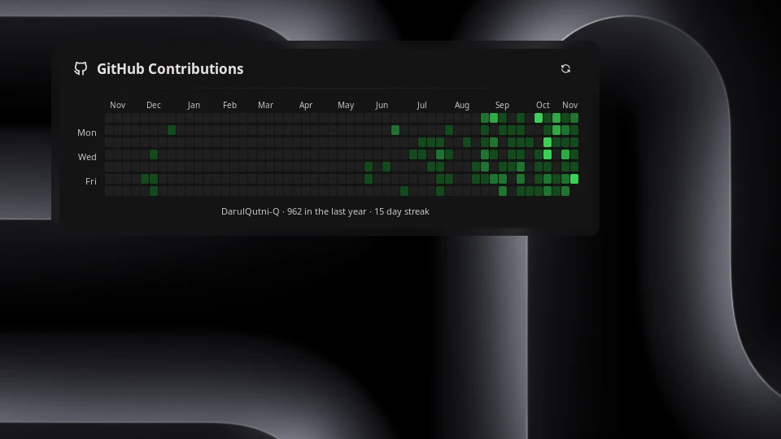

# GitHub Contributions

A minimalist GitHub contribution calendar as a Noctalia desktop widget. Just
the annual heatmap in the theme's primary color, with one footer line for the total and
the current streak. Hover a day to see its date and contribution count.



## Plugin

| Field | Value |
| --- | --- |
| Plugin ID | `darulqutni-q/github-contributions-desktop` |
| Entries | Desktop widget: `calendar`; service: `sync` |
| Minimum Noctalia plugin API | `43` (Noctalia v5.4.1) |

## Requirements

- [GitHub CLI](https://cli.github.com/) (`gh`), authenticated with the account
  whose activity you want to display.

Authenticate once before enabling the plugin:

```bash
gh auth login -h github.com
```

## Usage

1. Enable **GitHub Contributions** in Noctalia's plugin manager.
2. Add the `calendar` desktop widget from Noctalia's desktop-widget editor
   (Settings → Desktop → Toggle Editor, or `noctalia msg desktop-widgets-edit`).
3. Hover a day in the calendar to see its date and contribution count in the
   footer line. Click a day to pin its detail in the footer (click it again
   to unpin). Click the refresh button in the header to refresh now.

Desktop widgets cannot take keyboard focus and do not show tooltips, so the
hovered day's detail is shown as a visible footer line instead of a tooltip.
A pinned day is marked with a pin icon in the footer.

## Settings

| Setting | Type | Default | Description |
| --- | --- | --- | --- |
| Automatic refresh interval | select (15, 30, 60 minutes) | 30 minutes | How often contribution data refreshes automatically. |
| Year | select (Last 12 months, 2021–2026) | Last 12 months | Which year the contribution calendar covers. Changing it refetches the data; the footer then shows the total for that year instead of the last-12-months streak summary. |
| Heatmap color | color | `primary` (theme primary) | Accent color of the heatmap. The four activity levels are derived from it: palette roles use alpha variants, a custom hex color is darkened per level. |
| Cell size | int (6–24) | `10` | Width in pixels of each contribution day cell. Smaller cells make the whole calendar narrower; height is cell size + 2. |
| Heatmap only | bool | off | Show only the contribution heatmap grid, without the header, footer, or month and weekday labels. |
| Wrap into rows | select (off/2/3/4) | 2 | Split the year into stacked blocks so the widget is narrower and taller instead of one long strip. Each block gets its own month header and weekday labels. |

Changing the interval applies it immediately and requests a refresh unless a
request is already in progress.

Plugin interface text comes from `translations/en.json` and is translated
through Noctalia Translate. Calendar month and weekday labels are always
English (Jan, Feb, Mon, Wed, Fri): they are computed from the date with
Zeller's congruence instead of a locale-aware formatter, so they never follow
the process `LC_TIME` locale.

Request a refresh externally with:

```bash
noctalia msg plugin darulqutni-q/github-contributions-desktop:sync all refresh
```

## Data and privacy

The plugin runs `gh api graphql` to request the authenticated account's
`contributionCalendar`. It never reads, writes, or displays a GitHub token.
Authentication remains entirely inside GitHub CLI.

The latest successful normalized calendar is cached in Noctalia's per-plugin
data directory. The cache contains the public contribution dates, counts,
levels, username, and fetch time; it contains no credentials. It lets the
widget continue to show the last known activity when offline.

## Attribution

The sync service, the shared `lib/` helpers, and the heatmap grid code are
derived from [alexmnrs/github-activity](https://github.com/noctalia-dev/community-plugins/tree/main/github-activity)
(MIT), which provides the same contribution calendar as a bar widget and
panel. This plugin reuses its data fetching and grid code but ships a
different, minimalist desktop-only surface: no metric columns, no profile
button, theme primary color by default. The reference implementation for the
`[[desktop_widget]]` entry is the official
[noctalia/timer](https://github.com/noctalia-dev/official-plugins/tree/main/timer)
plugin.

## Troubleshooting

- **GitHub CLI is required:** install `github-cli` (or your distribution's
  `gh` package).
- **GitHub CLI needs authentication:** run `gh auth login -h github.com`.
- **No data after a refresh:** run `gh auth status` in a terminal, then retry.

## Compatibility

Noctalia v5's plugin API is beta and can change before the stable release.
This plugin targets API 43 and uses Noctalia's declarative desktop-widget and
shared-state APIs only.
