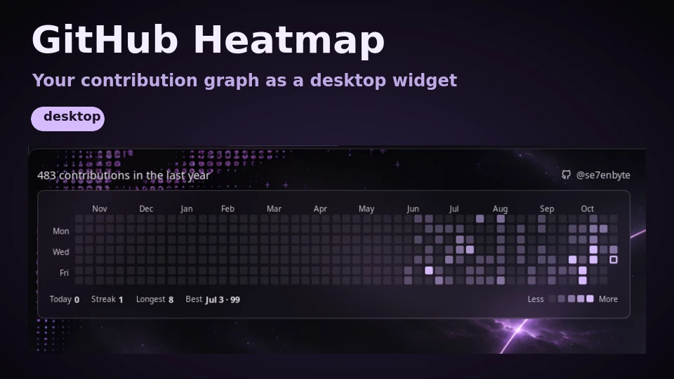

# GitHub Heatmap

Your GitHub contribution graph as a smooth, theme-aware desktop widget: the familiar week-by-week grid with month
labels, streak stats and a Less/More legend, drawn on your wallpaper in your shell's colors.



## Plugin

| Field | Value |
| --- | --- |
| ID | `se7enbyte/github-heatmap` |
| Entries | Desktop widget: `heatmap` |

## Requirements

Install the GitHub CLI (`gh`) on `PATH` and sign in once with the account whose contributions you want to show:

```sh
gh auth login -h github.com
```

To include contributions to private repositories, enable **Private contributions** in the *Contribution settings*
menu of your GitHub profile (they are then counted anonymously, GitHub shows only the numbers).

## Usage

1. Enable the plugin in Settings → Plugins.
2. Open the desktop widgets editor and add **GitHub Heatmap**:

   ```sh
   noctalia msg desktop-widgets-edit
   ```

3. Drag it where you want it. Leave the editor with `noctalia msg desktop-widgets-exit`.

The widget shows cached data immediately, then refreshes in the background. New data fades in as a short staggered
wave. By default it shows the last 53 weeks; set `weeks` to `5` for roughly the last month.

Two views are available: `heatmap` (default, the GitHub-style week grid) and `calendar` (a day-by-day month
calendar with previous/next month buttons, experimental: the buttons have only been tested to render).

When the widget is placed, size its box to the card (about 811 x 204 px for 53 weeks at the default cell size).

## Settings

Settings belong to the widget instance (desktop widgets editor → widget settings).

| Setting | Type | Default | Description |
| --- | --- | --- | --- |
| `view` | `select` | `heatmap` | `heatmap` (week grid) or `calendar` (month calendar). |
| `weeks` | `select` | `53` | Weeks shown in the heatmap view: 5, 9, 13, 26 or 53. |
| `cell_size` | `int` | `11` | Heatmap cell size in px (8-36). |
| `month_cell_size` | `int` | `40` | Day cell size in px for the calendar view (28-52). |
| `refresh_interval_minutes` | `select` | `30` | How often data is fetched: 15, 30 or 60 minutes. |
| `show_weekday_labels` | `bool` | `true` | Show the Mon/Wed/Fri labels. |
| `show_stats_footer` | `bool` | `true` | Show today, streak, longest streak and best day. |
| `show_legend` | `bool` | `true` | Show the Less/More legend. |

## Notes

- **Network:** the plugin spawns `gh api graphql` (a read-only query for your own contribution calendar) at startup and
  every `refresh_interval_minutes`. It makes no other network calls and honors the shell's offline mode.
- **Files:** it writes one cache file, `heatmap.json`, to its own plugin data directory. Nothing else is written.
- **Colors** come from the active theme palette; there are no hard-coded colors.
- **Glass look (optional, Hyprland):** the card is translucent. To blur what is behind it, add a layer rule matching
  the namespace `^noctalia-desktop-widget-se7enbyte/github-heatmap.*$` with `blur = true` and a small `ignore_alpha`.
- Tested on Noctalia 5.4.1 with Hyprland 0.57. `plugin_api = 26` is the level the manifest was checked against with
  `noctalia plugins lint`.
