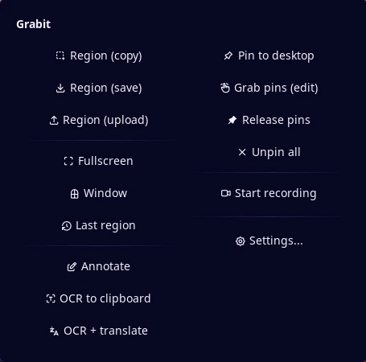
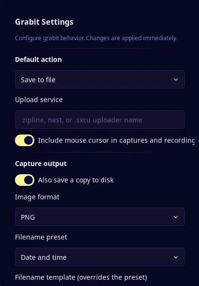

# Grabit Launcher

Launch grabit for region screenshots, screen recording, OCR, translation, pins, and uploads from a bar widget, a mode menu, and a control-center shortcut.

## Plugin

| Field | Value |
| --- | --- |
| ID | `snowballons/grabit` |
| Entries | Bar widget: `widget`; panels: `menu`, `settings`; shortcut: `shortcut`; services: `service`, `indicator`; layer: `recording` |

## Requirements

Install `grabit`, `sleep`, and `xdg-open` on `PATH`.

- `grabit` does every capture, recording, OCR, translation, pin, and upload. Its config is read and written with `grabit set` and `grabit unset`.
- `sleep` provides the short delay before a capture so a closing panel is not captured.
- `xdg-open` opens the grabit config directory from the settings panel.

[grabit](https://heliopolis.live/creations/grabit) handles the interactive UI (region selector, annotator, recording control bar). The widget and shortcut are thin clients that mirror the published status and drive grabit through the service.

## Usage

Add the Grabit widget to a bar in Settings → Bar. Left-click runs the configured default action; right-click opens the mode menu.

| Gesture | Action |
| --- | --- |
| Left click | Default action (`copy`, `save`, or `upload`) |
| Right click | Open the mode menu |
| Middle click | Capture the last region |
| Scroll up | Fullscreen capture |
| Scroll down | Window capture |

The mode menu offers region copy/save/upload, fullscreen, window, last region, annotate, OCR, OCR + translate, pin to desktop, grab pins, release pins, unpin all, recording, and settings.



Both panels can also be opened from the command line:

```sh
noctalia msg panel-toggle snowballons/grabit:menu
noctalia msg panel-toggle snowballons/grabit:settings
```

The control-center shortcut mirrors the widget: left-click captures or stops an active recording, right-click opens the menu. Add it in Settings → Control center → Shortcuts.



## Settings

| Setting | Type | Default | Description |
| --- | --- | --- | --- |
| `default_action` | `select` | `copy` | Action for a plain left-click: copy to clipboard, save to file, or upload. |
| `upload_service` | `string` | empty | grabit upload target used by upload captures and the menu's upload entry, for example `zipline`, `nest`, or a ShareX `.sxcu` uploader name. |
| `show_cursor` | `bool` | `true` | Include the mouse pointer in captures and recordings. Writes both `capture.cursor` and `recording.cursor`. |
| `record_upload` | `bool` | `true` | Upload a finished recording when an upload service is configured. When off, recordings start with `--no-upload`. |
| `hide_inactive` | `bool` | `false` | Hide the bar widget while no capture or recording is active. |

The settings panel also edits grabit's own config: `also_save`, image `format`, `filename` and `filename_preset`, `recording.fps`, `recording.format`, `recording.crf`, and `translate.target`.

## IPC

The service accepts events for scripted control:

```sh
noctalia msg plugin snowballons/grabit:service all capture copy
noctalia msg plugin snowballons/grabit:service all record
noctalia msg plugin snowballons/grabit:service all pause
noctalia msg plugin snowballons/grabit:service all resume
noctalia msg plugin snowballons/grabit:service all stop
```

The `capture` payload is a mode name (`copy`, `save`, `upload`, `fullscreen`, `window`, `last`, `annotate`, `ocr`, `ocr-translate`, `pin`, `pin-grab`, `pin-release`, `unpin-all`) or a table with `mode` and `delay_ms`. `record` accepts a table with `delay_ms`.

## Notes

- Processes spawned: `grabit` (captures, recording, pause, pins, OCR), `sleep` (capture delay), and `xdg-open` (config folder). The plugin makes no network requests itself; uploads are done by grabit only when the chosen action uploads.
- Files written: the plugin reads grabit's recording pid file in `$XDG_RUNTIME_DIR` and writes grabit config keys through the `grabit` CLI. Screenshots, recordings, and grabit's own log are written by grabit.
- The recording indicator is a click-through `recording` layer shown by the `indicator` service only while recording or paused. The bar widget and shortcut mirror the same state.
