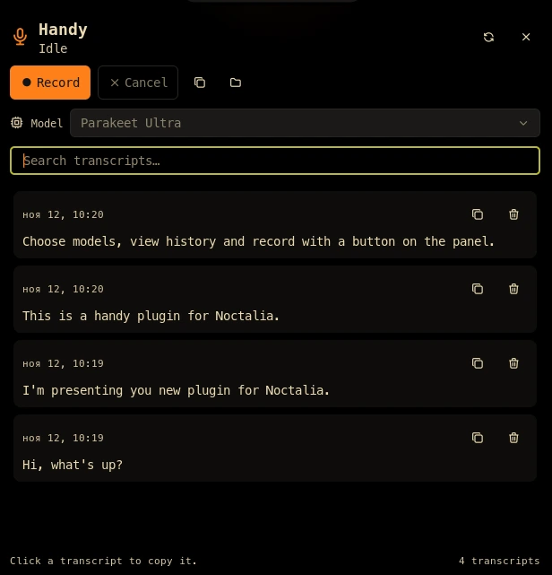

# Handy for Noctalia

[Handy](https://handy.computer) is offline speech-to-text. This plugin puts it
in the Noctalia bar: see whether Handy is idle, recording, or transcribing,
start and stop dictation without touching the global shortcut, and browse the
transcripts Handy has already saved.



## Plugin

| Field | Value |
| --- | --- |
| ID | `odnakov/handy` |
| Entries | Bar widget: `status`; panel: `panel`; service: `service` |
| Panel command | `noctalia msg panel-toggle odnakov/handy:panel` |

## Requirements

- Handy 0.10 or newer. It must be reachable as `handy` on `PATH`, or set **Handy command** to its absolute path.
- `sqlite3` to read Handy's `history.db`.
- `pactl` and `pgrep` to detect a live capture stream and the Handy process.
- `xdg-open` for the panel's recordings-folder button.
- `busctl` and `dbus-send` to read and activate Handy's tray menu model list.
- A running PipeWire or PulseAudio session (the same one Handy records from).

Handy stores its data under `$XDG_DATA_HOME/com.pais.handy`, normally
`~/.local/share/com.pais.handy`. The plugin uses that directory for
`history.db`, `logs/handy.log`, and `recordings/`. When portability or an
unusual install moves the directory, set **Data directory** in the plugin
settings.

## Usage

Add the `odnakov/handy:status` widget to a bar. It shows a microphone while
Handy is idle, a red record dot while recording, a loader while transcribing,
and a muted microphone when Handy is not running.

- **Left click** toggles dictation. If Handy is not running, the click starts
  it hidden instead, and the next click starts recording.
- **Right click** opens the panel.
- Gestures are declared as manifest defaults, so they can be changed or
  unbound in the bar widget settings like any other widget action.

The panel lists the newest transcripts with their timestamp and language.
Click a transcript to copy it, search to filter, and use the toolbar to record,
stop, cancel, copy the newest transcript, or open the recordings folder. Each
row also has a trash button: click it twice to delete the transcript and its
recording. When Handy is not running the primary button launches it.

The **Model** row lists the models Handy reports as downloaded in its tray menu
and marks the active one. Choosing another model activates the same tray-menu
item Handy itself uses, so Handy persists the selection and loads the model in
the background. The row is disabled while Handy is recording, transcribing, or
not running; with a single downloaded model there is nothing to switch to.

## Settings

| Setting | Type | Default | Description |
| --- | --- | --- | --- |
| `handy_command` | `string` | `handy` | Executable name or absolute path used for every Handy invocation. Set this for an AppImage or user-local binary. |
| `data_dir` | `folder` | empty | Override Handy's data directory. Empty uses `$XDG_DATA_HOME/com.pais.handy`, then `~/.local/share/com.pais.handy`. |
| `refresh_seconds` | `int` | `1` | How often state and history are polled, in seconds (1-10). |
| `model_refresh_seconds` | `int` | `10` | How often the downloaded-model list is read from Handy's tray menu (5-60 seconds). |
| `history_limit` | `int` | `30` | Maximum number of transcripts read from `history.db` and shown in the panel. |
| `transcript_lines` | `int` | `4` | Lines of each transcript previewed before clicking to copy it (1-10). |
| `show_state_text` | `bool` | `false` | Show `REC`, `…`, or `OFF` next to the bar icon. |

## IPC

```sh
noctalia msg plugin odnakov/handy:service all toggle
noctalia msg plugin odnakov/handy:service all toggle_post_process
noctalia msg plugin odnakov/handy:service all cancel
noctalia msg plugin odnakov/handy:service all launch
noctalia msg plugin odnakov/handy:service all refresh
noctalia msg plugin odnakov/handy:service all copy_latest
noctalia msg plugin odnakov/handy:service all open_recordings
noctalia msg plugin odnakov/handy:service all select_model "Parakeet Ultra"
noctalia msg plugin odnakov/handy:service all delete_transcript 42
```

`toggle` mirrors the bar click: it launches Handy when it is not running.
`copy_latest` writes the newest transcript to the clipboard.

## Notes

The service reads Handy's state from two sources: the capture stream that
appears in `pactl` as `cpal-pulseaudio-<pid>`, and recent lines of
`logs/handy.log`, where `tray apply: icon=...` records the tray state at debug
level and `recording stopped` / `Transcription completed` are logged at info
level. If Handy's log level hides those lines, the capture stream still
distinguishes recording from idle; transcribing then falls back to idle as soon
as the stream closes.

The plugin makes no network requests. It never writes `history.db`,
`settings_store.json`, or Handy's configuration. It only runs the configured
Handy command, reads the data directory and log, and activates items in Handy's
own tray menu. Menu item IDs are
re-read immediately before a model switch because Handy rebuilds the menu when
its state changes. `sqlite3` is invoked with a fixed read-only query and a
clamped `LIMIT`; no UI value is interpolated into SQL. Like every Noctalia
plugin, it runs as trusted user code.

## Publishing

Keep `plugin.toml`, the three Luau entries, `translations/en.json`, this
README, and a 960x540 `thumbnail.webp` in the plugin root. Do not add a
generated `catalog.toml`; the community catalog CI generates it.

MIT licensed.
