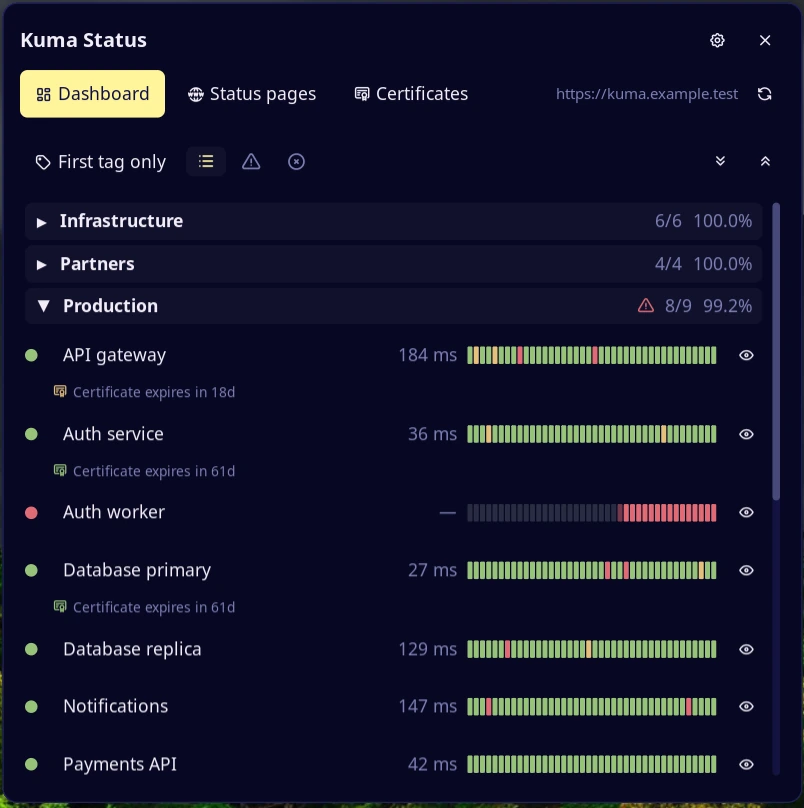
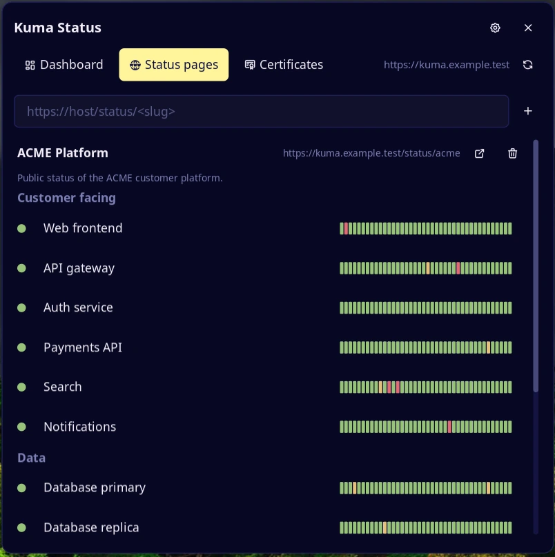
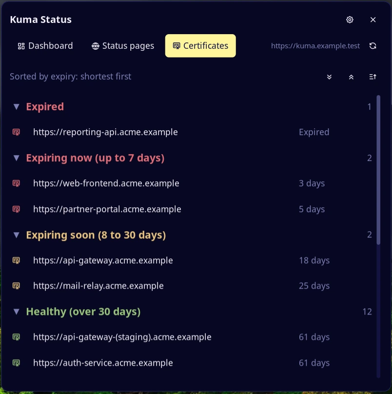

# kuma-status

Uptime Kuma on the bar. A glyph shows the overall state with the number of
monitors up and down. A panel lists every monitor with its last 40 heartbeats,
your status pages and certificate expiry. Read-only: it never pauses, edits or
restarts a monitor.








## Plugin

| Field | Value |
| --- | --- |
| ID | `nightwatch75/kuma-status` |
| Entries | Bar widget: `kuma-status`; panel: `panel`; service: `service` |

## Requirements

- noctalia 5.4.1 or newer (`plugin_api = 43`).
- Uptime Kuma 2.5 or newer. Kuma 3 (beta) adds the real group hierarchy.
- An API key, created in Kuma under **Settings → API Keys**. On Kuma 3 also
  enable the **Prometheus API** (`/metrics`) and the API section
  (`/api/monitors`) in **Settings → General**; both are off by default.
- `xdg-open` on `PATH`, to open a monitor or a status page in the browser.
- `stat` (coreutils), to warn when a credentials file is readable by others.

## Usage

Put the API key in a file only you can read, add **kuma-status** to a bar, set
the Kuma URL and the key file in the plugin settings, and click the glyph:

```sh
umask 077
mkdir -p ~/.config/kuma-status
printf '%s' 'uk1_xxxxxxxx' > ~/.config/kuma-status/api-key
```

Or open the panel from a terminal:

```sh
noctalia msg panel-toggle nightwatch75/kuma-status:panel
```

**Bar.** A text (default `Kuma`), the heart glyph and, in `counts` mode, the
monitors up (green) and down (red). The glyph shows the worst state: green all
up, yellow pending, red down, grey not reachable. The tooltip lists the
monitors that are down.

**Dashboard tab.** Groups and monitors with state, ping and a bar of the last
40 heartbeats; the certificate expiry shows under a monitor when Kuma reports
it.
- Click a group to collapse it. A red triangle on a group means a monitor in it
  is down.
- Click a monitor name to open it in Kuma; right click for **Open monitor in
  Kuma**, **Open monitored URL** and **Copy monitored URL**.
- The view button (left of the filters) cycles the grouping. Kuma 2: first tag,
  all tags, or **All monitors, no groups**. Kuma 3: groups as in Kuma, or no
  groups. The choice is remembered.
- The certificate button (**Show/hide certs**) hides the expiry lines under the
  monitors and makes the rows compact. The choice is remembered.
- Filter buttons: **all**, **not OK** (down or pending), **down**.
- The eye on a row mutes the monitor on the widget: it is greyed out and
  ignored by the bar counts, group totals, toasts and certificate alerts. Kuma
  is not changed. The eraser (shown while something is muted) forgets muted
  monitors that Kuma no longer reports.
- If Kuma stops answering, the last values stay and a warning triangle appears
  next to the URL in the header. Click it to retry.

**Status pages tab.** Type a status page URL and press `+` to add it; the trash
button removes it. Each page shows its title, description and URL (click to
copy), with a button to open it. Click the title to collapse a page; the arrows
next to `+` collapse or expand all.

**Certificates tab.** Monitors with a certificate expiry, shortest first, in
four groups: **Expired**, **Expiring now** (up to `cert_red_days`), **Expiring
soon** (up to `cert_yellow_days`) and **Healthy**. The sort button reverses the
order.

The refresh button in the header asks for new data now.

| Server | Groups |
| --- | --- |
| Kuma 3 with **Kuma 3 support** on | The real groups, nested ones as `Parent / Child`; paused monitors are grey |
| Kuma 2 | One group per tag. A monitor appears once, under its first tag; the view button also offers **All tags (duplicates)** |

The history bar uses status page data for monitors on one of your pages. The
others fill from the plugin's own polls (one cell per refresh, in memory), so
right after a start their bar is mostly empty.

## Settings

| Setting | Type | Default | Description |
| --- | --- | --- | --- |
| `kuma_url` | `string` | empty | Base URL, `http://` or `https://`. Over `http://` the panel warns: the key travels in clear text |
| `api_key_file` | `file` | empty | File holding the API key (see Credentials). Sent only to `kuma_url` |
| `proxy_user` | `string` | empty | Basic auth user for status pages behind a reverse proxy |
| `proxy_password_file` | `file` | empty | File holding that user's password. Sent only to the Kuma host and to `proxy_hosts` |
| `proxy_hosts` | `string_list` | empty | Hosts (`host` or `host:port`) of status pages behind the same proxy login. Other hosts get no password |
| `insecure_tls` | `bool` | `false` | Accept untrusted HTTPS certificates on every request. The panel warns while on |
| `kuma3_support` | `bool` | `false` | Beta. Call `/api/monitors` (Kuma 3). A 404 turns it off until the settings change |
| `groups_on_open` | `select` | `expanded` | Groups when the panel opens: `expanded`, `collapsed` or `last` |
| `start_tab` | `select` | `dashboard` | Tab the panel opens on: `dashboard`, `pages`, `certs` or `last` |
| `cert_red_days` | `int` | `7` | Certificates are red up to this many days left (1 to 365). Expired is always red |
| `cert_yellow_days` | `int` | `30` | Yellow up to this many days, green beyond (2 to 730). Kept above the red limit |
| `group_tags` | `string_list` | empty | Kuma 2 only. Tags that make the groups, in priority order. Empty: every tag is a group |
| `notify_changes` | `select` | `toast_blink` | `off`, `toast` (down for 2 cycles in a row, and recovery) or `toast_blink` (also blinks the bar for 10 s or until you open the panel). Same monitor at most every 10 minutes |
| `notify_certs` | `bool` | `false` | One toast a day for red or expired certificates, independent of Kuma's own alerts |
| `bar_display` | `select` | `counts` | `counts`: glyph and numbers. `color`: glyph color only |
| `refresh_seconds` | `int` | `60` | Seconds between updates, 20 to 3600. If Kuma does not answer, it retries after 10 s |
| `glyph` | `glyph` | `heartbeat` | Bar icon (per widget) |
| `bar_label` | `string` | `Kuma` | Text left of the glyph (per widget). Empty hides it |

## Credentials

Settings hold only the **path** of a file with the secret: an absolute path to a
regular file, 1 byte to 64 KiB, no NUL bytes, one trailing newline ignored. The
plugin never writes it. It is read again on every refresh, so a secret manager
can rotate it, and a source refused with 401 is retried when the file changes.
If the file is readable by group or other, the panel warns: run `chmod 600`.

## Notes

- Create a key just for this plugin and a read-only proxy user. A file protects
  the secret from `settings.toml` backups and screenshots, not from other
  programs running as you.
- A 401 or 403 stops calls to that source until the settings or the secret
  change.
- Kuma keeps exposing a paused or stopped monitor in `/metrics` with its last
  state, so a red one stays red. The widget cannot tell it from a real failure.
  Mute it with the eye, or delete its heartbeats and events in Kuma: then it
  disappears from `/metrics`. A monitor paused before Kuma started has no
  series and is not listed.
- The plugin keeps small text files in its data folder: `status_pages.txt`
  (your status pages), `muted.txt` (muted monitor ids), `tag_mode.txt` (the
  grouping), `hide_certs.txt`, `collapsed_groups.txt` and `last_tab.txt`. Delete
  one to reset that choice.
- Names from the server are cleaned of control characters and cut to 80
  characters. Monitored URLs are shown without `user:password@`, query and
  fragment.
- Answers over 1 MiB (4 MiB for status pages) are refused; a status page shows
  at most 500 monitors.
- Commands spawned: `xdg-open <url>` with a URL the plugin builds or validates,
  and `stat -c %a <file>` on a credentials file.
- Kuma exports the certificate expiry but not the domain expiry.
