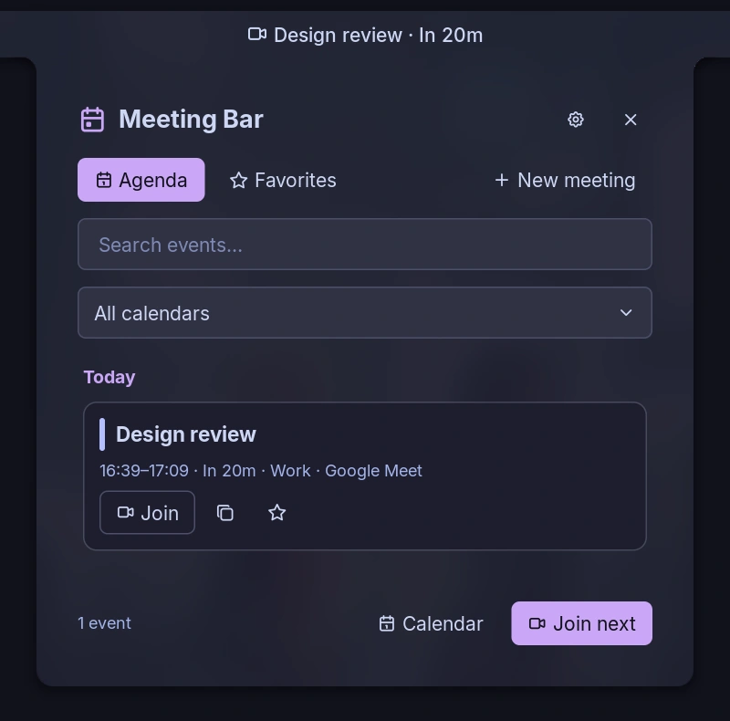
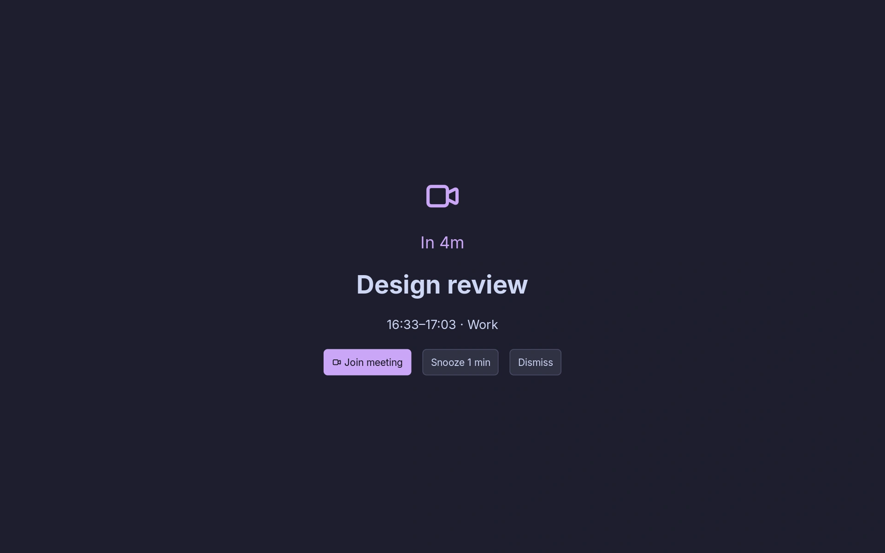

# Meeting Bar

See your next calendar event in the bar, browse your agenda, and open meeting links without leaving Noctalia. Optional full-screen reminders help you notice an upcoming online meeting.

## Plugin

| Field | Value |
| --- | --- |
| ID | `yuta/meeting-bar` |
| Entries | Bar widget: `bar`; panel: `agenda`; service: `calendar`; layer: `reminder` |

## Requirements

- Noctalia 5.4.0 or later, with a calendar account connected under **Settings → Calendar**.
- `xdg-open` on `PATH` to open web links with your default application.
- `noctalia` on `PATH` for opening the native Calendar panel through IPC.

The plugin reads Noctalia's synced calendar events. It does not require separate calendar credentials.

## Usage

Enable **Meeting Bar** in **Settings → Plugins**, then add `yuta/meeting-bar:bar` to your bar.

- Left-click the bar entry to open the agenda. Right-click to join the current or next recognized online meeting. Middle-click opens the plugin settings.
- Search events, select a calendar, open or copy a meeting link, and use the star to save a link under **Favorites**.
- **New meeting** opens the configured creation URL; it does not create a calendar event or send invitations.
- **Calendar** opens Noctalia's native Calendar panel.

Open the `agenda` panel from a key binding or terminal:

```sh
noctalia msg panel-toggle yuta/meeting-bar:agenda
```

The `calendar` service supplies events to every entry and checks reminders every 15 seconds. The `reminder` layer appears on the focused output before a recognized online meeting. Choose **Join meeting**, **Snooze**, or **Dismiss**. Joining or dismissing suppresses that occurrence, including after a service restart. Snoozing postpones only that meeting; a snoozed meeting can reappear until it ends.

Full-screen reminders are enabled by default. They are independent of native notification reminders: **Do Not Disturb and per-event notification settings do not suppress this layer**. Disable **Full-screen meeting reminders** if you only want native notifications. Close the overlay with its buttons or the IPC commands below; Noctalia 5.4.0 does not expose an Escape callback for layers.

## Screenshots

These screenshots use fictional calendar events.





## Settings

| Setting | Type | Default | Description |
| --- | --- | --- | --- |
| `days` | int | `2` | Local calendar days in the agenda, including today; 1–14. |
| `include_all_day` | bool | `true` | Include all-day events in the agenda, but never as bar countdowns or reminders. |
| `meetings_only` | bool | `false` | Show only links to recognized meeting services. |
| `show_past` | bool | `false` | Include events that finished earlier today. |
| `calendars` | string_list | `[]` | Calendar names to include; empty includes all. |
| `deduplicate` | bool | `true` | Merge events with matching title, times and URL across calendars. |
| `prefer_current` | bool | `true` | Prefer an ongoing event over the next one. Join actions consider recognized online meetings only. |
| `preview_minutes` | int | `0` | Show the next event in the bar this many minutes before it starts; 0 uses the entire agenda period. |
| `hide_empty` | bool | `false` | Hide the widget when there is no event within the preview window. |
| `show_title` | bool | `true` | Show the event title in the bar. |
| `show_time` | bool | `false` | Show its start time in the bar. |
| `show_countdown` | bool | `true` | Show time until start or time remaining. |
| `title_length` | int | `28` | Maximum title characters in the bar. |
| `browser` | string | empty | Executable name or path to open links; empty uses `xdg-open`. No shell arguments. |
| `service_commands` | string_map | `{}` | Override the executable per service: `meet`, `zoom`, `teams`, `webex`, `jitsi`, `whereby`, `goto`, `chime`, `ringcentral`, `discord`, `slack`, `zoho`. |
| `new_meeting_url` | string | `https://meet.google.com/new` | HTTP(S) page opened by **New meeting**. |
| `fullscreen_reminders` | bool | `true` | Show the full-screen reminder layer. |
| `reminder_minutes` | int | `5` | Minutes before start to show a reminder. |
| `snooze_minutes` | int | `1` | Minutes to postpone a reminder. |

Custom browser and service executables must be installed separately. Each receives the HTTP(S) URL as one argument; the plugin does not interpret shell commands or convert URLs to application-specific URI schemes.

## IPC

The singleton service uses the `all` target:

```sh
# Join the current or next recognized online meeting.
noctalia msg plugin yuta/meeting-bar:calendar all join
# Refresh from Noctalia's current calendar snapshot (does not force remote sync).
noctalia msg plugin yuta/meeting-bar:calendar all refresh
# Open Noctalia's Calendar panel.
noctalia msg plugin yuta/meeting-bar:calendar all calendar
# Close or snooze the active full-screen reminder.
noctalia msg plugin yuta/meeting-bar:calendar all dismiss
noctalia msg plugin yuta/meeting-bar:calendar all snooze
```

## Notes

- There are no direct network requests. Opening a meeting or creation URL launches `xdg-open` or your configured executable. Opening the native calendar launches `noctalia msg panel-open control-center calendar`.
- Favorites (titles and URLs), already-fired or dismissed reminder occurrences, and snooze deadlines are stored in `bookmarks.json`, `reminders.json`, and `snoozed.json` under `noctalia.pluginDataDir()`. Meeting URLs can contain access tokens; these files stay in your local user state directory. The plugin does not save credentials or the whole agenda.
- The calendar API does not expose RSVP status, participants, descriptions, stable calendar IDs, or event-edit URLs. Declined meetings cannot be filtered by RSVP, and same-named calendars cannot be distinguished across accounts.
- Recognized meeting hosts include Google Meet, Zoom, Teams, Webex, Jitsi, Whereby, GoTo, Chime, RingCentral, Discord, Slack, and Zoho. Other HTTP(S) links can be opened from the agenda, but are excluded from automatic meeting selection and reminders.
- A newly discovered event more than one minute past its start will not trigger a late reminder. Snoozed events remain eligible until they end. Removed or ended events close an active reminder on the next check.
- A sync failure can leave cached events visible. On Niri, launching a browser does not necessarily focus its window.
- Tested on Noctalia 5.4.0 with Niri. This plugin does not install compositor key bindings.

## Development

Run from the community-plugins repository root with Lua 5.4 or later:

```sh
noctalia plugins lint meeting-bar
TZ=Asia/Tokyo lua meeting-bar/tests/behavior.lua
TZ=America/New_York lua meeting-bar/tests/behavior.lua
```

The offline tests use synthetic events and a mock host API. They cover filtering, recurring instances, DST boundaries, URL selection, launch arguments, favorites, reminder persistence, snooze, cancellation, and UI callbacks. They do not replace testing the plugin in Noctalia.
