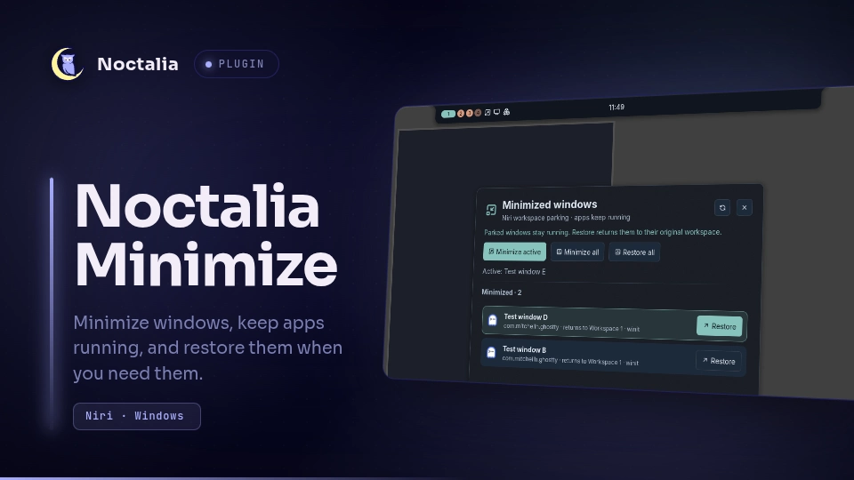

# Noctalia Minimize

Minimize focused windows into a Niri parking workspace and restore them from a native panel.

## Plugin

| Field | Value |
| --- | --- |
| ID | `swashx-dev/minimize` |
| Entries | widget: `minimize-button`; panel: `windows`; service: `actions`; shortcut: `minimize` |

## Requirements

Requires Noctalia plugin API 45 or newer. The standalone repository edition remains compatible with API 24.

Install `noctalia-minimizer` and `niri` on `PATH`.
The backend is maintained in [Noctalia-Minimize](https://github.com/SwashX-dev/Noctalia-Minimize) and is distributed separately as a Nix package (version 1.0.1).
Install its package and, where required, its NixOS module using that repository's README.
The community plugin calls the installed backend; it never downloads or executes helper code from the network.
The backend package also includes a standalone plugin. Enable only one frontend, not both the community ID and `local/minimizer`.

## Usage

Install this plugin from the community source and enable `swashx-dev/minimize` in Settings → Plugins.
Open its panel with:

```sh
noctalia msg panel-toggle swashx-dev/minimize:windows
```

Add bar widget `swashx-dev/minimize:minimize-button`: left-click minimizes the focused window; right-click opens the restore panel.
Add shortcut `minimize` in the control center to minimize the focused window.
The `windows` panel restores one or all parked windows and can minimize all windows after confirmation.
Arrow keys select a window, Enter restores it, Ctrl+A restores all, and Ctrl+R refreshes.
The `actions` service watches Niri events for taskbar restore when `auto_restore` is enabled.

## Settings

| Setting | Type | Default | Description |
| --- | --- | --- | --- |
| `enabled` | bool | true | Enable window minimization and restore actions. |
| `auto_restore` | bool | true | Restore a parked window when it is selected from the taskbar. |
| `confirm_minimize_all` | bool | true | Ask before minimizing every window from the panel. |

## IPC

```sh
noctalia msg plugin swashx-dev/minimize:actions all minimize
noctalia msg plugin swashx-dev/minimize:actions all windows
noctalia msg plugin swashx-dev/minimize:actions all minimize-all
noctalia msg plugin swashx-dev/minimize:actions all restore-all
noctalia msg plugin swashx-dev/minimize:actions all restore-last
```

The `minimize-all` IPC action bypasses the panel confirmation. Use it only as an intentional binding.

## Notes

Niri only. Apps keep running in a named parking workspace. The Python backend spawns `niri msg` commands to list and move windows and retains private state under `$XDG_STATE_HOME/noctalia-minimizer` (normally `~/.local/state/noctalia-minimizer`).
The service reads that state and runs an idle `niri msg --json event-stream` process for optional automatic restore. No network requests or administrator privileges are used.
Window titles, app IDs and original workspace names are stored locally; none are transmitted.



The screenshot inside the card shows the earlier UI branding. The current panel uses the name Noctalia Minimize.
