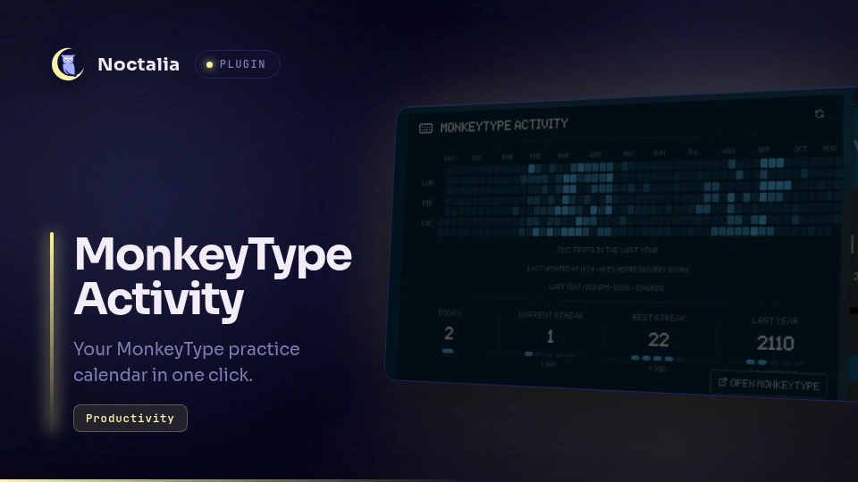

# MonkeyType Activity

A native MonkeyType practice calendar for the Noctalia bar: tests typed today,
your current streak and a hoverable activity heatmap of the last 372 days,
built from the official MonkeyType API instead of scraping the profile page.



## Plugin

| Field | Value |
| --- | --- |
| ID | `faminec/monkeytype-activity` |
| Entries | Bar widget: `activity`; panel: `calendar`; service: `sync` |
| Minimum Noctalia plugin API | `43` (container color roles) |

## Requirements

- A MonkeyType **Ape Key**. Every per-user endpoint of the API needs one; it is
  free and created on the website.
- `xdg-open` (`xdg-utils` on Arch) to open your profile and the Ape Keys page
  from the panel.

Create the key in MonkeyType under **Account settings**, then the **ape keys**
tab, and paste it into this plugin's settings. New keys start **disabled**: the
`active` column of that table has to be switched on, or every request answers
`471 ApeKey is inactive` and the panel offers a shortcut back to that page. The
key is only used for the read endpoints listed under [Notes](#notes) and is sent
in an `Authorization` header by the native HTTP client, so it never appears
in a process command line.

## Usage

1. Enable **MonkeyType Activity** in Noctalia's plugin manager and paste your
   Ape Key into its settings.
2. Add the `activity` widget to a bar from the widget picker.
3. Left-click the widget to open the yearly calendar; hover any day to see its
   test count. While no Ape Key is set, a click opens the plugin settings
   instead.
4. Right-click the widget or use the panel's refresh button to refresh now.

The panel can also be opened from the command line:

```sh
noctalia msg panel-toggle faminec/monkeytype-activity:calendar
```

## IPC

The sync service accepts a `refresh` event, which is what the panel's refresh
button and the widget's right-click send:

```sh
noctalia msg plugin faminec/monkeytype-activity:sync all refresh
```

## Settings

| Setting | Type | Default | Description |
| --- | --- | --- | --- |
| `ape_key` | string | empty | The MonkeyType Ape Key. Saved by Noctalia like any other plugin setting and sent only to `api.monkeytype.com`. |
| `refresh_interval_minutes` | select | `30` | How often the account is checked: 10, 15, 30 or 60 minutes. Applies immediately. |
| `profile_username` | string | empty | Optional MonkeyType username, used in the panel caption and for the profile button. The Ape Key already identifies the account. |
| `display_mode` (widget) | select | `icon_and_value` | `icon_only` shows just the keyboard glyph, `icon_and_value` adds the metric. |
| `display_metric` (widget) | select | `today` | Value next to the glyph: `today`, `current_streak`, `last_wpm` or `year_total`. |
| `show_today` (panel) | bool | `true` | Show today's test count below the calendar. |
| `show_current_streak` (panel) | bool | `true` | Show the current streak below the calendar. |
| `show_best_streak` (panel) | bool | `true` | Show the longest streak below the calendar. |
| `show_year_total` (panel) | bool | `true` | Show the total number of tests for the selected view above the calendar. |
| `show_last_test` (panel) | bool | `true` | Show the WPM and accuracy of the last saved test. |
| `show_profile_button` (panel) | bool | `true` | Show the button that opens your MonkeyType profile. |

Widget display and metric belong to each bar-widget instance, so two copies can
show different values. The panel content choices are shared by the calendar
panel. The streak number comes from MonkeyType's own streak endpoint, so it
follows the streak hour offset configured on the website rather than the local
clock.

## Notes

- **Network.** Three HTTPS requests to `api.monkeytype.com`, each with the
  header `Authorization: ApeKey <key>`: `GET /users/streak`, `GET
  /users/currentTestActivity` and `GET /results/last`. `/users/streak` is
  checked on every refresh to detect whether anything changed; the other two
  are fetched only when a full activity refresh is needed. The API's published
  global limit is 30 requests per minute across all Ape Keys on the account.
- **Storage.** The Ape Key is a normal string setting, so Noctalia keeps it in
  plain text in its own configuration file, and the cached `activity.json` holds
  only counts, dates and your last result.
- **Troubleshooting.** `471` means the key exists but the `active` toggle is off.
  `470`/`472` mean the key is unknown or malformed. The panel names the case and
  keeps rendering cached data when it has any.

- **View selector.** The panel offers a view switcher: `rolling` (last 12 months)
  or a full calendar year built from the same cached data. The API only returns
  a rolling window of recent days, so in a year view the days outside that
  window render as empty cells (they are unavailable, not zero-test days), the
  total counts only the covered days, and the caption shows the covered date
  range. Streak metrics always come from MonkeyType's streak endpoint, not from
  the selected view. If a year view cannot be built from old cached data, the
  panel silently falls back to the rolling 12-month view.
- **Manual profile username.** Set `profile_username` in settings if you want
  the panel caption and profile button to point at a specific MonkeyType profile.
  The Ape Key already identifies the account.

## Development

Plain Lua 5.4, no test framework and no network:

```bash
lua5.4 tests/test-units.lua    # dates, levels, API mapping, settings
lua5.4 tests/test-service.lua  # sync service against a mock of the runtime
lua5.4 tests/test-widget.lua   # bar widget against a mock of noctalia
```