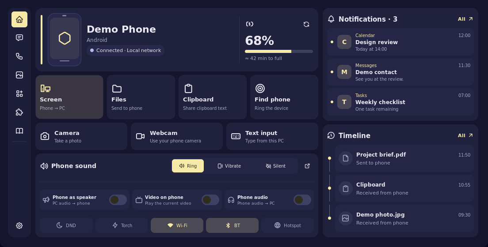

# NectarLink

Check your Android phone's battery from the Noctalia bar. Open the NectarLink panel to read notifications, send SMS, manage calls, browse photos, or mirror your phone's screen.



## Plugin

| Field | Value |
| --- | --- |
| ID | `vladikchi/nectarlink` |
| Entries | Bar widget: `phone`; panel: `controls`; service: `connection` |
| Version | `0.18.0` |
| Plugin API | `32` |
| License | [GPL-3.0-or-later](LICENSE) |

## Requirements

- Noctalia 5.2.0 or later.
- `nectarlink-desktop` from the **NectarLink for Noctalia** fork. Use **How to install** in the panel or find the Linux packages under [Releases in `vladikchi/nectarlink-noctalia`](https://github.com/vladikchi/nectarlink-noctalia/releases). The standard desktop build does not provide the extended local API this plugin needs. Run the app and Noctalia as the same user and use NectarLink's default data directory. If you use an AppImage, make it executable and set **NectarLink executable** to its absolute path.
- `xdg-open` on Noctalia's `PATH` for the **How to install** button.
- The official NectarLink Android app from [Releases in `thtbee/nectarlink`](https://github.com/thtbee/nectarlink/releases), paired with the desktop app. No custom Android build is needed. Available actions depend on your phone and the permissions you grant.

An estimated time to full charge and background page preloading require Desktop `0.1.6-nightly.12+noctalia` or a newer compatible build.

## Usage

1. Start the desktop app. Under **Settings → Connection & About**, turn on **Local automation API**. To let the plugin read notifications and messages, turn on **Notifications and messages** if your build offers that switch.
2. Install and enable **NectarLink** in Noctalia's Plugin Store under **Settings → Plugins**. The `connection` service starts automatically.
3. In **Settings → Panels**, select your bar, open **Widgets**, and add the NectarLink `phone` widget. It shows the first online phone's battery. Left- or right-click the widget to open the `controls` panel.
4. Select a phone on **Home** if you have more than one.

Open or close the panel from a terminal or key binding, even without the widget:

```sh
noctalia msg panel-toggle vladikchi/nectarlink:controls
```

### Panel sections

- **Home:** battery, notifications, recent activity, phone controls, and shortcuts for screen mirroring, webcam, audio, remote typing and file sharing.
- **Messages** and **Calls:** SMS, replies through supported notifications, call history and dialing.
- **Photos**, **Apps**, and **Deck:** browse albums and request originals, open supported phone apps, and run tiles configured in NectarLink.

If the panel can't connect, make sure the desktop app is running and its local API is enabled. Use **Check connection** on the setup screen or **Refresh** on **Home** to check again. If your phone is missing, check pairing in the desktop app.

## Settings

Use the gear on NectarLink's row in **Settings → Plugins**, or open **Plugin settings** from the panel.

| Setting | Type | Default | Description |
| --- | --- | --- | --- |
| `show_percentage` | `bool` | `true` | Show the battery percentage in the bar widget. |
| `show_charging` | `bool` | `true` | Show a charging icon in the bar widget while the phone is charging. |
| `show_name` | `bool` | `false` | Show the phone name on horizontal bars. |
| `hide_offline` | `bool` | `false` | Hide the widget when no phone is online. |
| `panel_battery` | `bool` | `true` | Show the battery card on Home. |
| `panel_controls` | `bool` | `true` | Show phone switches and session controls on Home. |
| `panel_actions` | `bool` | `true` | Show quick actions and remote typing on Home. |
| `panel_timeline` | `bool` | `true` | Fetch and show recent activity on Home. |
| `panel_notifications` | `bool` | `true` | Fetch and show current notifications on Home. |
| `panel_navigation` | `bool` | `true` | Show the sidebar. The settings button and IPC navigation still work when it is hidden. |
| `apps_display` | `select` | `icons_text` | Show icons with app names. Choose `icons` to fit more apps on each page without labels. |
| `executable` | `file` | `""` | Absolute path to the desktop executable or AppImage. Leave it empty to use `nectarlink-desktop` from Noctalia's `PATH`. `~` and shell expressions are not expanded. |

## IPC

With the panel already open, switch to **Messages**:

```sh
noctalia msg plugin vladikchi/nectarlink:controls all navigate messages
```

Replace `messages` with `home`, `calls`, `photos`, `apps`, `deck`, or `guide` to open another section. This event can load data for the section, but cannot send a message, place a call, or execute another phone action.

## Notes

- **Network and privacy:** The plugin reads `~/.local/share/Nectarlink/api-token.json` and sends authenticated HTTP requests only to the desktop app at `127.0.0.1`. The desktop app talks to the phone. The plugin does not read pairing keys or the app database. If Noctalia uses an HTTP proxy, add `127.0.0.1` to its `no_proxy` environment variable. The plugin blocks the request rather than sending the token through the proxy.
- **Files and clipboard:** The plugin doesn't write files directly; its drafts and caches stay in memory. It uses local photo and app previews created by the desktop app. The setup screen can copy the installer command to the clipboard, but the plugin never downloads or runs it. The desktop app handles file transfers and saving requested photos.
- **Processes:** The plugin runs `nectarlink-desktop` (or the configured executable) when you ask it to open the app, timeline, file picker, or clipboard tool. **How to install** opens the project page through `xdg-open`. Neither command is run through a shell.
- **Phone actions:** Action buttons send requests without an extra confirmation from the plugin. Entering or selecting a number doesn't dial it. Turning off Wi-Fi can disconnect your phone. The hotspot control asks you to choose **On** or **Off** because the phone doesn't report its current hotspot state. File and clipboard shortcuts require exactly one paired phone, and it must be online. After a timeout, check your phone or PC before trying again; the plugin does not retry the action automatically.
- **Messages:** Chats built from notifications aren't a full message history. The app's privacy settings and Android permissions determine what the plugin can read.
