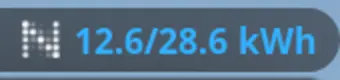
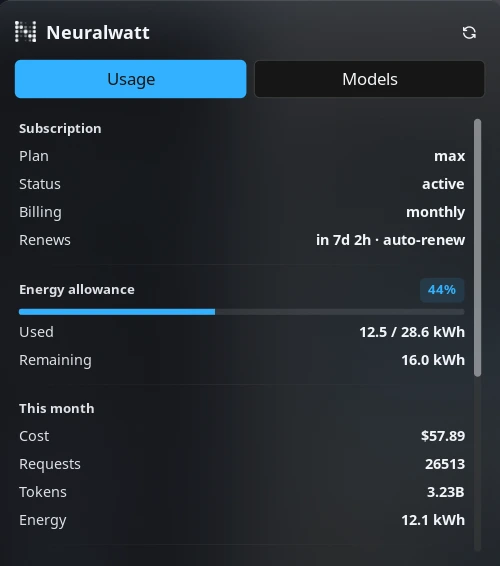
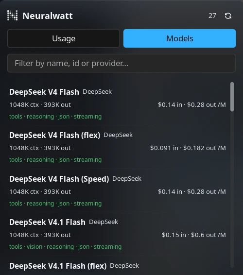

# Neuralwatt

Your Neuralwatt energy usage in the bar, in kWh: how much of the billing period's allowance the
account has drawn, when it renews, this month's cost, requests, tokens and physical energy, the CO₂e
that came with it, and the account balance. The same panel carries a second tab that browses the
model catalog with pricing, context limits and capability flags.

Neuralwatt bills inference by measured energy rather than by tokens, so the numbers this plugin
shows are the ones the account actually pays for.

## Plugin

| Field | Value |
| --- | --- |
| ID | `omertahaoztop/neuralwatt` |
| Entries | Bar widget: `bar`; panel: `usage`; service: `poller` |
| Panel | `usage` (420×480), floating, opening near the click, with **Usage** and **Models** tabs |

## Requirements

| Requirement | What it means |
| --- | --- |
| Neuralwatt account | Sign up at <https://portal.neuralwatt.com>. |
| API key (`sk-...`) | Create one in the portal and paste it into **API key** (see Usage). The plugin cannot show anything without it. |
| Network access | The plugin calls `api.neuralwatt.com` over HTTPS, and nothing else. |
| External commands | **None.** `dependencies` in `plugin.toml` is empty: the plugin uses Noctalia's built-in HTTP client, so there is no `curl`, no helper binary and nothing to install on `PATH`. |
| Compositor | None in particular — only Noctalia's bar, panel and service entries are used, so it works on every compositor Noctalia supports. |

## Usage

Quick start:

1. Install the plugin — from the plugin store, or with
   `noctalia msg plugins enable omertahaoztop/neuralwatt`.
2. Open **Settings → Plugins**, find **Neuralwatt** and paste your `sk-...` key into **API key**. The
   first poll runs immediately, so the capsule fills in within a couple of seconds.
3. Open **Settings → Bar** and add the **Neuralwatt** widget (`omertahaoztop/neuralwatt:bar`) to a
   bar. Right-click it any time to refresh; left-click opens the panel.
4. The panel has two tabs, **Usage** and **Models**; the Refresh button in its header refetches
   whichever tab is open.

### Bar capsule

Add the **Neuralwatt** capsule (`omertahaoztop/neuralwatt:bar`) to a bar from the widget picker.

- It prints Neuralwatt's logomark and the reading chosen under **Show in bar** — used / allowance
  (`12.5/28.6 kWh`, the default), remaining kWh, percent of allowance, or the icon alone.
- The colour tracks how much of the allowance is gone: **Healthy colour** (primary by default),
  **Warning colour** (amber by default) past **Warn at**, red past **Critical at**.
- Hovering lists the allowance, what is left, when the period renews, the plan, this month's cost
  and the credit balance as key/value rows.
- Left click opens the panel; right click asks the service for a fresh reading immediately.
- With no subscription on the account the capsule falls back to the remaining credit balance.

### Panel

`noctalia msg panel-toggle omertahaoztop/neuralwatt:usage`

Two tabs share one surface, so switching between them never moves the window:

**Usage**

- **Subscription** — plan, status, billing interval and the renewal countdown (`in 7d 3h`, marked
  `auto-renew` when it will renew itself).
- **Energy allowance** — the meter, the charged kWh drawn this period (`subscription.kwh_used` of
  `kwh_included`), what is left, and an **In overage** badge once the allowance is spent.
- **This month** — cost, requests, tokens and the physical energy the requests consumed.
- **Carbon** — the CO₂e for the billing period, its energy total and the exact window it covers.
  Shown only when carbon tracking is enabled on the account.
- **Account** — remaining and total credits, the accounting method, the rate-limit tier and the
  lifetime cost and energy totals.

**Models**

Every model the account can call, sorted by name, with the provider, the context window, the maximum
output, per-million-token pricing (input and output), the capability flags (tools, vision, reasoning,
JSON mode, streaming) and a `deprecated` badge where the model is on its way out. The filter box
matches on name, id or provider. Models with pricing still to be announced show `pricing TBD`
instead of numbers.

The header shows the model count on the Models tab and a **Refresh** button that refetches whichever
tab is open.

### Panel placement

The panel ships `floating` with `position = "auto"` and **open near click**, so a capsule on the
right of the bar opens it on the right, and one on the left opens it on the left. Placement, screen
position, layer and open-near-click are panel settings in **Settings → Plugins**, the same controls
built-in panels use.







## Settings

Plugin-level settings live in **Settings → Plugins**; `bar_mode` is per bar-widget instance.

| Setting | Type | Default | Description |
| --- | --- | --- | --- |
| `api_key` | `string` | `""` | Your Neuralwatt API key (`sk-...`). Required; without it the capsule stays empty and the panel explains how to add it. |
| `refresh_interval_sec` | `int` | `600` | Seconds between polls, clamped to 60–86400. A shorter interval means more requests against the account. |
| `warn_percent` | `int` | `70` | Allowance usage at or above this percentage switches the capsule and the meter to **Warning colour**. |
| `critical_percent` | `int` | `90` | Allowance usage at or above this percentage turns them red. |
| `ok_color` | `select` | `primary` | Colour while the allowance is healthy: `primary`, `secondary`, `tertiary` or `on_surface`. |
| `warn_color` | `select` | `secondary` | Colour past the warning threshold: `secondary`, `tertiary`, `error` or `primary`. |
| `bar_mode` | `select` | `used` | Which reading the capsule prints: `used` (used / allowance kWh), `remaining`, `percent`, or `none` for the logomark alone. |

The panel also gets the host's standard per-panel settings (`usage_placement`, `usage_position`,
`usage_open_near_click`, `usage_layer`) in the same place, because Noctalia injects them for every
panel entry.

## IPC

Open the panel from a keybinding or a script:

```sh
noctalia msg panel-toggle omertahaoztop/neuralwatt:usage
```

Ask the service for fresh data without waiting out the interval:

```sh
noctalia msg plugin omertahaoztop/neuralwatt:poller all refresh   # account usage + carbon
noctalia msg plugin omertahaoztop/neuralwatt:poller all models    # model catalog
```

The panel accepts the same events; `models` and `usage` also switch to that tab:

```sh
noctalia msg plugin omertahaoztop/neuralwatt:usage all refresh
noctalia msg plugin omertahaoztop/neuralwatt:usage all models
noctalia msg plugin omertahaoztop/neuralwatt:usage all usage
```

## Notes

**Network calls.** One headless service is the only thing that touches the network.

- Every `refresh_interval_sec`, one `GET /v1/quota` (account balance, usage, limits and subscription).
- Alongside it, one `GET /v1/usage/energy` for the current billing period, which is where the carbon
  row's CO₂e comes from. This call is best-effort: a failure leaves the previous reading in place.
- `GET /v1/models` is fetched only when the Models tab is opened without a cached list, or when you
  press Refresh on it. The catalog is cached for the session.

Extra capsules on extra monitors cost no extra requests: they read the state the service publishes.

**Credentials.** The API key is stored by Noctalia in its own plugin settings and sent only to
`api.neuralwatt.com`, in an `Authorization: Bearer` header. The plugin never logs it, writes it to
disk or sends it anywhere else. Like every other plugin setting it is stored as plain text in
Noctalia's settings file.

**Units.** The capsule and the allowance meter use *charged* kWh — `subscription.kwh_used`, the
amount that draws the allowance. The **This month** and **Carbon** energy rows are the *physical*
energy the requests consumed (`energy_kwh`). The two differ when flex-tier requests apply their
discount, so the numbers are not expected to match.

**Nothing else runs.** The plugin spawns no processes, writes no files and reads no environment
variables. It uses Noctalia's built-in HTTP client rather than shelling out to `curl`, which is why
`dependencies` is empty.

**Assets.** `assets/logomark-light.png` and `assets/logomark-dark.png` are Neuralwatt's own logomark
(from neuralwatt.com), kept in both a light and a dark cut so it reads on either palette.
