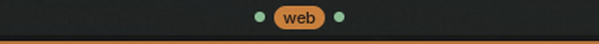

# Niri Workspaces

A workspace switcher for niri that draws the workspaces the way Noctalia's Focus
Hint style does — a dot for every workspace you are not on, an expanded pill with
its name for the one you are — with one thing the built-in workspaces widget
cannot do: **leave named workspaces out of the bar entirely**.

That is for a shelf rather than a desk. A scratchpad (`nscratch` and similar)
parks windows on a workspace it never shows you, and a scratch workspace is not a
place you switch to — it is where Nemo waits until you call it. Noctalia's own
widget has no `hidden_workspaces` setting, so that shelf costs a pill, or after
this a dot, that means nothing.



## Plugin

| Field | Value |
| --- | --- |
| ID | `madmedicnl/niri-workspaces` |
| Entries | Bar widget: `niri-workspaces` |

## Requirements

`niri` on `PATH`. The widget reads workspace state from `niri msg --json
workspaces` and follows it with `niri msg --json event-stream`; the plugin API
exposes no compositor state. Clicking a dot runs `niri msg action
focus-workspace`, and scrolling runs `focus-workspace-up` / `-down`.

Noctalia 5.2 or newer (plugin API 32 — the tooltips on the dots and the pill).

## Usage

Add **Niri Workspaces** from **Settings → Bar → Add widget**, or name it in the
bar's config file directly:

```toml
[widget.workspace-dots]
type = "madmedicnl/niri-workspaces:niri-workspaces"

[bar.default]
center = ["workspace-dots"]
```

Remove the built-in `workspaces` widget from that bar section if both should not
show.

- Left click a dot or the pill: focus that workspace.
- Scroll over the widget: the next or previous workspace.
- Hover a dot: its name, unless labels were turned down with `max_label_chars`.

The workspace you are on is always drawn, even if it is in `hidden` — an operator
on an invisible workspace with no way back is worse than a dot. A workspace with
no windows is left out while `hide_empty` is on, which is what niri's trailing
empty workspace needs.

## Settings

Settings live in **Settings → Plugins**, the gear beside Niri Workspaces.

| Setting | Type | Default | Description |
| --- | --- | --- | --- |
| `hidden` | `string` | `scratch` | Workspace names left out of the bar, comma separated. Case does not matter. |
| `hide_empty` | `bool` | `true` | Draw nothing for a workspace with no windows. The focused one is always drawn. |
| `dot_size` | `int` | `7` | Dot diameter in logical pixels. |
| `dot_color` | `string` | `tertiary` | Colour of the dots: a palette role or a hex value. |
| `focused_color` | `string` | `primary` | Colour of the focused workspace's pill. |
| `focused_text_color` | `string` | `on_primary` | Colour of the name inside it. |
| `font_size` | `int` | `0` | 0 uses the bar's own font size. |
| `max_label_chars` | `int` | `0` | Truncate the focused name; 0 shows it whole. |
| `gap` | `int` | `6` | Space between the dots and the pill, in logical pixels. |

Colours are palette roles, so they follow the theme; a hex value pins one.

## Notes

- Workspace state is one `niri msg --json workspaces` snapshot at load, again
  every 60 seconds as a self-heal, and `niri msg --json event-stream` for live
  updates. Only `niri` is spawned; nothing else, no network, no files written.
- Multi-monitor: each bar shows the workspaces of its own output when the host
  can name it, and falls back to the globally focused workspace otherwise.
- No app icon is drawn on the focused pill. The built-in Focus Hint style draws
  the focused window's icon; a plugin cannot read it.
- The focus styling follows the palette, so a theme change recolours it without
  a reload.

## License

MIT.
