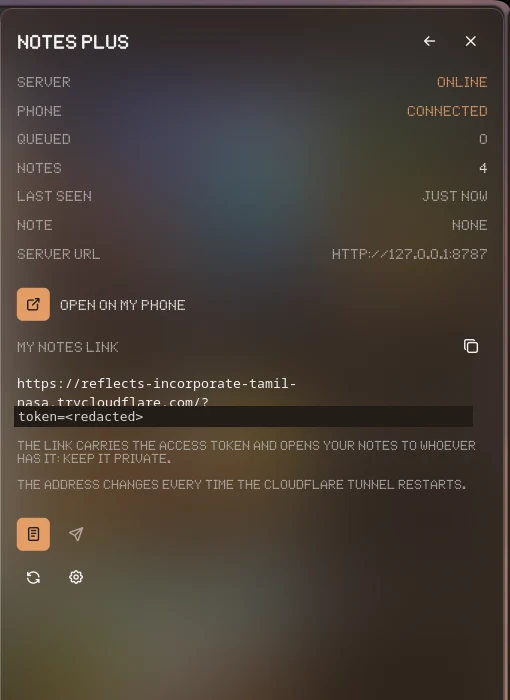

# Notes Plus

The official Notes plugin plus a mobile bridge: quick Markdown notes in a
panel, a bar widget that shows the state of the bridge, and a Sync view that
hands you a public link to open the same notes on your phone.

## Plugin

| Field | Value |
| --- | --- |
| ID | `faminec/notes-plus` |
| Entries | Bar widget: `widget`; panel: `panel`; service: `service` |

## Requirements

- `wl-copy` on `PATH`, used to copy the public link to the clipboard.
- The `notes-mobile` server, which is what the phone app talks to. It is not a
  package: it runs from `~/notes-mobile` (Node, no npm dependencies), serves the
  notes folder over HTTP on `server_url` (default `http://127.0.0.1:8787`) and
  keeps the token in `~/notes-mobile/config.json`. Without it the panel still
  edits notes locally; only the Sync view has nothing to talk to.
- A Cloudflare tunnel in front of that server for the public link. The tunnel
  writes its address to `~/notes-mobile/public-url.txt`; the link is
  `https://<tunnel>.trycloudflare.com/?token=<token>` and it changes every time
  the tunnel restarts.
- A writable notes folder. The panel creates `notes_dir` on open if it is
  missing.

## Usage

Notes are plain files (`extension`, default `md`) in `notes_dir`
(default `$XDG_DOCUMENTS_DIR/Notes`, the localized Documents folder; the legacy
`~/Documents/Notes` is kept when it is the folder that already exists).

Open the panel:

```sh
noctalia msg panel-toggle faminec/notes-plus:panel
```

The panel lists the notes plus an always-present scratchpad, and opens the
editor when you pick one. The editor autosaves shortly after you stop typing, on
navigation and on close. The header has the sort toggle, the Sync view (cloud
glyph) and the new-note button.

The bar widget shows whether the phone is connected; clicking it opens the
panel, its tooltip carries the pending count. Toggle it with:

```sh
noctalia msg widget-toggle faminec/notes-plus:widget
```

The service keeps polling the `notes-mobile` server and publishes the state the
panel and widget show. It starts with the shell; restart it with
`noctalia msg service-start faminec/notes-plus:service`.

### Sync view and the public link

The Sync view shows the server, the phone, the queue, the note that would be
sent and the server URL. **Open on my phone** resolves the public link, copies
it with `wl-copy` and keeps it on screen (with the copy button) so it can be
copied by hand when the clipboard command fails.

The phone opens that link in its browser and chooses: install it as an app
(Add to Home Screen) or keep it as one more tab. Every person runs their own
plugin and their own `notes-mobile`, so the link always points at their own
notes.

When the button cannot build a link it says why: no tunnel
(`public-url.txt` missing or empty) or no token (the `token` setting and
`config.json` are both empty).



### Changes made outside the panel

The panel watches the notes folder and folds in edits made outside it (the
phone app, Syncthing, a text editor). Appends from both sides are combined; an
incompatible edit in the middle is never overwritten — the phone's text wins
and the local text is saved to `<notes_dir>/.conflicts/` with a notification.

## Settings

| Setting | Type | Default | Description |
| --- | --- | --- | --- |
| `notes_dir` | `folder` | `$XDG_DOCUMENTS_DIR/Notes` | Folder where the notes are stored. |
| `extension` | `string` | `md` | File extension without the dot; only these files are listed. |
| `watch` | `bool` | `true` | Refresh the panel when notes change outside it. |
| `server_url` | `string` | `http://127.0.0.1:8787` | Address of the `notes-mobile` server. |
| `token` | `string` | empty | Token for that server; fallback is `~/notes-mobile/config.json`. |
| `poll_interval` | `int` | `10` | Seconds between state polls when the live stream is not active. |

Widget settings:

| Setting | Type | Default | Description |
| --- | --- | --- | --- |
| `glyph` | `glyph` | `device-mobile` | Glyph shown in the bar. |
| `show_text` | `bool` | `false` | Show a text label next to the glyph. |

## IPC

The panel accepts these events:

```sh
noctalia msg plugin faminec/notes-plus:panel all refresh
noctalia msg plugin faminec/notes-plus:panel all open-home
noctalia msg plugin faminec/notes-plus:panel all open-note <file.md>
```

`refresh` re-reads the notes folder, `open-home` returns to the list and
`open-note` opens the given file (the extension is added when missing).

The service accepts the same `refresh` / `open-home` / `open-note` events plus
`cmd` with a JSON payload, which is what the Sync view uses:

```sh
noctalia msg plugin faminec/notes-plus:service all cmd '{"op":"status"}'
noctalia msg plugin faminec/notes-plus:service all cmd '{"op":"send-current"}'
noctalia msg plugin faminec/notes-plus:service all cmd '{"op":"push","text":"...","title":"..."}'
```

## Notes

- Files written: the notes themselves; `<notes_dir>/.current.json` (the note the
  panel has open, so the phone can mirror it); `<notes_dir>/.pinned.json` (pins);
  `<notes_dir>/.conflicts/` (local text kept when an outside edit could not be
  merged). The `.current.json` file is written to a temporary file and renamed,
  so a reader never sees a half-written file.
- Network: HTTP requests to `server_url` only, with the token in the
  `Authorization` header.
- Processes spawned: `wl-copy` (public link) and `noctalia msg ...` (asking the
  service to refresh, or opening the panel from the service).
- Sensitive data: the `token` is stored as plain text in the shell settings and
  travels inside the public link. The link gives full access to the notes of
  that machine while the tunnel is up: keep it private.
- Compositor: tested on Hyprland; the clipboard step needs a Wayland session
  (or `wl-copy` provided by `wl-clipboard`).
- This plugin is a fork of the official `notes` plugin (MIT), which is the
  panel UI you already know; the additions are the outside-change watching, the
  IPC handlers, the service and the Sync view with the public link.
