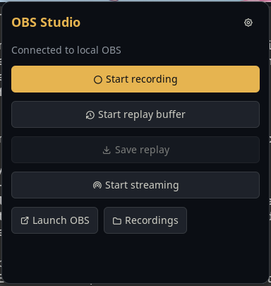

# OBS Control

Start and stop OBS Studio recording, replay buffer and streaming from the bar, a panel, the control center or a keybind, without switching to the OBS window. It replaces the v4 OBS Control plugin.

## Plugin

| Field | Value |
| --- | --- |
| ID | `ayagmar/obs-control` |
| Entries | Bar widget: `status`; panel: `controls`; service: `controller`; shortcut: `quick-controls` |

## Requirements

Install `python3`, the Python module `websocket-client`, `obs`, `pgrep` and `xdg-open`. On Arch Linux:

```sh
sudo pacman -S obs-studio python-websocket-client procps-ng xdg-utils
```

The Python executable set in settings must be 3.10 or newer and have `websocket-client` installed; `requirements.txt` pins the tested version, 1.9.2. In OBS, enable **Tools → WebSocket Server Settings → Enable WebSocket server**. You can keep authentication on: the helper reads the port and password from OBS's local config.

The `obs` command must be on `PATH`. A running OBS is detected by the process name `obs`, or `.obs-wrapped` on NixOS.

## Usage

Enable the plugin, then add `ayagmar/obs-control:status` to your bar. Left click opens the controls; right click opens plugin settings. Add `ayagmar/obs-control:quick-controls` to the control-center shortcuts for the same panel. The `controller` service polls OBS while the plugin is enabled.

```sh
noctalia msg panel-toggle ayagmar/obs-control:controls
```

The panel controls recording, replay buffer and streaming, saves replays, launches OBS and opens the recording folder. Starting an output launches OBS minimized if it is not running. Saving a replay requires an active replay buffer.



## Settings

| Setting | Type | Default | Description |
| --- | --- | --- | --- |
| `python_executable` | `string` | `python3` | Python with websocket-client installed. A virtual environment's `bin/python` works. |
| `poll_interval_ms` | `int` | `2500` | How often to poll OBS, in milliseconds, from 1000 to 30000. |
| `auto_close_managed_obs` | `bool` | `true` | After you stop an output, close OBS if the plugin started it and recording, replay, streaming and virtual camera are all off. |
| `open_videos_after_stop` | `bool` | `true` | Open the folder of a finished recording with xdg-open. |
| `show_when_idle` | `bool` | `true` | Keep the widget visible when nothing is recording or streaming. |
| `show_elapsed_in_bar` | `bool` | `false` | Add the recording duration to the bar label. |

## IPC

```sh
noctalia msg plugin ayagmar/obs-control:controller all toggle-record
noctalia msg plugin ayagmar/obs-control:controller all toggle-replay
noctalia msg plugin ayagmar/obs-control:controller all save-replay
noctalia msg plugin ayagmar/obs-control:controller all toggle-stream
noctalia msg plugin ayagmar/obs-control:controller all launch
noctalia msg plugin ayagmar/obs-control:controller all open-videos
noctalia msg plugin ayagmar/obs-control:controller all status
```

`launch` starts OBS but never closes it automatically, unlike an OBS started by a toggle. An action sent while a status poll is running waits for the poll to finish. The bar label shows REC, REPLAY and LIVE for active outputs. Errors appear in the panel and in action notifications.

## Notes

The Python helper connects only to `127.0.0.1` with OBS WebSocket protocol v5 and contacts no remote service. The password stays inside the helper: it is never passed as an argument or included in status output. The helper reads `$XDG_CONFIG_HOME/obs-studio/plugin_config/obs-websocket/config.json` and `/proc/<pid>/stat`.

The helper writes the PID of an OBS it started, and an action lock, to `$XDG_RUNTIME_DIR/noctalia-obs-control/`. Before sending SIGTERM it checks the process start time, so a reused PID never gets closed. The plugin never kills an OBS it did not start. Disabling the plugin or restarting Noctalia leaves OBS and active outputs running.

The helper runs `pgrep` to detect OBS, `obs --minimize-to-tray` to start it, and `xdg-open` for the recording folder, which it asks OBS for. Nothing is downloaded at runtime. The tooltip always shows elapsed recording time.
