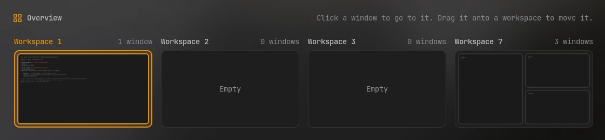
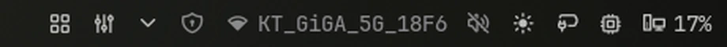

# Overview

See every workspace and its windows at once, laid out as they are tiled. Click a window
to go to it, click a workspace to switch to it, and drag a window onto another workspace
to move it there.



## Plugin

| Field   | Value                                                                                                                 |
| ------- | --------------------------------------------------------------------------------------------------------------------- |
| ID      | `omerfuyar/overview`                                                                                                  |
| Entries | Bar widget: `widget`; panels: `panel`, next to the bar, and `center`, in the middle of the screen; service: `service` |

## Requirements

| Command   | Needed   | What for                                                                                      |
| --------- | -------- | --------------------------------------------------------------------------------------------- |
| `hyprctl` | Required | Reads the workspaces and windows, and focuses and moves them. Overview works on Hyprland.     |
| `grim`    | Required | Takes a small picture of each window. Without it, windows show as their app's icon and title. |

## Usage

Add the **Overview** widget to the bar and click it.



- Each workspace in use shows its tiled windows in their places, as pictures of their content.
  Floating windows are small tiles under them. Workspaces sit three to a row, and the
  overview is only as tall as the rows in use.
- The active workspace and the focused window have an accent border.
- Click a window to focus it, or a workspace's title to switch to it. The overview closes.
- Drag a window onto another workspace to move it there without leaving the overview.
- Escape or a click outside closes the overview.

To open it with a key, set **Key binding** in its settings, such as `SUPER + Tab`. The
binding is added to Hyprland while Noctalia runs, not written to your config. A key that
is already bound is left alone, and a notification says so: free it in your Hyprland
config first, or pick another.

The key binding opens the overview in the middle of the screen. To bind it yourself, or
to open it from a script:

```sh
noctalia msg panel-toggle omerfuyar/overview:center
noctalia msg panel-toggle omerfuyar/overview:panel
```

## Settings

| Setting    | Type     | Default | Description                                                                                              |
| ---------- | -------- | ------- | -------------------------------------------------------------------------------------------------------- |
| `keybind`  | `string` | `""`    | A key that opens Overview, such as `SUPER + Tab`. Empty adds no key binding.                             |
| `previews` | `bool`   | `true`  | Advanced. A small picture of each window, taken with grim. Off, windows show their app's icon and title. |

## Notes

- Pictures are taken when the overview opens and when windows move, so they show each window as it was then. While the overview is open, it follows workspaces and windows as they change. Pictures are kept in the plugin's data folder.
- Works with both Hyprland config formats, Lua and the older one.
