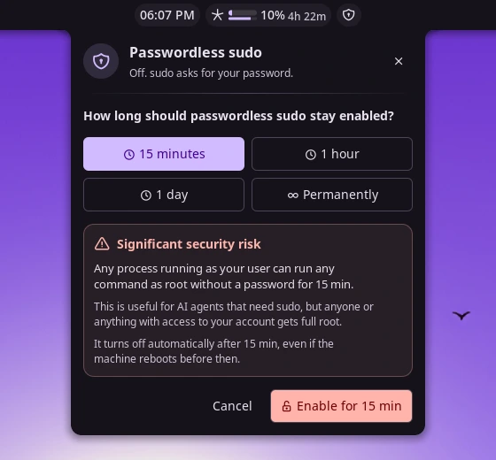
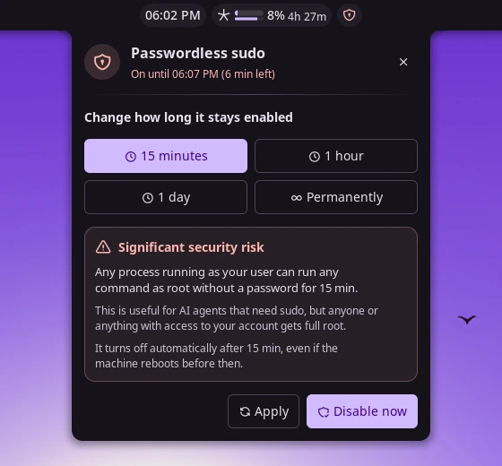

# Passwordless Sudo

Turn on passwordless `sudo` for a limited time from the bar, so an AI agent or
script can run privileged commands. The bar icon turns red while it is on and
one click turns it off. Grants expire on their own, even across a reboot.
This is a port of Omarchy's passwordless-sudo indicator.



## Plugin

| Field | Value |
| --- | --- |
| ID | `crsmthw/passwordless-sudo` |
| Entries | Bar widget: `indicator`; panel: `panel`; shortcut: `shortcut`; service: `service` |

## Requirements

- `sudo`, with `/etc/sudoers` including `/etc/sudoers.d` (the default on most
  distributions).
- `polkit`, for `pkexec`, plus a running polkit authentication agent. Noctalia's
  own agent works: set `polkit_agent = true` under `[shell]`.
- `systemd`, for the expiry timer (`systemd-run`) and boot cleanup (`systemd-tmpfiles`).
- Your account must be an administrator (in the `wheel` group on Arch).

## Usage

Add the **Passwordless Sudo** widget (`crsmthw/passwordless-sudo:indicator`) to
a bar in **Settings → Bar**, or in TOML:

```toml
[widget.passwordless_sudo]
type = "crsmthw/passwordless-sudo:indicator"
```

- **Click the shield while it is off** to open the panel. Pick **15 minutes**,
  **1 hour**, **1 day** or **Permanently**, read the warning, and press
  **Enable**. Noctalia's polkit dialog asks for your password.
- **While it is on**, the shield is red and its tooltip shows when the grant
  expires. **Click it to turn passwordless sudo off immediately**, with no
  password.
- **Right-click the shield** to open the panel at any time. While a grant is
  on, the panel can change its duration or turn it off.

Open the panel from a keybind or script:

```sh
noctalia msg panel-toggle crsmthw/passwordless-sudo:panel
```

The **Passwordless Sudo** control-center tile (`shortcut`) works the same way:
add it under **Settings → Control Center**. Click it to turn sudo off or to open
the panel, and right-click it to open the panel.

The first time you enable it, the same password prompt installs the root-owned
helper described under [Notes](#notes).



## Settings

These are bar widget settings.

| Setting | Type | Default | Description |
| --- | --- | --- | --- |
| `glyph` | `glyph` | `shield-lock` | Icon shown in the bar. |
| `hide_when_inactive` | `bool` | `false` | Show the icon only while passwordless sudo is on, as Omarchy does. While it is hidden, use the control-center tile or IPC to turn it on. |
| `show_countdown` | `bool` | `false` | Show the time left (for example `12m`) next to the icon while a timed grant is on. |

## IPC

```sh
# Re-check the state, for example after changing sudoers by hand
noctalia msg plugin crsmthw/passwordless-sudo:service all refresh
# Turn passwordless sudo off, or open the panel when it is off
noctalia msg plugin crsmthw/passwordless-sudo:service all toggle
noctalia msg plugin crsmthw/passwordless-sudo:service all disable
# Ask for a password and enable for 1-1440 minutes, or permanently
noctalia msg plugin crsmthw/passwordless-sudo:service all enable 30
noctalia msg plugin crsmthw/passwordless-sudo:service all enable permanent
```

Once the helper is installed, you can also use it from a terminal:

```sh
noctalia-sudo-passwordless 15          # enable for 15 minutes (asks for your password)
noctalia-sudo-passwordless permanent
noctalia-sudo-passwordless --disable
noctalia-sudo-passwordless --status
```

## Notes

**Security.** While a grant is on, any process running as your user can run any
command as root. Use the shortest duration that works for you.

**What runs as root.** Privileged work is done by
`bin/noctalia-sudo-passwordless`, a short, commented bash script shipped with
the plugin. Your first enable copies it, root-owned, to
`/usr/local/bin/noctalia-sudo-passwordless`, using `pkexec /bin/bash install.sh`.
It must live outside the user-writable plugin directory because the expiry timer
runs it as root. When the plugin updates the helper, the next enable reinstalls it.

**Files written (as root):**

- `/etc/sudoers.d/99-noctalia-nopasswd-<uid>`: a timed grant,
  `#<uid> ALL=(ALL) NOTAFTER=<UTC> NOPASSWD: ALL`. sudo enforces the deadline
  itself, including after suspend.
- `/etc/sudoers.d/99-noctalia-permanent-nopasswd-<uid>`: a permanent grant,
  kept across reboots.
- `/etc/tmpfiles.d/noctalia-nopasswd-sudo.conf`: removes leftover timed grants
  at boot.
- `/usr/local/bin/noctalia-sudo-passwordless`: the helper.

Each rule is checked with `visudo -cf` before an atomic rename puts it in
place, and the whole sudoers config is checked again afterwards. A transient
`systemd-run` timer deletes a timed grant once it expires.

**Processes spawned:**

- `sudo -kn <helper> __status` checks the state without prompting (`-k` ignores
  cached credentials). It runs at startup, after every change, and once a
  timed grant's deadline passes. It never polls.
- `pkexec` enables a grant and shows the password prompt.
- `sudo -n <helper> __disable` turns a grant off without a password; it only
  works because the grant itself is passwordless.
- `noctalia msg plugin crsmthw/passwordless-sudo:service all …` lets the
  enable wrapper and the terminal helper report back to the plugin.

The plugin makes no network calls. It writes only `enable.err`, the last
enable error, to its own data directory.

**Uninstall.** Turn the grant off, then run `sudo ./install.sh --uninstall` from
the plugin directory. That removes the helper, the boot cleanup file and every
grant the helper created.

**Credits.** The grant design (sudoers `NOTAFTER` rule, root expiry timer, boot
cleanup, and noninteractive status and disable) follows Omarchy's
`omarchy-sudo-passwordless`, used under the MIT license. See `LICENSE`.
