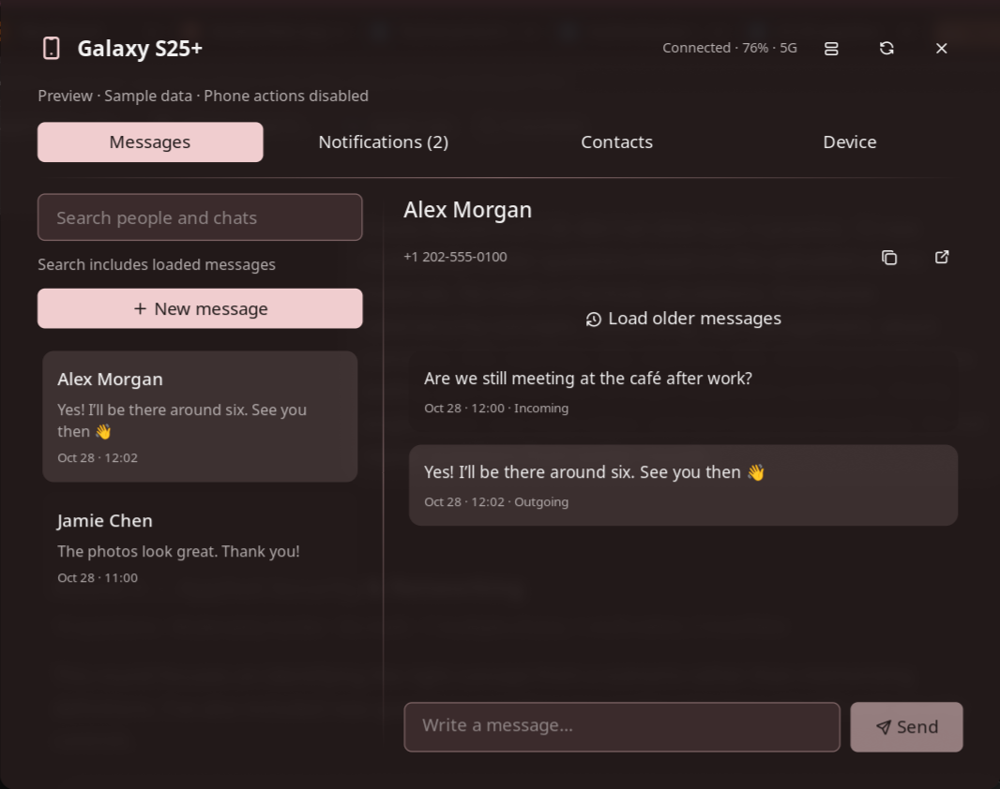

# Phone Connect

Read SMS conversations, find people by name, and interact with phone notifications
from a native Noctalia panel, using KDE Connect.



## Plugin

| Entry | Type | Id |
|-------|------|----|
| `icefish/phone-connect` | plugin | — |
| `bar` | widget | `icefish/phone-connect:bar` |
| `tile` | shortcut | `icefish/phone-connect:tile` |
| `details` | panel | `icefish/phone-connect:details` |
| `details_floating` | panel | `icefish/phone-connect:details_floating` |
| `details_widget` | panel | `icefish/phone-connect:details_widget` |
| `kde` | service | `icefish/phone-connect:kde` |

## Usage

Pair the phone in KDE Connect, enable SMS/contact sharing and notification access
on the phone, then add the bar widget or control-center tile in Noctalia Settings.
Click either to open the panel. Unknown battery/network values remain unknown.

```sh
noctalia msg panel-toggle icefish/phone-connect:details
noctalia msg panel-toggle icefish/phone-connect:details_floating
noctalia msg panel-toggle icefish/phone-connect:details_widget
```

- **Messages** opens first by default. Search people, numbers, previews, and already loaded
  messages. Select a conversation to fetch 50 messages. History displays 25
  messages at a time; Load older traverses cached pages before requesting more.
  Newer messages returns through loaded pages. New message offers a contact
  picker and manual number entry.
- **Notifications** lists active notifications mirrored by KDE Connect. Reply
  appears only when the phone supplies a reply action. Dismiss removes the phone
  notification too. Incoming/missed-call events are retained for this session.
- **Contacts** shows compact rows with a cached phone photo or initials. Expand a
  person to choose among all their numbers, start a message, or copy a number.
  Refresh asks KDE Connect to sync.
  Results are paged to keep large address books responsive; search covers all contacts.
- **Device** contains Find phone, Ping, files, clipboard, sharing, media playback,
  volume, avatar/alias editing, and pairing. The IP address appears on the same
  line as the phone name in small muted text, preferring IPv4 and falling back
  to IPv6 when IPv4 is unavailable. The Unpair icon sits next to Edit and opens
  a confirmation in the panel.

The header's layout button switches between the wide two-pane view and compact
list → conversation navigation. The panel uses the shell palette and an 800×640
logical-pixel surface; Noctalia clamps it to the available output. Drafts survive
tab/device changes and closing the panel, but not a plugin restart.

Sending reports **accepted by KDE Connect**, not delivery. A failed/uncertain
request retains the draft; check the phone before retrying an uncertain send.
Existing thread replies preserve KDE Connect's recipient/SIM selection.

### Limits

- Requires the phone's KDE Connect plugins and Android permissions. Empty lists
  do not prove permissions are missing. Refresh and check the phone if no data arrives.
- SMS text and existing group-thread replies are supported. Full RCS, WhatsApp,
  and Signal histories are not exposed; their notification replies may work.
- Attachments are indicated, with an action to open the existing KDE Connect SMS
  application. This panel does not compose or download MMS attachments.
- No dialing, answering, hanging up, call audio, full call log, remote read-marking,
  or full-history search/indexing. Number matching ignores punctuation, but does
  not guess country codes or choose between conflicting contact names.
- Disconnected content is a session cache. Notification access and phone app
  behavior determine which notifications are mirrored, including sensitive content.

## Requirements

- `kdeconnect` — daemon, CLI, and optional existing KDE Connect SMS application.
- `gdbus` — GLib command-line tools for the existing device controls.
- `python3` — messaging helper runtime.
- `PyGObject` — Python Gio/GLib bindings (`python-gobject` on Arch,
  `python3-gi` on Debian/Ubuntu). No packages are installed automatically.
- `sshfs` — optional phone file browsing through KDE Connect SFTP.

Existing file/image pickers use `zenity` or `kdialog` when installed; browsing
uses `xdg-open`. The helper reads typed D-Bus values rather than parsing message
text from shell output. Noctalia plugin API 24 or newer is required.

Python 3 and PyGObject are required for **Messages, Contacts, and mirrored
Notifications**. If either is missing, those tabs show a dependency notice with
package names and an action to open Device controls. Device discovery, battery,
media, Find phone and the existing CLI/gdbus controls continue working. There is
no separate notification fallback. The service retries a failed helper startup
automatically; restarting the plugin retries immediately after installation.

### API compatibility

The API floor is 24 because the implementation uses direct argument arrays for
helper requests. Relative modules require 22, chat scrolling and input submission
controls require 21, and frame-coalesced rendering requires 18. Lowering the
manifest alone would make older hosts load code they cannot execute.

Noctalia's [API version history](https://docs.noctalia.dev/noctalia/plugins/development/plugin-api/)
places API 24 in v5.0.0-beta.9, before the stable v5.0.0 series. Hosts below API 24
need the older plugin revision. The API floor does not establish a test claim
for every compatible shell version; tested versions are listed in TESTING.md.

## Settings

| Setting | Default | Description |
|---------|---------|-------------|
| State Update Interval | 30 | Seconds between device refreshes; 0 disables polling. Messaging signals remain active. |
| Show Charging Fill | true | Highlight the bar widget when charging. |
| Show Device Name | false | Show the selected device's name or alias in the bar. |
| Battery Display | icon_and_percent | Icon, percentage, both, or neither. |
| Show Clipboard Action | true | Show Send clipboard in the Device tab. |
| Device image and name | — | Informational setting; edit them in the Device tab. |
| Language | en | English / Simplified Chinese; new strings fall back to English. |
| Panel Placement | attached | Attached, floating center, or below the widget. |
| Default Page | messages | Open Messages, Notifications, Contacts, or Device whenever the panel opens. |

## IPC

```sh
noctalia msg plugin icefish/phone-connect:kde all refresh
noctalia msg plugin icefish/phone-connect:kde all cmd '{"op":"sync","device":"<id>"}'
```

Existing ops remain available: `ring`, `ping`, `clipboard`, `share_text`,
`share_url`, `share_file`, `pair`, `accept`, `reject`, `unpair`, `browse`,
`sms_send`, `launch_sms_app`, `media`, `media_seek`, `media_set_volume`, `select`,
`refresh`, `set_image`, `set_alias`, `pick_image`, and `pick_share`.

New commands: `sync`, `contacts_sync`, `history` (`thread`, `start`),
`notification_reply` (`notification`, `replyId`, `text`), and
`notification_dismiss` (`notification`). `sms_send` accepts the existing
`destination`, `text`, optional `attachment`, or a `thread` for a thread-aware reply.
All commands require `device` where applicable.

The service owns `pc.messaging`: device-keyed capabilities, contacts, threads,
loaded messages, notifications, call events, pending operations, and results.
Results are request-scoped; a successful request does not mean delivery.

## Notes

All data stays local. The Python helper subscribes to the session D-Bus and reads
KDE Connect's per-device vCards under `$XDG_DATA_HOME/kpeoplevcard/` (default
`~/.local/share/kpeoplevcard/`). KDE Connect handles phone communication and its
own caches; the helper makes no direct network requests.

Embedded JPEG/PNG/WebP contact photos (up to 256 KiB each) are decoded into
`$XDG_RUNTIME_DIR/noctalia-phone-connect/<device hash>/` so native image controls
can display them. These session files use hashed filenames, private directories
(0700), and private files (0600). Replaced/removed photos are pruned after a short
grace period; the runtime directory normally disappears at logout. No contact
names or numbers are written there. Without a writable runtime directory or an
embedded supported photo, the row shows initials. Remote photo URLs are never fetched.

Noctalia runs one helper stream plus short-lived helper requests. The host stops
the stream on reload/disable. Device controls retain their `gdbus`,
`kdeconnect-cli`, picker, `sleep`, and file-opener processes. Phone actions are
only invoked from explicit UI/IPC commands. Message text is passed as an argument
array, never interpreted by a shell. Do not log helper JSON: it contains personal data.
**Process-argument trade-off:** API 24's `runAsync` has no stdin payload option.
The request JSON therefore contains SMS/reply text in argv for the duration of
the short-lived helper process. It can be visible through `ps` or `/proc` to
other local accounts when process visibility permissions allow it. This is a
known trade-off in 0.3.0; direct execution avoids shell interpretation, but does
not make arguments private. No message handoff files are created.

Aliases, images, and the selected device remain in `pluginDataDir()/state.json`.
Picker handoff files are temporary and removed after use. Message data,
notification content, drafts, and search preferences live only in memory.

## Development and testing

```sh
python3 -m unittest discover -s phone-connect/tests -p 'test_*.py'
lua phone-connect/tests/messaging.lua phone-connect
lua phone-connect/tests/panel.lua phone-connect
lua phone-connect/tests/regressions.lua phone-connect service
lua phone-connect/tests/regressions.lua phone-connect panel
noctalia plugins lint phone-connect
python3 .github/workflows/scripts/validate-plugins.py
```

See [DEVELOPMENT.md](DEVELOPMENT.md) for the module map, state ownership, helper
protocol and formatting commands. The automated tests use synthetic data and
never send messages or phone actions. [TESTING.md](TESTING.md) records coverage,
native checks and the remaining live verification checklist.

For screenshots with sample data, open the panel, then send the bundled fixture:

```sh
noctalia msg plugin icefish/phone-connect:details all preview "$(cat phone-connect/tests/preview.json)"
noctalia msg plugin icefish/phone-connect:details all view '{"tab":"notifications","compact":false}'
```

The panel displays a Preview banner and blocks phone commands while previewing.
Closing it ends preview mode. Preview changes never enter the backend model.

### Local override and rollback

Keep the canonical plugin ID. Back up Noctalia's active settings and this plugin's
state, then link only the `phone-connect` directory into the active local plugin
directory (`$XDG_DATA_HOME/noctalia/plugins/phone-connect` by default). Reload
Noctalia and verify the local version is selected. This overrides the installed
community copy without removing it or changing its ID.

To roll back, remove only that symlink and reload. The community copy takes over
with the same settings/state. Do not remove KDE Connect pairings or its caches.
Keep the override while the PR is under review; remove it after installing the
released version. Local `.luau` edits hot-reload; manifest changes need a reload.
