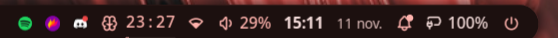
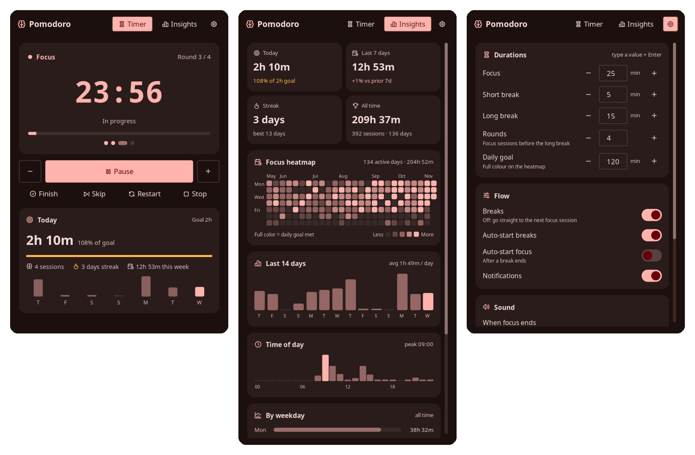

# Pomodoro Heatmap

A Pomodoro timer for the Noctalia bar that also keeps track of your focus time.
You get a countdown on the bar and a panel with a calendar heatmap, streaks and
charts showing when you focus best.





Other Pomodoro plugins only run the timer. This one adds:

- **Focus history**: a 26-week heatmap, streaks, trends, and time-of-day and weekday charts.
- **Quick edits**: change a session's length right from the bar or the panel before you start.
- **Full control while running**: finish a session early, skip a break, add or remove time, or stop.
- **Gentle sounds**: three soft built-in sounds, separate sounds for the end of focus and the end of a break, and a volume setting.

## Features

- **Bar widget**: stage icon, live countdown and a thin progress line. When idle
  it shows today's finished sessions.
- **Timer**:
  - Before starting, set the length with − / +, preset chips (15 · 25 · 45 · 60 · 90),
    by clicking the clock and typing minutes,
    or by scrolling on the bar. Keep it for this session only, or save it as your default.
  - While running: pause or resume, ±1 minute, **Finish** (end now and count the time
    as a completed session), **Skip**, **Restart** and **Stop**.
  - During a break: **Skip break** or **Focus now**. Breaks can also be turned off.
- **Insights**:
  - four summary tiles: today, last 7 days, streak and all-time totals
  - a heatmap with a tooltip for each day
  - a 14-day trend
  - time-of-day and weekday charts
  - your best day and completion rate
- **Settings tab**: durations, rounds and daily goal (step with − / + or type a
  value and press Enter), break options, sounds with
  preview, and volume, all without leaving the panel.
- **Reliable timer**: deadlines follow the real clock, so the timer stays correct
  through suspend and lag. A running session resumes after the shell restarts.

## Plugin

| Field | Value |
| --- | --- |
| ID | `adam-gassem/pomodoro-heatmap` |
| Entries | Service: `engine`; bar widget: `widget`; panel: `panel` |

## Requirements

`pw-play`, which comes with PipeWire, plays the end sounds. Nothing else is needed.

## Installation

```sh
git clone https://github.com/Adam-Gassem/pomodoro-heatmap.git ~/.local/share/noctalia/plugins/pomodoro-heatmap
noctalia msg plugins enable adam-gassem/pomodoro-heatmap
```

Then add the widget in **Settings → Bar → Add widget → Pomodoro Heatmap**, or
add it in `config.toml`:

```toml
[widget.pomodoro-heatmap]
type = "adam-gassem/pomodoro-heatmap:widget"

["bar"."default"]
"end" = [ "tray", "pomodoro-heatmap", "network", "volume", "clock" ]
```

## Usage

| On the bar widget | Effect |
| --- | --- |
| Left click | Open or close the panel |
| Right click | Start / pause |
| Middle click | Skip to the next stage |
| Scroll | Idle: change the length in 5-minute steps. Running: ±1 minute |

The panel has three tabs:

- **Timer**: run and adjust sessions.
- **Insights**: your statistics.
- **⚙**: quick settings.

Hover any heatmap cell or bar to see its exact values.

A cycle is a series of focus sessions with short breaks in between, ending with
a long break. The dots under the clock show where you are in the cycle.

```sh
noctalia msg panel-toggle adam-gassem/pomodoro-heatmap:panel             # Timer
noctalia msg panel-toggle adam-gassem/pomodoro-heatmap:panel insights    # Insights
noctalia msg panel-toggle adam-gassem/pomodoro-heatmap:panel settings    # Settings
```

## Settings

All of these can be changed in Noctalia's settings (**Plugins → Pomodoro
Heatmap**) or in the panel's ⚙ tab. If both are used, the most recent change wins.

| Setting | Type | Default | Description |
| --- | --- | --- | --- |
| `work-minutes` | `int` | `25` | Default length of a focus session, in minutes. |
| `short-break-minutes` | `int` | `5` | Length of a short break, in minutes. |
| `long-break-minutes` | `int` | `15` | Length of the long break at the end of a cycle, in minutes. |
| `rounds` | `int` | `4` | Focus sessions per cycle before the long break. |
| `breaks-enabled` | `bool` | `true` | Turn off to go straight from one focus session to the next. |
| `auto-start-breaks` | `bool` | `true` | Start the break as soon as a focus session ends. |
| `auto-start-work` | `bool` | `false` | Start the next focus session as soon as a break ends. |
| `daily-goal-minutes` | `int` | `120` | Daily focus target. Full colour on the heatmap means the goal was met. `0` disables the goal, and the heatmap then scales against your busiest day. |
| `log-partial` | `bool` | `true` | Also record focus sessions you skip or stop, if they lasted at least one minute. |
| `notify` | `bool` | `true` | Show a notification when a stage ends. |
| `focus-end-sound` | `select` | `soft-chime` | Sound when a focus session ends: `soft-chime`, `gentle-bell`, `wood`, `system-bell`, `system-message`, `system-complete`, `custom` or `none`. |
| `break-end-sound` | `select` | `wood` | Sound when a break ends. Same options. |
| `sound-volume` | `int` | `60` | Volume of the end sounds, from 0 to 100. |
| `custom-sound-file` | `string` | `""` | Audio file used when a sound is set to `custom`. |

Widget settings, set per widget instance:

| Setting | Type | Default | Description |
| --- | --- | --- | --- |
| `show-idle-count` | `bool` | `true` | Show today's finished sessions next to the icon while idle. |
| `show-progress` | `bool` | `true` | Show the progress line under the countdown. |

## IPC

```sh
noctalia msg plugin adam-gassem/pomodoro-heatmap:engine all <event> [payload]
```

| Event | Payload | Description |
| --- | --- | --- |
| `toggle` | | Start if idle or paused, pause if running. |
| `start` / `pause` | | Start or resume / pause the current stage. |
| `finish` | | End now. A focus session counts as completed with the time spent; a break simply ends. |
| `skip` | | Move to the next stage without counting the session as completed. |
| `skip-break` | | Skip the current break. Does nothing during focus. |
| `focus` | | Jump straight into a focus session. |
| `reset` | | Restart the current stage from its full length. |
| `stop` | | Stop and go back to the first focus session of a cycle. |
| `plus` / `minus` | | Add or remove one minute on the current stage. |
| `length` | minutes | Set the length of the next stage before it starts, e.g. `length 50`. |
| `set` | `key=value` | Change a setting, e.g. `set work-minutes=50` or `set breaks-enabled=false`. |

Example Hyprland binds:

```ini
bind = SUPER, P, exec, noctalia msg panel-toggle adam-gassem/pomodoro-heatmap:panel
bind = SUPER ALT, P, exec, noctalia msg plugin adam-gassem/pomodoro-heatmap:engine all toggle
```

## Notes

- Noctalia plays its own sound for every notification, on top of this plugin's
  sound. To hear only the plugin's sound, either turn off `notify`, or silence
  these notifications with a filter:

  ```toml
  [notification.filter.pomodoro]
  match = "noctalia"
  match_content = "Pomodoro"
  play_sound = false
  ```

- History is stored locally in
  `~/.local/state/noctalia/plugins/data/adam-gassem/pomodoro-heatmap/history.json`.
  It is never sent anywhere. Each focus session is one record:
  `s` start, `e` end (Unix seconds), `d` seconds focused, `p` planned length,
  `c` completed. Only focus time is recorded; breaks are not.
- Days follow your local time zone. A session counts towards the day it started.
- Changes made from the panel are saved to `prefs.json` in the same folder,
  because plugins can't write Noctalia's own settings. The timer state is saved
  to `state.json` there too.
- The bundled sounds are generated by `tools/make_sounds.py` and use the same
  MIT license as the code.

## License

[MIT](LICENSE)
