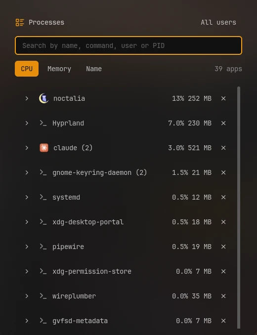
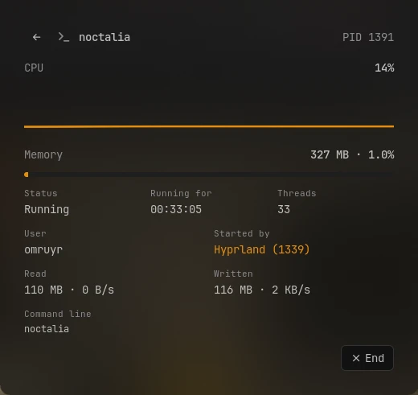

# Process Manager

Find a running app and end it, or force it to end when it does not stop. Apps are grouped
by name, with the CPU and memory they use right now.



## Plugin

| Field   | Value                                                    |
| ------- | -------------------------------------------------------- |
| ID      | `omerfuyar/process-manager`                              |
| Entries | Bar widget: `widget`; panel: `panel`; service: `service` |

## Requirements

| Command  | Needed   | What for                                                                                                      |
| -------- | -------- | ------------------------------------------------------------------------------------------------------------- |
| `kill`   | Required | Ends a process.                                                                                               |
| `pkexec` | Required | Ends another user's process, after asking for an administrator's password. Without it, those cannot be ended. |
| `sudo`   | Optional | Ends another user's process in a terminal, when **End as admin with** is set to it.                           |

## Usage

Add the **Process Manager** widget to the bar and click it.


- Search by name, command line, user or process ID, and sort by CPU, memory or name.
- Each row is an app. An app with more than one process shows how many and opens to them
  with a click; it shows its first 30, and search finds the others. An app with one process
  has no arrow.
- Click a process, or an app with one process, for its details: its CPU over the last
  minutes as a graph, memory, status, how long it has run, threads, owner, the process that
  started it, what it has read and written, and its whole command line. **Started by**
  opens that process's details, and ← goes back to the list.

  

- **✕** asks the app or process to end, so it can save and close. When it is still running
  3 seconds later, the skull, **Force end**, stops it at once, without saving.
- A process that belongs to another user, such as root, shows a shield, **End as admin**,
  which asks for a password.
- The list scrolls through every app.
- Only your own processes show, unless **All users** is on.
- A process waiting on a disk or device, or one that already ended and waits for its
  parent, says so: neither can be ended until that changes.

```sh
noctalia msg panel-toggle omerfuyar/process-manager:panel
```

## Settings

| Setting    | Type     | Default  | Description                                                                                                 |
| ---------- | -------- | -------- | ----------------------------------------------------------------------------------------------------------- |
| `interval` | `int`    | `2000`   | How often the list updates while the panel is open, in milliseconds, from 250 to 10000.                     |
| `admin`    | `select` | `pkexec` | Advanced. How to end another user's process: `pkexec`, which needs a polkit agent, or `sudo` in a terminal. |

## Notes

- Processes are read only while the panel is open, from `/proc` and `ps`. Nothing is
  written to disk.
- What a process reads and writes shows only for your own processes: the kernel shows it
  only to the owner and administrators.
- CPU is the use since the last read, where 100% is one core, as `top` shows it.
- System totals are not shown here: Noctalia's system monitor shows them.
