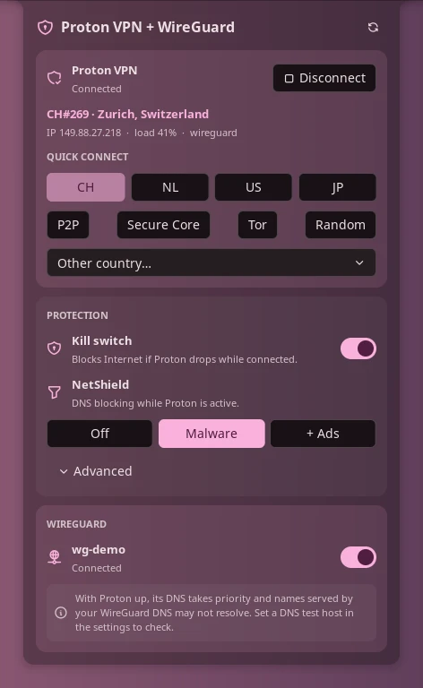

# Proton VPN + WireGuard

Control Proton VPN and your NetworkManager WireGuard tunnels from the bar, a
panel and the control center: connect, switch country, toggle the kill switch
and NetShield, and bring WireGuard tunnels up or down.

> **Control only.** This plugin switches things on and off and shows their
> state. Setup stays in the CLI: WireGuard tunnels and peers are configured
> with `nmcli` (or `nm-connection-editor`), and Proton VPN with the official
> `protonvpn` CLI.



## Plugin

| Field | Value |
| --- | --- |
| ID | `gitgxldf1sh/proton-wireguard` |
| Entries | Bar widget: `bar`; panel: `panel`; service: `service`; shortcut: `proton` |

## Requirements

You can use either half on its own. The panel only shows what is configured
and tells you which half is missing.

- **Proton VPN:** `proton-vpn-cli` 1.0.5 or newer, with `proton.VPN.service`
  running and a signed-in account. Tested with CLI 1.0.5.
- **WireGuard:** NetworkManager's `nmcli`. Only connections managed by
  NetworkManager are listed; tunnels started with `wg-quick` are not.
- `getent` (glibc) for the optional DNS check, and `bash` for the sign-in
  helper. Both are present on virtually every system.

Setting things up happens outside the plugin:

```sh
# Proton VPN (Arch-based example)
sudo pacman -S proton-vpn-cli
protonvpn signin <user>

# WireGuard: import an existing .conf into NetworkManager
nmcli connection import type wireguard file wg0.conf
nmcli connection modify wg0 connection.autoconnect no   # optional
```

## Usage

Add the **Proton VPN + WireGuard** widget to a bar from Settings → Bar. It
shows a shield (highlighted while Proton is up) and a network glyph while any
WireGuard tunnel is up.

- **Left click** opens the panel.
- **Right click** connects Proton to the fastest server, or disconnects it.

The panel can also be toggled with:

```sh
noctalia msg panel-toggle gitgxldf1sh/proton-wireguard:panel
```

The panel shows, depending on what is configured:

- **Proton VPN:** connect/disconnect, server, location, IP, load and protocol,
  favourite-country buttons and a list of every other country.
- **Protection:** kill switch and NetShield (off, malware, malware + ads).
- **WireGuard:** one toggle per NetworkManager WireGuard connection, found
  automatically.
- A "not set up yet" notice for whichever half is missing, or a single
  "control only" note when neither is.

The **`proton`** shortcut connects Proton (fastest) or disconnects it. Add it
in Settings → Control Center → Shortcuts.

## Settings

| Setting | Type | Default | Description |
| --- | --- | --- | --- |
| `favorite_countries` | `string_list` | `["CH", "NL", "US"]` | Two-letter country codes shown as quick-connect buttons. |
| `hidden_connections` | `string_list` | `[]` | NetworkManager connection names to leave out of the panel. |
| `dns_check_host` | `string` | `""` | A name only your WireGuard DNS resolves (e.g. `nas.lan`). When Proton and a WireGuard tunnel are both up, Proton's DNS usually takes priority; the panel warns if this name stops resolving. Empty disables the check. |
| `show_server` | `bool` | `false` | Shows the Proton server (e.g. `CH#120`) next to the bar icon. |
| `notify` | `bool` | `true` | Notify on connect and when Proton drops without being asked to. |

## IPC

```sh
noctalia msg plugin gitgxldf1sh/proton-wireguard:service all toggle-proton [CC]
noctalia msg plugin gitgxldf1sh/proton-wireguard:service all connect [CC]
noctalia msg plugin gitgxldf1sh/proton-wireguard:service all disconnect
noctalia msg plugin gitgxldf1sh/proton-wireguard:service all toggle-wg <name|uuid>
noctalia msg plugin gitgxldf1sh/proton-wireguard:service all wg-up <name|uuid>
noctalia msg plugin gitgxldf1sh/proton-wireguard:service all wg-down <name|uuid>
noctalia msg plugin gitgxldf1sh/proton-wireguard:service all refresh
```

`CC` is an optional two-letter country code (`connect CH`); without it Proton
connects to the fastest server. `<name|uuid>` is a NetworkManager connection
name or UUID.

## Notes

- **What it does not do:** it never creates, edits or deletes WireGuard
  connections, peers, keys, endpoints or `AllowedIPs`, and it does not manage
  your Proton account. **Sign in** opens `protonvpn signin` in a terminal, so
  your password and 2FA go straight to the official CLI.
- **Processes spawned**, always with arguments passed directly (no shell):
  - `protonvpn info | status | config list | countries list | connect | disconnect | config set kill-switch|netshield`
  - `nmcli -t -f NAME,UUID,TYPE,DEVICE,STATE connection show` and
    `nmcli connection up|down uuid <uuid>`
  - `getent hosts <dns_check_host>`, only when that setting is set
  - `bash signin.sh` in a terminal, only when you press **Sign in**
- **Files:** it reads `/sys/class/net/proton0` to detect the tunnel. It writes
  no files and makes no network requests of its own.
- **Privileges:** no `sudo`/`pkexec`. Bringing a NetworkManager connection up
  uses NetworkManager's normal polkit rules for your session.
- **Detection:** Proton counts as connected only while the `proton0`
  interface exists. Proton's own NetworkManager profiles (`ProtonVPN …`) are
  excluded from the WireGuard list, so the two are never confused.
- **Polling:** the tunnel interface every second, the WireGuard list every 3 s,
  Proton status every 15 s while connected, Proton settings every 60 s.
- The plugin parses the English output of the Proton CLI. A future CLI that
  changes its output format may need a plugin update.

## License

[MIT](LICENSE)
