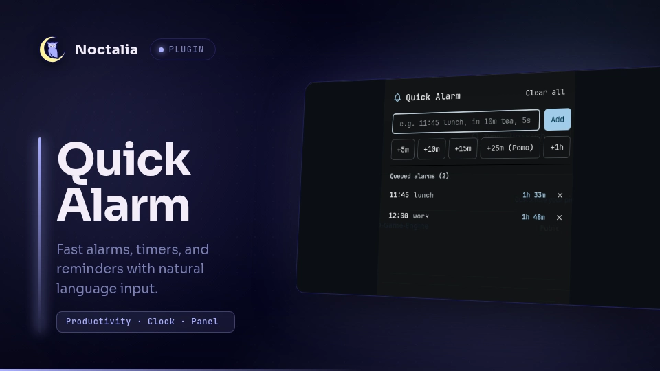

# Quick Alarm

Quick Alarm allows you to quickly set multiple alarms, timers, and reminders using flexible natural language input, matching the behavior and syntax of the popular Cinnamon Quick Alarm applet.



## Plugin

| Field | Value |
| --- | --- |
| ID | `rsmendes/quick-alarm` |
| Entries | Bar widget: `bar`; panel: `panel`, `alert`; service: `service` |

## Usage

Click the bell icon on the status bar to toggle the main alarm manager panel, or use the panel IPC command:

```sh
noctalia msg panel-toggle rsmendes/quick-alarm:panel
```

When an alarm triggers, sound plays and a modal alert dialog appears with snooze and dismiss buttons. You can also toggle the alert panel manually via IPC:

```sh
noctalia msg panel-toggle rsmendes/quick-alarm:alert
```

### Supported Time Formats

Type natural language specifications in the input box:

- **Specific time today or tomorrow**: `11:45`, `11:45 lunch`, `11.45`, `14:30 meeting`, `11am standup`, `tomorrow 09:00 - coffee`. If the time has already passed today, it automatically schedules for tomorrow.
- **Relative countdown**: `in 10m tea`, `after 5m - stretch`, `45s`, `5 seconds`, `1h 30m`, `25m Pomodoro`.
- **Quick presets**: click any preset button (`+5m`, `+10m`, `+15m`, `+25m (Pomo)`, `+1h`) to add a timer instantly.

## IPC

Send events directly to the background service from terminal scripts or keybindings:

```sh
# Add an alarm or timer
noctalia msg plugin rsmendes/quick-alarm:service all add "10m tea"

# Dismiss currently ringing alarm
noctalia msg plugin rsmendes/quick-alarm:service all dismiss

# Clear all alarms
noctalia msg plugin rsmendes/quick-alarm:service all clear
```

## Notes

- Alarms persist and tick live every second in the background service.
- The completion alert plays a sound and can be dismissed with `Esc`, `Enter`, `Space`, or by clicking the notification banner.
- Detects missed alarms automatically if the system was suspended when an alarm was due.
