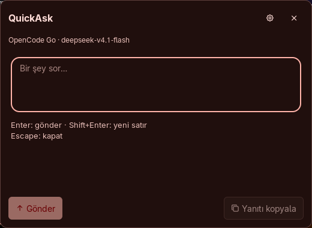

# QuickAsk

A keyboard-first Noctalia popup for streaming text answers from OpenCode Go or an OpenAI-compatible API.

## Plugin

Plugin ID: `yusuferdemyamali/quickask`. Floating panel entry: `panel`.

A minimal, keyboard-first text popup for Noctalia v5. Ask one question, read a streaming Markdown answer, then close it. QuickAsk supports OpenCode Go and explicitly configured OpenAI-compatible Chat Completions APIs.



The panel opens at the bottom center (520 × 380), follows your Noctalia theme, and focuses the input. It has no saved conversation history, uploads, audio, agents or background service.

## Requirements

- Noctalia Plugin API **24 or newer**, with a working Wayland desktop.
- `secret-tool` (Arch/CachyOS package: `libsecret`) and an unlocked Linux Secret Service keyring, such as GNOME Keyring or KeePassXC with Secret Service enabled.
- An account and API key authorized for your chosen endpoint, model and use case; network access to that endpoint.
- For compatible mode: an **HTTPS Chat Completions** endpoint that accepts Bearer authentication, `system`/`user` messages and streams `choices[].delta.content` as SSE followed by `data: [DONE]`. This is not a guarantee that every provider or model works. Responses-only models, tool calls, local HTTP endpoints, custom authentication and extra request parameters are unsupported.

**OpenCode Go requirements:** Go is a subscription service with documented coding-agent traffic requirements, model availability, region restrictions and usage limits. QuickAsk is a standalone text client. General-chat permission has not been established by this project. Verify that your intended usage is permitted before sending a request; if it is not, do not use Go with QuickAsk. Community catalog hosting does not imply OpenCode approval or permission. See [OpenCode Go](https://opencode.ai/docs/go/) and your account terms. Go uses `deepseek-v4.1-flash`, with non-reasoning requested by `thinking.type = "disabled"`; current model access may require Privacy → Regions → Global. QuickAsk never changes account settings or imitates another client.

For OpenAI or another compatible service, use that service's API credentials, terms, model permissions and billing. A Go subscription key is not an OpenAI API key. OpenAI's Chat Completions reference is [here](https://developers.openai.com/api/reference/resources/chat).

## Usage

1. Install **QuickAsk** from the Noctalia plugin catalog and enable it in **Settings → Plugins**. For a source checkout, run `noctalia plugins install ./quickask`, then `noctalia msg plugins enable local/quickask`; local installs use `local/quickask` in all commands below.
2. Open QuickAsk's **Settings** button, or run `noctalia msg settings-open-plugin yusuferdemyamali/quickask`. Select **OpenCode Go** or **OpenAI compatible**. Compatible mode requires a full endpoint URL and an exact model ID that your account can use. OpenAI's URL is `https://api.openai.com/v1/chat/completions`; no model is selected automatically.
3. Store the matching key interactively in your own terminal. Never put a key in Noctalia settings, a command argument, a URL or a chat message.

For **OpenCode Go**, existing credentials continue to work:

```sh
secret-tool store --label='QuickAsk OpenCode Go' application quickask provider opencode-go
```

For **OpenAI compatible**, the `endpoint` attribute must match the **complete URL in Settings exactly** (including case, port and path). For OpenAI:

```sh
secret-tool store --label='QuickAsk OpenAI API' application quickask provider openai-compatible endpoint https://api.openai.com/v1/chat/completions
```

For another compatible service, use its authorized HTTPS Chat Completions URL in both Settings and the command. `secret-tool` prompts for the secret; enter your key there. A changed endpoint requires a separately stored key. QuickAsk never falls back to a Go key or another provider. The keyring must already be unlocked. Do not run `secret-tool lookup` in a recorded terminal; it prints the key.

4. Open the panel using the IPC command or shortcut below. Its status line shows the selected service and model. An invalid configuration disables Send and links you to Settings through the gear button.
5. **Enter** sends, **Shift+Enter** inserts a newline, **Escape** or an outside click closes the panel. Use **Stop** to cancel and preserve received text, **Copy** for the plain Markdown answer, and **Retry** to repeat a failed question manually. Opening Settings cancels the current request and clears that panel session. To change providers for a new question, close and reopen the panel.

Removing a stored key is optional and does not change the selected provider:

```sh
secret-tool clear application quickask provider opencode-go
secret-tool clear application quickask provider openai-compatible endpoint https://api.openai.com/v1/chat/completions
```

## Settings

| Key | Default | Description |
| --- | --- | --- |
| `provider` | `opencode-go` | `opencode-go` or `openai-compatible`. Selection is explicit; no automatic fallback. |
| `endpoint` | `https://api.openai.com/v1/chat/completions` | Compatible mode only. Full HTTPS URL ending in `/chat/completions`; no embedded credentials, query or fragment. Keys are bound to this exact URL. |
| `model` | empty | Compatible mode only. Set the exact text model ID supported by the endpoint. |

OpenCode Go retains its preset endpoint and model. Settings contain no secrets. The minimum API stays at 24: settings and `openSettings()` predate the existing argv subprocess API requirement.

## IPC

Catalog installation:

```sh
noctalia msg panel-toggle yusuferdemyamali/quickask:panel
noctalia msg settings-open-plugin yusuferdemyamali/quickask
```

Hyprland Lua example for `~/.config/hypr/hyprland.lua` (check the shortcut is available before adding it):

```lua
hl.bind("SUPER + A", hl.dsp.exec_cmd("noctalia msg panel-toggle yusuferdemyamali/quickask:panel"))
```

For local source installations, substitute `local/quickask:panel` and `local/quickask` respectively. QuickAsk does not modify compositor configuration.

## Notes

- **Network:** Only the explicitly selected HTTPS endpoint receives a POST. Common JSON fields are `model`, `messages` and `stream`. The Go preset additionally sends `thinking.type = "disabled"` and its required per-question `x-opencode-session`; compatible mode sends neither. A QuickAsk User-Agent identifies the client. TLS verification is enabled and redirects are disabled. There is no background traffic or automatic retry.
- **Credentials and subprocesses:** Only `secret-tool lookup` runs, through native argv execution without a shell. Attributes are `application=quickask, provider=opencode-go` or `application=quickask, provider=openai-compatible, endpoint=<exact URL>`. Keys stay in memory for request setup and are not logged or saved. Raw service errors and credential subprocess output are never displayed. Prompts and model responses are sent to your chosen service under its data policy; clipboard writes happen only on Copy.
- **Filesystem:** Runtime reads its shipped Luau modules/translations and declared host settings. It writes no chat or credential files. Noctalia persists non-secret plugin settings; the user's keyring persists credentials.
- **Failures:** Credential, HTTP, SSE, cancellation and timeout errors are shown safely. Partial output is preserved when possible. The displayed connection is captured when the panel opens and retained for submission/retry; reopen after changing settings. Timeout is 45 seconds idle / 180 seconds total; response text is capped at 256 KiB. No provider fallback, bypass or alternative transport is attempted.
- **Validation:** Production-source mock tests, Luau compilation and Noctalia lint cover both connection modes. Compatible-provider live inference requires separate account permission and has not been exercised for this update; mocks do not establish provider compatibility or permitted use.
- **Maintenance:** If a provider disallows this usage, update or disable that connection. Users must meet provider requirements; catalog inclusion supplies no provider endorsement.
- **Troubleshooting and rollback:** For 401, check the key for the exact selected URL; for 403, check model access and permitted usage; for 429, wait and check billing/quota. Missing-key errors require an unlocked keyring and the exact attributes above. To roll back, disable QuickAsk, restore the previously installed plugin directory/version, then enable it again. To remove it, disable/uninstall it in Noctalia and optionally clear its keyring entries using the commands above.

Development checks (Luau CLI is a development tool only):

```sh
noctalia plugins lint ./quickask
python3 quickask/tests/run.py --runtime /path/to/luau
luau-compile --null quickask/panel.luau quickask/lib/api.luau quickask/lib/credentials.luau quickask/lib/config.luau
```

MIT licensed. The test-only JSON codec retains its upstream MIT notice in `tests/vendor/LICENSE`.
