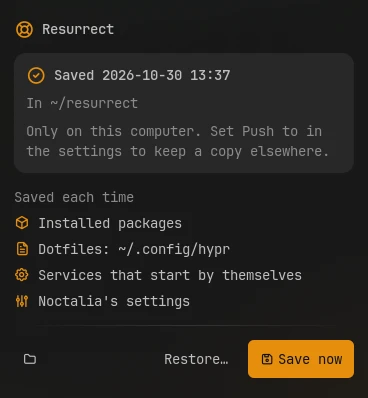

# Resurrect

Save your system's setup to a git repository: the packages you installed, your dotfiles,
the services that start by themselves and Noctalia's settings. Share the dotfiles between
your devices, and on a new install, bring it all back with one script.



## Plugin

| Field   | Value                                                    |
| ------- | -------------------------------------------------------- |
| ID      | `omerfuyar/resurrect`                                    |
| Entries | Bar widget: `widget`; panel: `panel`; service: `service` |

## Requirements

| Command                                                     | Needed                     | What for                                                                                                                                                                                                                                                                                                                                                    |
| ----------------------------------------------------------- | -------------------------- | ----------------------------------------------------------------------------------------------------------------------------------------------------------------------------------------------------------------------------------------------------------------------------------------------------------------------------------------------------------- |
| `git`                                                       | Required                   | Keeps each save as a commit, and pushes it when a remote is set. Without it, the panel says so.                                                                                                                                                                                                                                                             |
| `sh`                                                        | Required                   | Runs git's network commands in the background, as a push can take longer than a minute, and the restore, review and install scripts in a terminal, and the script that lists what changed for Review.                                                                                                                                                                                                 |
| `env`, `find`, `chmod`, `grep`, `sed`, `xargs`, `sha256sum` | Required                   | Run your own save steps, keep which saved files are executable, remove links from the repository, leave out the packages `packages/exclude.txt` matches, read the lists in the scripts, and tell whether a save step changed since you approved it. They come with every Linux system, as do the coreutils the scripts use, such as `cp`, `sort` and `fmt`. |
| `noctalia`                                                  | Required                   | Lists the Noctalia plugins that are on, reloads the settings after taking them, and turns the plugins on when restoring.                                                                                                                                                                                                                                    |
| `systemctl`                                                 | Required                   | Lists and restores the services that start by themselves. Without it, services are not saved.                                                                                                                                                                                                                                                               |
| `sudo`                                                      | Required to restore        | Installs packages and turns on system services in the restore and install scripts.                                                                                                                                                                                                                                                                          |
| `xdg-open`                                                  | Required                   | Opens the repository folder. Without it, that button is hidden.                                                                                                                                                                                                                                                                                             |
| `pacman`, `apt-mark` or `dnf`                               | Required                   | Lists the installed packages, with the system's package manager (and `dpkg-query` or `rpm`), and installs them (with `apt-get` on apt systems). Without one, no packages are saved.                                                                                                                                                                         |
| `flatpak`                                                   | Optional                   | Lists the installed Flatpak apps too. Without it, none are saved.                                                                                                                                                                                                                                                                                           |
| `paru` or `yay`                                             | Required with AUR packages | Restores AUR packages. Without them, the AUR list stays in `packages/aur.txt`.                                                                                                                                                                                                                                                                              |
| `gitleaks`                                                  | Optional                   | Checks each save for passwords, tokens and keys before it is committed, except Noctalia's config and settings. Without it, saves are not checked.                                                                                                                                                                                                           |
| `hyprctl`                                                   | Required on Hyprland       | Checks Hyprland's config after shared files come in. Without it, they are not checked.                                                                                                                                                                                                                                                                      |

## Usage

Add the **Resurrect** widget to the bar. The setup is saved once a day, and when you
press **Save now** in the panel.


- The panel shows when the setup was last saved, where, and how many packages, services,
  Noctalia plugins, dotfiles and steps of your own the last save held.
- Choose the dotfiles in the settings. The default, `~/.config`, saves your whole config
  folder; list files elsewhere, such as `~/.icons/default/index.theme`, beside it. Links
  are followed, here and in Noctalia's config, so files kept elsewhere, as with GNU Stow,
  are saved themselves.
- Inside a folder, a save leaves out what is not settings: caches, logs and crash reports,
  the data of browsers and Electron apps such as Brave or VS Code, nested git folders,
  binary files and files over 1 MB. A file you list by name is always saved, such as
  `~/.config/Code/User/settings.json`.
- List what else to skip in **Leave out**, such as `~/.config/gh/hosts.yml`, which holds
  a token, or `~/.config/kdeconnect`, which holds this device's key.
- When the dotfiles still add up to more than 50 MB, or a file cannot be read, nothing is
  saved, and the panel names the folder.
- To keep a copy off this device, set **Push to** to a private git repository.
- **Restore…** opens a terminal that asks before each step. It runs the plugin's own
  restore script. The repository holds no script, as its remote could change it.

On a new install, first install Noctalia and Resurrect, from Noctalia's plugin list. Then
clone the repository into Resurrect's **Folder**, `~/resurrect` by default, and press
**Restore…** in the panel:

```sh
git clone -c core.symlinks=false <your repository> ~/resurrect
```

The script installs the saved packages, puts back the dotfiles and Noctalia's settings,
turns on the saved Noctalia plugins and services, and runs your own steps. Before each
question, it lists the packages, plugins or services it would install or turn on. With
sharing on, it brings back what your devices share, with what this device keeps for itself when it has
a folder there. Without sharing, it asks which device's save to use when there is no save
of this device. It asks before each step, and copies any file it would replace to
`~/.local/state/resurrect/backup-<date>` first. A file it cannot copy there is left as it
is, and the script lists it at the end. It puts back files only, never links, and nothing
that leads into Resurrect's data folder. A repository with a link where Resurrect saves is
not restored at all, as Resurrect never saves one. A file this device keeps for itself
replaces the shared one, and the backup keeps the file as it was before the restore. Before
each of your restore steps, it shows the step's code. Noctalia's settings are put in place
once Noctalia runs with Resurrect on. The settings each device keeps as its own, listed in
the next section, stay as they are on this device: set them again there.

```sh
noctalia msg panel-toggle omerfuyar/resurrect:panel
```

### Sharing between devices

With **Share between devices** on, as it is by default, devices that push to the same
repository share their setup. Each save, and each start of Noctalia, also checks what the
other devices changed. Nothing from them comes in until you take it:

- A dotfile that only another device changed, or deleted, waits in the panel's
  **Changes from your other devices** card, when it is in this device's **Files**. You take
  it in **Review**, which shows, in the panel, what changed in each waiting file and in the
  settings. **Take theirs**, or **Take all**, puts in place the version Review shows, with
  the next save. When another device changes it again while Review is open, Review shows the
  new version instead, and a choice made on the old one is dropped. **Keep mine** shares this
  device's version instead. The file it replaces goes to
  `~/.local/state/resurrect/backup-<date>` first. When that copy fails, the save stops
  before replacing the file, and the panel shows why.
- A dotfile that only this device changed reaches the others, where it waits the same way.
  When a device deletes more than half of the shared files at once, the others keep theirs
  and share them again.
- A dotfile changed on two devices is left as it is on both. The panel lists it, and Review
  shows it with **Keep mine** and **Take theirs**; **Take all** leaves it out.
- When files that came in give Hyprland config errors, they go back, and the panel lists
  them as held back until another device changes them again.

List the files that differ by hardware in **Only this device**, such as a monitor layout or
GPU variables. They are saved, but not shared.

Noctalia's config folder is shared like the dotfiles. Settings changed in Noctalia's settings
window are shared one setting at a time, but only those of the look and the layout:
accessibility, audio, backdrop, bar, calendar, control center, desktop and lock screen
widgets, dock, lock screen, night light, notifications, on-screen display, the enabled
plugins, shell, theme, wallpaper, weather and widgets. Settings only another device changed
wait in the same card, together, and are taken the same way: **Take theirs** puts in place
the settings **Review** shows, **Keep mine** shares this device's instead. When
two devices changed one, each keeps its own. A setting shared for the first time takes the
value of the device that shared it first. Plugins turned on or off on one device are turned
on or off on the others once you take the settings. Brightness, battery and widgets placed
on a monitor stay on each device. Each device also keeps these as its own, never taken from
another device or restored from the repository, so none of them adds code to run here:
every other setting, such as hooks, keybinds, idle, hot corners, other plugins' settings
and the plugin sources; and, inside the shared ones, the session actions and power
commands, the screenshot command, the launcher's commands, the greeter sync, theme
templates, calendar accounts, the avatar, and each bar, widget or desktop button action or
command. Resurrect's own settings stay too, so none changes where saves go or what they
hold. Resurrect's data folder, with the steps you approved, is never shared, and a
save writes nothing into it, not even through a link. Nor does a save write through a link
in the repository: git writes the remote's links as plain files, a link already in
`shared/`, `devices/`, `hooks/` or `packages/` is removed before the save writes anything,
and a file whose path holds `..` or `.git` is left out.

The devices also share one list of packages and one of services:

- A package installed, or a service turned on, on one device joins the list. The other
  devices' panels list it; **Install…** opens a terminal that installs the packages and
  turns on the services. **Not here** leaves one off this device, in
  `devices/<name>/exclude.txt`; **Leave all out** does it for the whole list.
- One uninstalled or turned off on one device leaves the list. A device that still has it
  does not put it back by itself: its panel lists it, with **Share again**, and **Only
  here**, which keeps it on this device alone, in `devices/<name>/extra.txt`.
- A package that is only a dependency here still counts as installed.

### The repository

With sharing on:

| Path                            | What it holds                                                                                                   |
| ------------------------------- | --------------------------------------------------------------------------------------------------------------- |
| `shared/files/`                 | The dotfiles and Noctalia's config folder, at their place under the home folder.                                |
| `shared/noctalia/settings.toml` | Noctalia's settings, without the ones tied to a device's hardware.                                              |
| `shared/packages/<list>.txt`    | The packages of each package manager: `pacman`, `aur`, `apt`, `dnf` and `flatpak`.                              |
| `shared/services/<list>.txt`    | The services that start by themselves: `system` and `user`.                                                     |
| `shared/steps/`                 | What your shared steps save.                                                                                    |
| `devices/<name>/settings.toml`  | The settings of the device with that hostname that stay on it: brightness, monitors, **Only this device**.      |
| `devices/<name>/files/`         | Its files from **Only this device**.                                                                            |
| `devices/<name>/exclude.txt`    | Shared packages and services it leaves out, one name per line. The panel's **Not here** adds to it.             |
| `devices/<name>/extra.txt`      | Packages and services it keeps only for itself, as `<list> <name>` lines. The panel's **Only here** adds to it. |
| `devices/<name>/hooks/`         | Yours. Its own steps, in `save/` and `restore/`.                                                                |

Without sharing, `devices/<name>/` holds everything a device saves: its packages, services,
files and Noctalia's config, settings and plugins.

Either way:

| Path                   | What it holds                                                                                                                                  |
| ---------------------- | ---------------------------------------------------------------------------------------------------------------------------------------------- |
| `packages/exclude.txt` | Optional, yours. Package names left out of every save: one regular expression per line, for the whole name, such as `linux.*` or `.*nvidia.*`. |
| `packages/extra.txt`   | Optional, yours. Packages installed on restore besides the saved ones, one per line, such as ones pacman counts as dependencies.               |
| `hooks/`               | Yours. The steps every device runs, in `save/` and `restore/`.                                                                                 |

Anything else in the repository is yours too. A save writes, and commits, only `shared/` and
the files it names in `devices/<name>/` of the device it runs on; changes you make
elsewhere, such as in `hooks/`, are yours to commit. While a file git tracks has changes
that are not committed, saves are kept on this device and not pushed, and the panel says so;
Resurrect never stashes or rebases over them. It removes the `restore.sh` that older
versions wrote, and moves to this layout a repository from an older version.

### Secrets

Noctalia's config and settings are saved whole, with any tokens and keys they hold, such as a
plugin's API key. So push only to a private repository.

When `gitleaks` is installed, the rest of each save is checked before it is committed. If
something looks like a password, token or key, nothing is committed, and the panel names the
file. Take the file out of the dotfiles, or allow the finding in a `.gitleaksignore` file in
Resurrect's data folder, `~/.local/state/noctalia/plugins/data/omerfuyar/resurrect/`, which
stays on this device. A `.gitleaksignore` in the repository is not read, as the remote could
fill it: it is moved aside during the check. Turn off **Check saves for secrets** in the advanced settings to commit
saves without the check.

### Your own steps

Put an executable script in `hooks/save/` to run it on every save, and one in
`hooks/restore/` to offer it on restore. Every device runs these. Steps for one device only
go in `devices/<name>/hooks/save/` and `devices/<name>/hooks/restore/`, and run after the
others. They run in name order, from the repository's folder, with these variables:

| Variable           | Value                                                                                                                     |
| ------------------ | ------------------------------------------------------------------------------------------------------------------------- |
| `RESURRECT_REPO`   | The repository's folder.                                                                                                  |
| `RESURRECT_DEVICE` | The hostname of the device whose save it is.                                                                              |
| `RESURRECT_DIR`    | The folder for the step's files: `shared/steps/` for a step every device runs, with sharing on; else the device's folder. |

A save step runs only once you approve it on this device, and again each time it changes,
so a step that came from the remote never runs unseen. The panel shows how many steps wait;
**Review** opens a terminal that shows each one's code and asks. Approvals are kept in the
plugin's data folder, outside the repository, so each device approves for itself.

Whatever a save step writes into `RESURRECT_DIR` is committed with the save. A save step
that fails stops the save, and the panel shows it. For example, to also save a database:

```sh
#!/bin/sh
# hooks/save/20-notes
cp ~/.local/share/notes/notes.db "$RESURRECT_DIR/notes.db"
```

```sh
#!/bin/sh
# hooks/restore/20-notes
mkdir -p ~/.local/share/notes
cp "$RESURRECT_DIR/notes.db" ~/.local/share/notes/notes.db
```

The panel's hooks button opens the folder and creates it when it is missing.

## Settings

| Setting        | Type          | Default         | Description                                                                                              |
| -------------- | ------------- | --------------- | -------------------------------------------------------------------------------------------------------- |
| `folder`       | `folder`      | `~/resurrect`   | The git repository the setup is saved in. It is created when missing.                                    |
| `remote`       | `string`      | `""`            | A git remote to push each save to. Empty keeps the saves on this device.                                 |
| `files`        | `string_list` | `["~/.config"]` | Files and folders in the home folder to save.                                                            |
| `leave_out`    | `string_list` | `[]`            | Files and folders inside the dotfiles not to save.                                                       |
| `share`        | `bool`        | `true`          | Share the dotfiles with the other devices that push to the same remote.                                  |
| `device_files` | `string_list` | `[]`            | Shown when `share` is on. Files and folders saved but kept on this device.                               |
| `daily`        | `bool`        | `true`          | Save once a day while Noctalia runs.                                                                     |
| `packages`     | `bool`        | `true`          | Advanced. Save the list of installed packages.                                                           |
| `services`     | `bool`        | `true`          | Advanced. Save which services start by themselves.                                                       |
| `noctalia`     | `bool`        | `true`          | Advanced. Save Noctalia's config and settings.                                                           |
| `secret_check` | `bool`        | `true`          | Advanced. Check each save with `gitleaks` before it is committed, except Noctalia's config and settings. |

## IPC

Save now:

```sh
noctalia msg plugin omerfuyar/resurrect:service all save
```

## Notes

- Do not add files with passwords, tokens or keys to the dotfiles when the repository
  is pushed, and push only to a private repository.
- Only packages installed on purpose are saved, not their dependencies.
- Each save is a git commit, so older setups stay in the repository's history.
- With **Push to** set, a device without the repository folder clones it on its first
  save, so all devices share one history.
- Several devices can push to one repository: before pushing, a save is put on top of the
  other devices' saves. A file both changed, such as a step in `hooks/`, keeps the version
  of the device that saves last.
