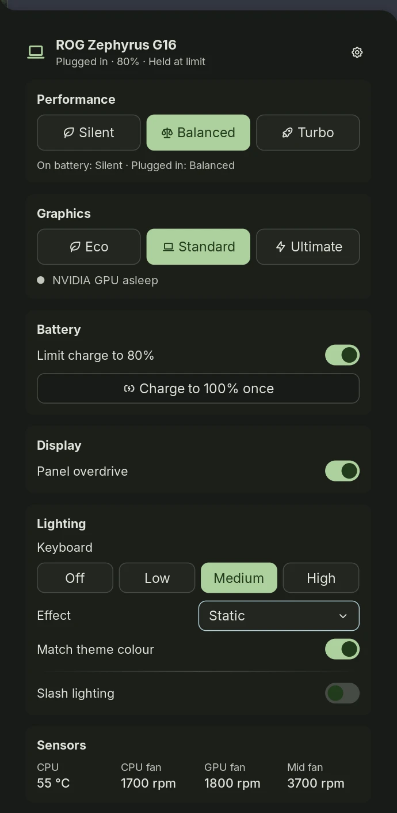

# ROG Control

Performance modes, battery charge limit, graphics mode, panel overdrive, fans and keyboard lighting for ASUS ROG laptops, in the bar and a panel. It is a thin front end for `asusd` (from asusctl) that reacts to the daemon's own change events instead of polling.



## Plugin

| Field | Value |
| --- | --- |
| ID | `genuinemoron/rog-control` |
| Entries | Bar widget: `bar`; panel: `panel`; shortcut: `mode`; service: `service` |

## Requirements

- An ASUS laptop supported by asusctl, with `asusd` running: install `asusctl` and enable `asusd.service`.
- `busctl` (systemd) and `gdbus` (glib2) on `PATH`.
- Optional: `supergfxd` (supergfxctl) for switching the graphics mode. Without it, the panel shows the current mode without switching, because a safe switch has to unload the NVIDIA driver first.
- Optional: UPower 1.90 or newer with charge-threshold support, for the charge limit.

Each section only appears when the hardware and daemons report it, so a laptop without Slash lighting or panel overdrive simply doesn't show those controls.

## Usage

Add the **ROG Control** bar widget in Settings → Bar. It shows the current performance mode as one icon: a leaf for Silent, a scale for Balanced, a rocket for Turbo.

- **Hover:** shows the mode, graphics mode and charge limit.
- **Click:** opens the panel.
- **One scroll flick:** steps to the next or previous mode.

Open the panel from the widget, or with:

```sh
noctalia msg panel-toggle genuinemoron/rog-control:panel
```

The panel has these sections:

- **Performance:** Silent, Balanced or Turbo. The choice also becomes the default for the power source you are on (charger or battery), and asusd switches between the two defaults by itself, as Armoury Crate does.
- **Graphics:** Eco, Standard or Ultimate. When a switch needs you to log out or restart, a banner offers that and a Cancel. A status line says whether the NVIDIA GPU is asleep.
- **Battery:** **Limit charge to N%**, and **Charge to 100% once** while the limit is on. The limit is UPower's, the same one Noctalia's Control Center Power tab shows, so both stay in sync.
- **Display:** **Panel overdrive**.
- **Lighting:**
  - keyboard brightness and effect;
  - **Match theme colour**, which tints the keyboard with the current theme accent and follows wallpaper-driven themes; turn it off to pick a colour;
  - **Slash lighting** and its animation, on laptops that have it.
- **Sensors:** CPU temperature and fan speeds, read while the panel is open.

Add the **mode** shortcut in Settings → Control Center. Clicking it steps to the next mode; right-clicking opens the panel.

When the mode changes from anywhere, including the laptop's ROG key, the shell's on-screen display shows the new mode.

## Settings

| Setting | Type | Default | Description |
| --- | --- | --- | --- |
| `show_osd` | `bool` | `true` | Show the new mode in the on-screen display whenever it changes. |
| `show_label` (bar widget) | `bool` | `false` | Show the mode name next to the icon on horizontal bars. |
| `scroll_changes_mode` (bar widget) | `bool` | `true` | One scroll flick over the icon steps the mode. |

The charge-limit percentage is UPower's configured limit (udev hwdb `CHARGE_LIMIT`, 80% by default), not a plugin setting.

## IPC

```sh
noctalia msg plugin genuinemoron/rog-control:service all next-profile   # step to the next mode
noctalia msg plugin genuinemoron/rog-control:service all refresh        # re-read every daemon
```

`next-profile` is handy to bind to a key.

## Notes

- **Processes:**
  - One long-lived `gdbus monitor --system` per daemon (asusd; supergfxd if present; the UPower battery object, filtered to charge-threshold changes).
  - One `busctl --json=short` read when a daemon reports a change.
  - One `busctl set-property` or `call` per action you take.
  - `noctalia msg panel-toggle session` when you press Restart or Log out in the graphics banner.
- **Polling:** nothing polls the hardware. The panel reads hwmon fan speeds, the CPU package temperature, the NVIDIA GPU's `power/runtime_status`, battery capacity and status, and AC state from sysfs once a second while it is open, never otherwise. Reading `runtime_status` does not wake the GPU. The service ticks every 20 s to restart a dropped stream and to notice a theme colour change for the keyboard; neither spawns anything unless something changed.
- **Files written:** `prefs.json` in the plugin's data directory (`noctalia.pluginDataDir()`), holding the Match theme colour choice and your custom keyboard colour.
- **Network:** none.
- **Permissions:** asusd accepts property writes from local users. UPower's `enable-charging-limit` action is allowed for the active session by default. supergfxd mode changes follow its own policy.
- **Tested on:** ROG Zephyrus G16 GU605MI (2024), asusctl 6.5.0, supergfxctl 5.2, UPower 1.91, Noctalia 5.4.1 on Umbriel.
