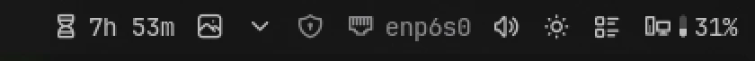

# Screen Time

Today's screen time in the bar, with your most used apps. Noctalia already records how long
you use each app, but shows it only in its control center; this widget keeps it in sight.

## Plugin

| Field   | Value                                    |
| ------- | ---------------------------------------- |
| ID      | `omerfuyar/screen-time`                  |
| Entries | Bar widget: `widget`; service: `service` |

## Requirements

None. The plugin reads the screen time Noctalia records.

## Usage

Add the **Screen Time** widget to the bar.

- It shows an hourglass and today's screen time, such as `3h 12m`. On a vertical bar it
  shows only the hourglass.
- Hover it to see today's total and your five most used apps.
- Click it to open Noctalia's control center at **Screen time**, with each hour and the
  last days. The click is the widget's left action, so you can bind it to something else in
  the widget's settings.
- The widget hides while Noctalia does not record screen time. Turn it on in Noctalia's
  settings, under **Shell**.

## Settings

| Setting     | Type   | Default | Description                                                                              |
| ----------- | ------ | ------- | ---------------------------------------------------------------------------------------- |
| `show_text` | `bool` | `true`  | Widget setting. Show today's screen time next to the hourglass.                          |
| `data_file` | `file` | `""`    | Advanced. The screen time file to read. Empty reads Noctalia's own, in its state folder. |

## Notes

- The time comes from `$XDG_STATE_HOME/noctalia/screen_time.json`
  (`~/.local/state/noctalia/screen_time.json` by default), read once a minute.
- A day is the local date, as Noctalia records it.
