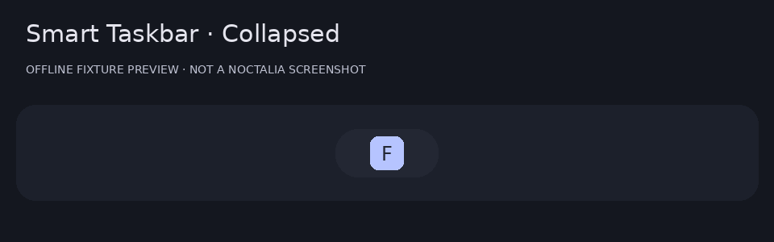
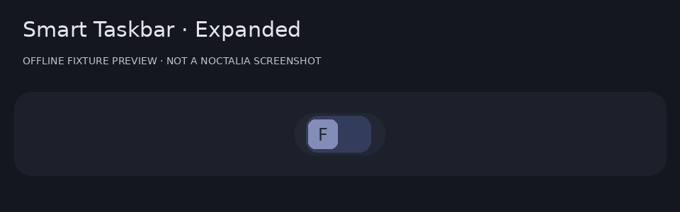
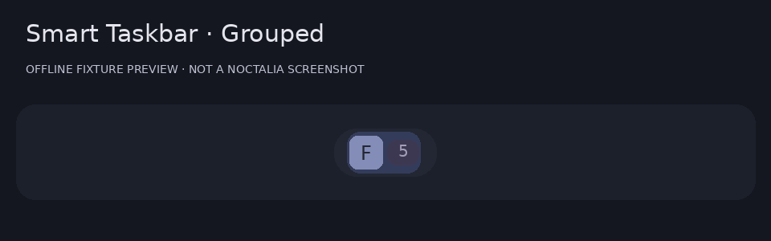
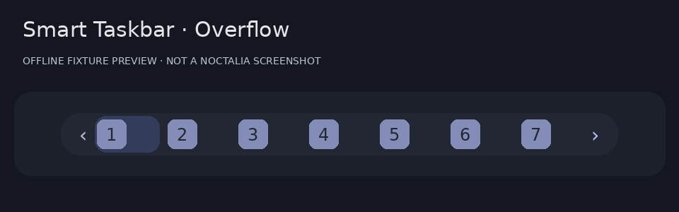

# Smart Taskbar

A compact, collapsible application switcher with grouped window counts, focused-application reveal, and a bounded wheel-navigable icon strip. Uses one Luau bar widget and Noctalia's active theme roles.

**Preview release:** requires **plugin API 54**, currently marked unreleased in the official documentation. This is not compatible with all Noctalia v5 versions. Desktop acceptance testing is pending; the images below are clearly labeled offline fixture renders, not live screenshots.

## Plugin

| Field | Value |
| --- | --- |
| ID | `omardardery/smart-taskbar` |
| Entries | Bar widget: `taskbar` |
| Full widget type | `omardardery/smart-taskbar:taskbar` |
| License | MIT |

## Requirements

- A Noctalia build supporting plugin API 54; Umbriel is the primary target.
- `niri` is required on PATH only when running under niri, for focus/close actions. Events use the host's native subscription, without subprocess polling.
- `gtk-launch` is required on PATH only to launch pinned desktop entries. On many distributions it is supplied by GTK's utilities package. Enter desktop-entry IDs with their original case.
- Hyprland, Sway, Mango, labwc, and KDE currently show a placeholder. They do not receive guessed or unverified actions.

## Usage

Add the custom Git source and enable the plugin:

```sh
noctalia msg plugins source add smart-taskbar git https://github.com/OmarDardery/smart-taskbar-noctalia
noctalia msg plugins enable omardardery/smart-taskbar
```

In Settings → Bar, add the plugin widget **Smart Taskbar / taskbar** to the desired bar lane. Remove the existing taskbar from that lane and disable the dock in your own configuration if desired.

For a hand-written configuration, declare a named instance and add `smart_taskbar` to your existing bar's `start`, `center`, or `end` list:

```toml
[widget.smart_taskbar]
type = "omardardery/smart-taskbar:taskbar"
capsule = false
capsule_padding = 0
scale = 1.0
max_width = 420
collapsed_width = 64
```

The maximum applies to the plugin's rendered main-axis content extent, **including its own padding and arrows**. For the same outer limit, use the host settings above, no custom label, and no capsule group padding. The owning bar’s scale and host widget scale multiply the extent; use both at 1.0 for the stated budget. output DPI scaling does not change logical pixels. On side bars the main-axis budget limits height. The root is clipped in both orientations. Oversized icons under exceptionally small budgets are clipped instead of growing the root.

Hover the capsule to expand; leaving it collapses after the configured delay. Click capsule padding to toggle expansion, or select click/always mode. Clicking an application focuses it or cycles its windows in first-observed order. The count lane stays fixed as counts change; the focused icon is revealed when focus changes or the strip expands.

Wheel up/down or scroll horizontally to navigate overflow. Each new wheel/touchpad gesture moves one configured step or page; the host accumulates touchpad movement into whole detents. Repeated detents within a gesture are ignored. This is discrete navigation with a clipped, virtualized viewport, not pixel-continuous scrolling. Arrows indicate hidden content and are not separate buttons.

Choose manual sorting to drag an application onto another and place it before that application. This reorders the taskbar model, not compositor window layout. In manual sorting the widget stays expanded until clicked, to protect pointer interactions when dragging outside it. Reordering is within this widget instance and resets on reload/restart. IPC previous/next provides a non-drag overflow alternative; the bar does not take keyboard focus.

Right click opens plugin settings. The host's built-in middle click still opens widget settings. To enable an optional middle-click action, explicitly free the gesture:

```toml
[widget.smart_taskbar.actions]
middle = "none"
```

Then select Close or Minimize/Restore in this widget's settings. The action targets the hovered group, preferring its focused member; otherwise its first window. On capsule padding it targets the focused group. Host bindings take precedence over widget-level callbacks. Inline application controls consume their own left-clicks; right, middle, and scroll continue through the host gesture path.

## Settings

All settings use `[[widget.setting]]`, with English labels, descriptions, defaults, and numeric limits. Settings labels are prefixed by category because the manifest does not expose arbitrary category containers.

| Setting | Default | Meaning |
| --- | --- | --- |
| `expand_mode` | `"hover"` | Whole-widget native hover, click toggle, or always expanded. |
| `hover_delay` | `150` | Milliseconds before expanding. |
| `collapse_delay` | `400` | Milliseconds before collapsing. Manual sorting stays open until clicked to protect drags. |
| `animations` | `true` | Fade newly expanded content. Disable for reduced motion. |
| `animation_duration` | `120` | Milliseconds for the content fade. No continuous scroll animation is implied. |
| `min_width` | `64` | Minimum expanded extent, clamped to maximum width. |
| `max_width` | `420` | Maximum content extent in logical pixels; use capsule_padding = 0 and scale = 1 for a matching outer budget. |
| `collapsed_width` | `64` | Stable collapsed extent, clamped to maximum width. |
| `icon_size` | `22` | Logical pixels. Choose a size that fits your bar thickness. |
| `icon_spacing` | `4` | Logical pixels between application cells. |
| `overflow_behavior` | `"items"` | Wheel navigation replaces visible items; the viewport is clipped. |
| `scroll_step` | `1` | Application items per wheel gesture in item mode. |
| `auto_reveal_focused` | `true` | Reveal on focus changes and expansion. Manual wheel navigation remains usable until focus changes. |
| `show_scroll_indicators` | `true` | Subtle direction indicators inside the width budget. |
| `display_mode` | `"running"` | Additional workspace and output filters below apply to running windows. |
| `workspace_filter` | `"all"` | Active uses compositor active or focused workspaces; combines with output filtering. |
| `output_filter` | `"all"` | Current means this bar instance’s output, not the globally focused monitor. |
| `show_minimized` | `true` | Umbriel reports minimized state; unavailable state is treated as not minimized. |
| `grouping` | `"app"` | Unknown application IDs remain separate. Workspace groups use a representative application icon. |
| `duplicate_indicator` | `"badge"` | Every grouped window contributes to the count. Dots above three show an overflow mark. |
| `sorting` | `"launch"` | Launch order means first observed order. Manual order is per instance and resets on reload. |
| `exclusions` | `[]` | Exact normalized desktop/application IDs. No shell patterns. |
| `pinned_apps` | `[]` | Desktop-entry IDs, for example org.mozilla.firefox. gtk-launch is needed only to launch pins. |
| `app_aliases` | `{}` | Map normalized unusual application IDs to desktop-entry IDs. Matching ignores case and a .desktop suffix. |
| `collapsed_label` | `"none"` | Text is ellipsized within the stable width. Side bars show the icon only. |
| `placeholder` | `""` | Shown when there is no focused application. Bounded by collapsed width. |
| `placeholder_glyph` | `"apps"` | Theme glyph when no application is focused. |
| `capsule_radius` | `14` | Logical pixels for the plugin’s own theme-colored capsule. |
| `opacity` | `0.9` | Background alpha only; icons and text stay opaque. |
| `border` | `false` | Use the active theme outline role. |
| `active_indicator` | `true` | Use the theme primary container role. |
| `minimized_indicator` | `true` | Dim a group only when every member is minimized. |
| `urgent_indicator` | `true` | Use the theme error role when compositor events provide urgency. Umbriel does not guarantee this field. |
| `badge_placement` | `"after"` | A fixed count lane prevents layout shifts. Badges are inline, not absolute overlays. |
| `click_behavior` | `"cycle"` | Grouped apps always cycle windows. Minimize requires compositor support. |
| `middle_click` | `"settings"` | Host defaults to widget settings. To use these actions, explicitly set this instance’s actions.middle = "none". |
| `refresh_fallback` | `60` | Seconds between idle subscription retries if a supported compositor could not subscribe. No subprocess polling. |
| `diagnostic_logging` | `false` | Log subscription and action errors. Window titles are not logged. |
| `compositor_compatibility` | `"auto"` | Unsupported compositors show a placeholder. API 54 is required even in automatic mode. |

## IPC

```sh
noctalia msg plugin omardardery/smart-taskbar:taskbar focused expand
noctalia msg plugin omardardery/smart-taskbar:taskbar focused collapse
noctalia msg plugin omardardery/smart-taskbar:taskbar focused next
noctalia msg plugin omardardery/smart-taskbar:taskbar focused previous
```

`focused` targets the focused output; use `all`, a connector, or `connector:bar-name` for other instances. Always-expanded mode ignores collapse.

## Previews

These images were rendered from the actual Luau test fixture's UI trees with an illustrative palette and symbolic application icons. They are **not live Noctalia screenshots**, and do not verify native layout, pointer input, or DPI behavior.






## Notes

Umbriel window IDs, active state, workspace, minimized state, and minimizability are normalized from its public windows/workspaces streams. Focus, close, and minimize use `noctalia.umbriel.action`. Restore uses focus, matching Noctalia's taskbar behavior. Scratchpad windows without a workspace are excluded. Urgency is shown only if the stream supplies it; Umbriel does not guarantee urgency in this schema.

niri receives native events with stable numeric IDs. Focus and close use argument-array `niri` commands only when clicked. Minimize is unavailable and degrades to an informational notification. Unknown compositors render a placeholder. Subscription resets clear stale identities; the host reconnects and sends fresh snapshots. Titles are displayed locally and never logged.

Application IDs are normalized for grouping without fuzzy-merging distinct applications. Missing IDs stay separate. Icons use cached `noctalia.appIconPath`, including the host's desktop-entry, StartupWMClass, and fuzzy icon matching; a theme glyph replaces missing icons. Configure `app_aliases` for unusual IDs. Pins preserve the exact desktop-entry ID for launching. Pins are edited through settings because the API cannot persist configuration changes from callbacks.

Native context menus are only public for panels, so this single-widget plugin offers settings on right click. There is no fabricated bar context menu or runtime Pin/Unpin operation. Animations fade expanded content briefly at 30 Hz; no frame loop runs while idle. Manual order is not persisted, workspace sorting follows snapshot order/index, and launch order means first observed since connection.

The plugin makes **no network calls and no filesystem writes**. It uses one native compositor subscription per widget instance, cached host icon lookup, and host actions. Only explicit pin launches and niri window actions spawn processes. No repeated subprocesses run per icon or frame. Theme colors remain role references and follow host palette changes without a private theme API.

Installation commands and placement syntax were checked against official documentation. Manifest and Luau fixture tests ran; enabling, adding the widget, real pointer behavior, multi-monitor scaling, hot reload, compositor restarts, and resource measurements still require a live Noctalia session. See the source repository's `docs/TESTING.md` for the complete acceptance matrix. Do not interpret this preview as production acceptance.
