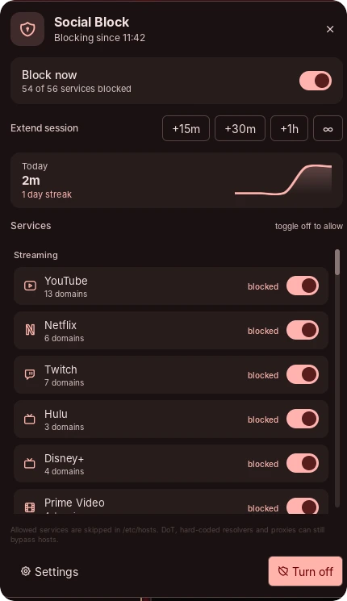

# Social Block

One switch for focus. Social Block writes a marked block into `/etc/hosts`
for streaming, social, forum, dating and shopping services, quits blocked
desktop apps, and keeps the block active until you turn it off. Every service
also has its own toggle, so you can keep Discord or Slack allowed at work while
everything else stays blocked.



## Why

Social Block is a productivity tool for people who work from home. The goal is
to keep a work session from drifting into "just one quick look", while keeping
the tools the team actually uses, such as Slack and Discord, one toggle away.
It is deliberately not a parental-control or network-security tool.

## Plugin

| Field | Value |
| --- | --- |
| ID | `treeonlinux/social-block` |
| Entries | Bar widget: `widget`; panel: `panel`; service: `service`; shortcut: `shortcut`; launcher provider: `launcher` |
| Launcher Prefix | `/block` |

## Requirements

- Noctalia v5.4 or newer (plugin API 43).
- `bash`: the root helper and its installer are bash scripts. Alpine and other
  minimal systems do not ship bash by default (`apk add bash`).
- `sudo` or `doas` for the one-time helper installation and for each toggle.
- `flatpak` and `pkill` to quit blocked desktop apps (Discord, Slack, Vesktop,
  WebCord, ArmCord).
- `hyprctl` for **Close matching windows** (Hyprland only).
- A writable `/etc/hosts`. NixOS and Guix System generate or manage
  `/etc/hosts`; runtime toggling is not supported there (see [Notes](#notes)).

### 1. Install Noctalia

Noctalia is in the plugin store, but the shell itself has to be installed
first. Use the command for your distribution:

| Distribution | Install |
| --- | --- |
| Arch Linux | `sudo pacman -S noctalia` |
| Fedora 44+ | `sudo dnf install noctalia` |
| openSUSE Tumbleweed / Slowroll | `sudo zypper refresh && sudo zypper install noctalia` |
| Debian trixie / Ubuntu 26.04+ | See the APT steps below |
| Gentoo | Enable the [GURU overlay](https://wiki.gentoo.org/wiki/Project:GURU/Information_for_End_Users), unmask `gui-apps/noctalia`, then `sudo emerge --ask gui-apps/noctalia` |
| Void Linux | `sudo xbps-install -S noctalia` after adding the [UniversalRepository](https://universalrepo.pages.dev) (see the [Noctalia docs](https://docs.noctalia.dev/noctalia/getting-started/installation/#void-linux)) |
| Alpine Edge | `doas apk add noctalia bash procps` after enabling the [UniversalRepository](https://universalrepo.pages.dev) (see the [Noctalia docs](https://docs.noctalia.dev/noctalia/getting-started/installation/#alpine-edge)) |
| Chimera Linux | `doas apk add chimera-repo-user && doas apk update && doas apk add noctalia bash` |
| Solus | `sudo eopkg install noctalia` |
| GNU Guix | Add `noctalia-shell` from `(gnu packages window-management)` to your system or home packages (host blocking is not supported) |
| NixOS | `nix-shell -p noctalia` or add `noctalia` to `environment.systemPackages` (the hosts helper is not supported) |
| Anything else | [Build manually](https://docs.noctalia.dev/noctalia/getting-started/installation/#manual-installation) with `meson` and `just` |

Debian and Ubuntu use Noctalia's APT repository:

```bash
wget https://pkg.noctalia.dev/deb/nickh-archive-keyring.deb
sudo dpkg -i nickh-archive-keyring.deb

# Debian trixie (replace "trixie" with "sid", "ubuntu2604" or "ubuntu2610" as needed)
sudo wget -O /etc/apt/sources.list.d/noctalia-trixie.sources \
  https://pkg.noctalia.dev/deb/noctalia-trixie.sources

sudo apt update && sudo apt install noctalia
```

Start Noctalia from your compositor (`noctalia` or the autostart entry), then
continue below.

### 2. Install the plugin

Open **Settings → Plugins → Plugin Store**, find **Social Block** and enable
it. From a terminal:

```sh
noctalia msg plugins enable treeonlinux/social-block
```

### 3. Install the privileged helper

A Noctalia plugin runs as your user and cannot write `/etc/hosts` or install a
sudoers rule. This one command does that part. It is distribution-independent
and needs `sudo` or `doas`.

After enabling the plugin, find its directory and run the installer:

```sh
# Works from fish, zsh, bash and sh: the wrapper runs the lookup in bash.
bash -c 'priv="$(command -v sudo || command -v doas)"; installer="$(find -L "${XDG_STATE_HOME:-$HOME/.local/state}/noctalia/plugins" "$HOME/.local/share/noctalia/plugins" -maxdepth 5 -name install-helper.sh -path "*social-block*" 2>/dev/null | head -n1)"; if [ -z "$installer" ]; then echo "Enable Social Block first, then re-run this command."; else cd "$(dirname "$installer")" && "$priv" bash install-helper.sh; fi'
```

If you use `doas`, the installer detects it. You can force it with
`bash install-helper.sh --doas` (or `--sudo`).

The installer creates:

| Path | Purpose |
| --- | --- |
| `/usr/local/bin/social-block-net` | Root-owned helper with `on`, `off`, `status`, `list`, `allow <id>`, `block <id>` |
| `/etc/social-block/domains` | Root-owned service/domain list (preserved on re-run) |
| `/etc/social-block/allowed` | Root-owned allowlist; services you toggle off are written here |
| `/etc/hosts.social-block.bak` | Last clean `/etc/hosts` before a block |
| `/etc/sudoers.d/social-block` | `NOPASSWD` for only the helper's commands, one rule per service, or an equivalent marked block in `/etc/doas.conf` |

The commands below run **from the plugin directory found above** (the
`bash -c` wrapper does not change your shell's working directory).

Inspect it without changing anything:

```sh
bash install-helper.sh --check
```

If you already have the old flat domain list, migrate it to per-service
headers and regenerate the privilege rules:

```sh
bash install-helper.sh --update-domains
```

The installer preserves an existing domain list by default, so the
`--update-domains` flag is the explicit opt-in to replacing it.

The helper is deliberately narrow: the plugin cannot feed arbitrary lines into
`/etc/hosts`, and every privilege rule is scoped to a fixed command and service
ID.

## Usage

After the helper is installed, the plugin works immediately. If the panel shows
**Finish setup** or **Helper problem**, copy the command from the card, run it
in a terminal, then press **Re-check**.

### Bar widget

Add **Social Block** in **Settings → Bar → Add widget**. The widget shows
`OFF`, `ON`, or a countdown (`24m`) while a timer is running.

- Left-click: open the panel
- Right-click: toggle blocking

### Panel

Open it from the bar widget or with:

```sh
noctalia msg panel-toggle treeonlinux/social-block:panel
```

The panel contains the master switch, session timers (`15m`, `30m`, `1h`,
`∞`), today's blocked time, the streak graph, and the service list.

**Every service has its own toggle.** A service is blocked when its toggle is
on. Toggle it off to allow it, for example:

- turn **Slack** off to keep work chat available;
- turn **Discord** off if your team uses it;
- leave YouTube, Netflix, Reddit and the rest on.

Changing a service while the block is active immediately rewrites
`/etc/hosts`; changing it while the block is off stores the choice for the next
time you turn the block on. Choices survive restarts and plugin updates.

Use the `blocked` / `allowed` label beside each row to confirm the state.

### Control-center tile

Add **Social Block** under **Control Center → Shortcuts**. A left-click
toggles the whole block.

### Launcher

Type `/block` in the Noctalia launcher:

| Query | Action |
| --- | --- |
| `/block on` | Block every enabled service until turned off |
| `/block 30` | Block for 30 minutes |
| `/block 15`, `/block 60` | Block for 15 or 60 minutes |
| `/block forever` | Clear the timer and keep blocking |
| `/block off` | Turn the block off |
| `/block status` | Show the current state |
| `/block slack` | Show **Allow Slack** / **Block Slack**; works for any service name or ID |

### Keybind

Hyprland, Lua config:

```lua
hl.bind("SUPER + SHIFT + B",
  hl.dsp.exec_cmd("noctalia msg plugin treeonlinux/social-block:service all toggle"))
```

Hyprland, `hyprland.conf`:

```ini
bind = SUPER SHIFT, B, exec, noctalia msg plugin treeonlinux/social-block:service all toggle
```

### Timers and schedule

The timer buttons start a session or extend a running one. `∞` clears the
timer so the block stays on until you turn it off.

Enable **Daily schedule** in the plugin settings to block automatically every
day between the start and end time (24-hour `HH:MM`). A window whose end is
earlier than its start runs overnight. Turning the block off manually during
a window keeps it off until the next day. Disabling the schedule ends an active
scheduled block.

Day-to-day blocked minutes are stored in the plugin state directory and shown
as today's total and a streak. Time while the machine is suspended is not
counted.

## Settings

| Setting | Type | Default | Description |
| --- | --- | --- | --- |
| `close_apps` | `bool` | `true` | Quit blocked desktop apps (Discord, Slack, Vesktop, WebCord, ArmCord) when blocking starts and whenever they are relaunched. Allowed services are not killed. |
| `close_windows` | `bool` | `false` | Close windows whose class or title matches a blocked service. Hyprland only; can close a whole browser window. Allowed services are skipped. |
| `schedule_enabled` | `bool` | `false` | Block automatically during the daily window. |
| `schedule_start` | `string` | `09:00` | Window start in 24-hour `HH:MM`. |
| `schedule_end` | `string` | `17:00` | Window end in 24-hour `HH:MM`; an earlier end means the window crosses midnight. Invalid times are reported in a notification and the schedule stays inactive. |

## IPC

The service is a singleton; target it with `all`:

```sh
noctalia msg plugin treeonlinux/social-block:service all toggle
noctalia msg plugin treeonlinux/social-block:service all on
noctalia msg plugin treeonlinux/social-block:service all off
noctalia msg plugin treeonlinux/social-block:service all timer 30
noctalia msg plugin treeonlinux/social-block:service all forever
noctalia msg plugin treeonlinux/social-block:service all allow slack
noctalia msg plugin treeonlinux/social-block:service all block slack
noctalia msg plugin treeonlinux/social-block:service all services
noctalia msg plugin treeonlinux/social-block:service all refresh
```

`allow <id>` and `block <id>` change one service without touching the others.
`services` refreshes the list; `refresh` re-reads the state file and `/etc/hosts`.
The helper also exposes `list` and the same `allow`/`block` commands directly:

```sh
sudo social-block-net list
sudo social-block-net allow slack
sudo social-block-net block slack
```

`list` is read-only and can be run without `sudo`; it prints
`id|category|name|domain-count|blocked|allowed`.

## Notes

**What it writes.** While blocking is on, `social-block-net` rewrites
`/etc/hosts` with a block delimited by `# >>> social-block >>>` and
`# <<< social-block <<<`. Turning it off removes exactly that block and leaves
the rest of the file untouched. Before the first write it copies the current
file to `/etc/hosts.social-block.bak`. If the block markers are incomplete
(for example after an interrupted write), the helper refuses to touch the file
and reports the backup path instead of deleting unrelated entries.

**Per-service allowlist.** `/etc/social-block/allowed` contains one service ID
per line for services you have allowed. It is root-owned; the helper updates it
when you use a panel toggle. `on` skips those services entirely, including
their CDN/gateway entries. The file survives plugin updates; `--uninstall`
removes it.

**Services and domains.** `/etc/social-block/domains` is the source of truth.
Each service starts with a machine-readable header:

```
## slack | Social | Slack
slack.com
app.slack.com
...
```

The panel builds its rows and toggles from these headers. After adding a
service, re-run `bash install-helper.sh --update-domains` from the plugin
directory so the sudoers/doas rules include the new `allow`/`block` IDs. A legacy flat list with no headers
is treated as one service called `all`.

**Commands spawned.** `sudo`/`doas` runs
`social-block-net on|off|status|allow|block`. When `close_apps` is enabled the service runs `flatpak kill` and
`pkill` for Discord/Slack-family apps. When `close_windows` is enabled it reads
`hyprctl clients -j` and closes matching windows. Entries talk to each other
with `noctalia msg`.

**Enforcement is best-effort.** `/etc/hosts` controls name resolution, not
network access. The shipped list includes common CDN/gateway hosts (for example
`googlevideo.com`, `nflxvideo.net` and `gateway.discord.gg`) and common
DNS-over-HTTPS endpoints so secure DNS is less likely to bypass the block.
A browser using DNS-over-TLS, a hard-coded resolver IP, or its own proxy can
still reach a site; cached pages and already-open tabs may keep working until
reloaded. An application that ignores `/etc/hosts` is outside the block's
reach. On some systems a local service listening on `0.0.0.0` can also answer
a blocked name; don't run a catch-all local server if you rely on hosts
blocking.

**NixOS and Guix.** `/etc/hosts` is generated from the system configuration on
both, and is replaced on every rebuild/reconfigure. Runtime toggling is not
supported there. Use `networking.extraHosts` (NixOS) or `hosts-service-type`
(Guix) for a static block, and do not run the helper. The panel still renders,
but toggling reports an error.

**Immutable distributions.** Fedora Silverblue/Kinoite, openSUSE Aeon and
similar systems keep `/etc` and `/usr/local` writable, so the helper works. If
your system makes them read-only, install the helper at build time or use an
overlay.

**Uninstall.** From the plugin directory, turn the block off and remove the
system files:

```sh
bash install-helper.sh --uninstall
noctalia msg plugins disable treeonlinux/social-block
```

Disabling or uninstalling the plugin also turns the block off. If Noctalia
crashes while blocking, run `sudo social-block-net off`. If `/etc/hosts` is
damaged, restore the backup:

```sh
sudo cp /etc/hosts.social-block.bak /etc/hosts
```

**Editing services.** From the plugin directory, edit the root-owned list:

```sh
sudoedit /etc/social-block/domains
# doas-only systems:
doas vi /etc/social-block/domains
```

One domain per line; `#` starts a comment. Hosts entries are exact, so add the
subdomains and CDNs you actually use (`www`, `m`, `web`, `music`, …); there are
no wildcards. Run `bash install-helper.sh --update-domains` afterwards.

**License.** MIT.
