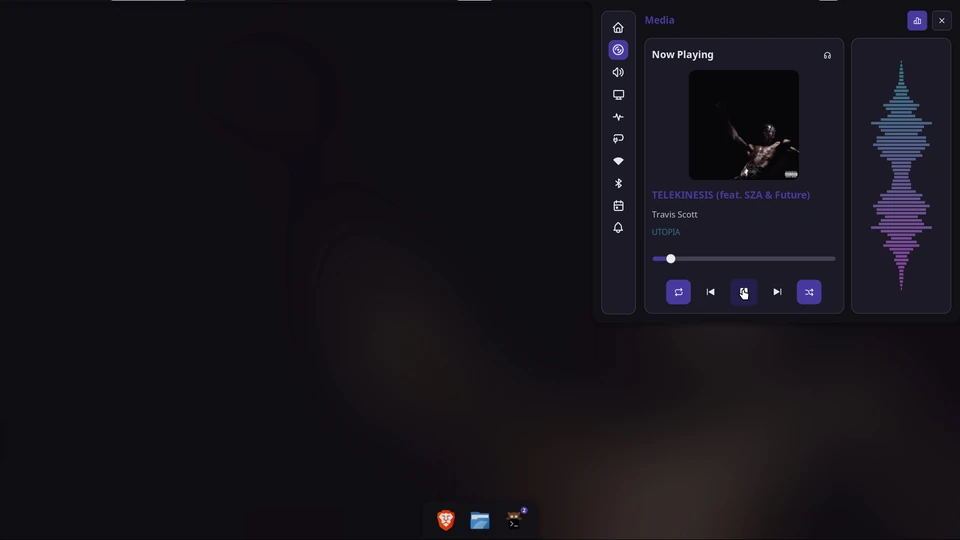

# Spotify Ambient

Turn the currently playing Spotify album cover into an ambient wallpaper and generate a matching Noctalia color palette from the original artwork. When playback stops or Spotify disappears, the plugin restores the wallpaper and color scheme it found before taking control.



## Plugin

| Field | Value |
| --- | --- |
| ID | `kryzhh/spotify-ambient` |
| Entries | Service: `ambient` |

## Requirements

- Noctalia Shell **5.5.0 or newer**, with plugin API **44** or newer.
- Spotify running in the same user session and exposing the MPRIS player name `spotify`.
- `playerctl` available on `PATH`.
- `python3` 3.10+ with `Pillow` installed.
- The `noctalia` CLI supplied by Noctalia Shell, including its native `theme` command.
- The standard Linux `sh` and `rm` utilities for detached cleanup when the plugin exits.
- `flock` (from `util-linux`) to serialize palette generation/application with detached shutdown cleanup.
- A Linux desktop session running Noctalia and Spotify as the same user.

Install the external dependencies with your distribution's package manager. For example:

**Arch Linux / CachyOS**

```bash
sudo pacman -S --needed playerctl python python-pillow util-linux
```

**Debian / Ubuntu**

```bash
sudo apt install playerctl python3 python3-pil util-linux
```

**Fedora**

```bash
sudo dnf install playerctl python3 python3-pillow util-linux
```

## Usage

1. Start Spotify in the same user session as Noctalia.
2. Open **Noctalia Settings → Plugins** and enable **Spotify Ambient** (`kryzhh/spotify-ambient`).
3. Play a track. The service checks Spotify playback through MPRIS and applies an ambient wallpaper plus a palette derived from the track's original cover.
4. Pause or stop playback, or close Spotify. The plugin restores the wallpaper and color scheme it captured before taking control.

The plugin is a headless service; it does not add a bar widget, panel, launcher provider, or control-center shortcut. No separate systemd user service is needed.

The palette is generated with Noctalia's native image-theme command. Both dark and light variants are written, and Noctalia's own theme mode (including automatic mode) remains in control. Terminal ANSI colors are derived from the album art and are available to Noctalia app templates such as Kitty.

## Settings

Spotify Ambient has no configurable plugin settings. It currently follows the Spotify MPRIS player named `spotify` and polls playback every five seconds.

## IPC

The plugin does not expose custom IPC actions. Its service is managed through **Noctalia Settings → Plugins**.

## Notes

### What it reads and writes

- Reads Spotify playback status, track ID, and artwork URI through `playerctl` / MPRIS. It does not use Spotify Web API credentials or OAuth.
- Artwork may be read from a local `file://` URI or downloaded from an HTTP(S) artwork URI supplied by MPRIS. Downloads have a 12 MiB size limit and a 15-second timeout; images above 50 megapixels are rejected before pixel decoding. File URIs must refer to the local machine. HTTP(S) hosts and redirect targets are checked to reject non-public IP addresses.
- Writes its session snapshot to Noctalia's plugin data directory and generated wallpaper JPEGs to its plugin-owned `wallpapers/` cache directory.
- Writes uniquely named custom palettes to Noctalia's palette directory. It does not overwrite existing user palettes.
- Uses Noctalia IPC to read and set the current color scheme and per-output wallpaper. On pause, stop, or Spotify disappearing, it restores only values that still match what the plugin applied; manual theme or wallpaper changes are preserved.
- On disable or uninstall, it makes a best-effort restoration attempt. A detached cleanup command uses the system shell and `rm` to restore state and remove plugin-owned palette files after the service exits. Generated wallpaper cache and persistent plugin state are retained for the plugin's next run.

### Processes

The service starts `playerctl` to query MPRIS, `python3` to render wallpapers and build palette files, and `noctalia` for native theme generation and Noctalia IPC. The helper uses Python's standard-library `urllib` client to retrieve artwork when the MPRIS URI is HTTP(S). The exit cleanup uses `sh` and `rm`; these are standard Linux utilities. `flock` serializes detached cleanup with the palette helper so cleanup cannot restore the old theme between palette generation and application.

### Behavior and limitations

- The blurred wallpaper is generated from the album cover; the original, unblurred cover is used for palette generation.
- Each connected output gets a wallpaper rendered at that output's current dimensions.
- The plugin does not toggle dark/light mode and does not edit Kitty configuration directly.
- The generated palette and wallpaper are applied only while Spotify is playing. The shell remains responsible for displaying the wallpaper and applying app theme templates.
- If Spotify is closed, paused, or no longer registered with MPRIS, the saved theme and wallpaper are restored.

### Diagnostics

The installed helper supports a read-only diagnostic report:

```bash
python3 ~/.local/share/noctalia/plugins/spotify-ambient/ambient.py doctor
```

Machine-readable output:

```bash
python3 ~/.local/share/noctalia/plugins/spotify-ambient/ambient.py doctor --json
```

The report checks Python/Pillow, `playerctl`, Spotify MPRIS availability/status, Noctalia IPC, and the native image-theme CLI. A missing Spotify player is a warning when Spotify is closed. It does not include track titles, artwork URLs, credentials, or file contents.

To inspect Noctalia's plugin logs:

```bash
journalctl --user -b --no-pager | grep -i 'spotify-ambient' | tail -n 150
```

Do not share plugin `state.json`, credentials, full Spotify metadata, or private artwork in bug reports.
