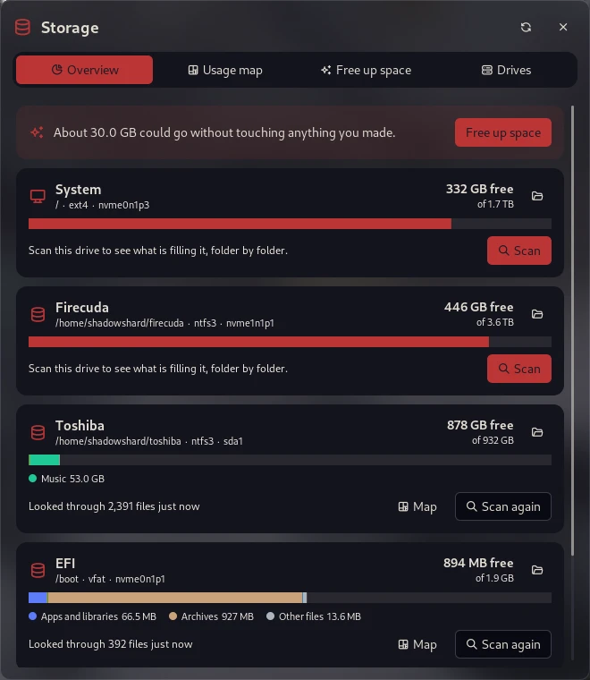
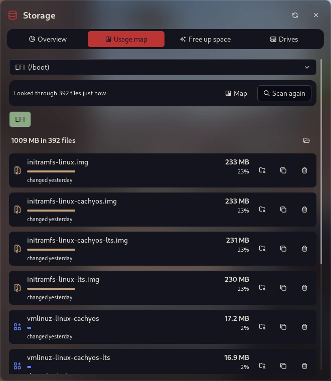
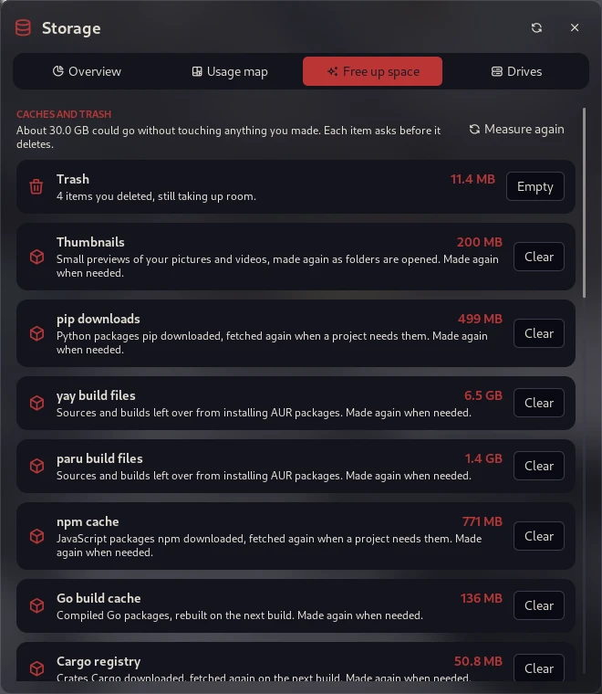
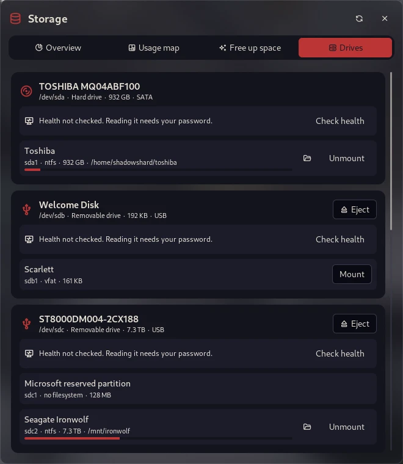

# Storage Manager

See what fills your drives, check their health, and free up space. A panel with
an overview of every filesystem, a folder-by-folder usage map, a cleanup list
for caches, old packages, logs and trash, and a drives page with SMART health,
mounting and ejecting. A background service warns when space runs low and can
empty old trash on its own.



## Plugin

| Field | Value |
| --- | --- |
| ID | `shadowshard4080/storage-manager` |
| Entries | Panel: `manager`; bar widget: `indicator`; service: `monitor` |

## Requirements

- `python3` runs the helper script that does all disk work (standard library only).
- `lsblk` lists drives and partitions.
- `gio` moves files to the trash.
- `udisksctl` (udisks2) mounts, unmounts and ejects drives.
- `smartctl` (smartmontools) reads drive health; it runs through `pkexec`, so it asks for your password.
- `pkexec` (polkit) runs the cleanup steps that need root.
- `journalctl` and `systemctl` (systemd) measure and shrink the system logs and toggle `fstrim.timer`.
- `nice` and `kill` run scans at low priority and stop them.
- `dbus-send` reaches your file manager through `org.freedesktop.FileManager1` when the default folder app is missing or is a terminal emulator. Folders open in your default folder app (`xdg-mime query default inode/directory`) otherwise, and any installed folder-capable app is the last resort.
- Optional: `pacman` for the package cache and unused dependencies (Arch and derivatives), `flatpak` for unused runtimes.

Anything that is missing is skipped: the related items simply do not appear.

## Usage

Open the panel from the bar widget, or bind this command to a key:

```sh
noctalia msg panel-toggle shadowshard4080/storage-manager:manager
```

To add the bar widget, open the bar's Add-widget picker and choose **Storage Manager**
(`shadowshard4080/storage-manager:indicator`). It shows the free space on one filesystem;
left click opens the panel, right click refreshes. The glyph turns red below the low-space
threshold.

The panel has four tabs:

- **Overview**: every mounted filesystem with its free space. **Scan** walks the
  filesystem (at low priority, it keeps running when the panel is closed) and splits the
  bar into videos, pictures, music, documents, caches, apps, the system and so on.
- **Usage map**: pick a scanned filesystem and click folders to walk into them. Each row
  can be shown in the file manager, have its path copied, or be moved to the trash (with a
  confirmation). Folders whose contents were too small to list get a **Look closer** button
  that scans just that folder in more detail.
- **Free up space**: measured caches (thumbnails, pip, npm, yarn, bun, Go, Cargo, Gradle,
  Maven, Electron, Composer, shader caches, yay and paru build files), the trash, old
  pacman package downloads, unused dependencies, the systemd journal, crash dumps and unused
  Flatpak runtimes. Every item asks before it deletes anything. Below them are your largest
  files and duplicate files from the scanned drives, which are never deleted unless you
  move one to the trash yourself.
- **Drives**: physical drives with their partitions, temperature, SMART health on demand,
  mount, unmount and eject buttons, and a switch for the weekly SSD trim (`fstrim.timer`).





## Settings

Plugin settings live under **Settings → Plugins** (the gear on this plugin's row).

| Setting | Type | Default | Description |
| --- | --- | --- | --- |
| `low_space_warning` | `bool` | `true` | Notify when the system filesystem, or the one holding your home folder, runs low. Checked every ten minutes. |
| `low_space_percent` | `int` | `10` | Free space, in percent, below which the warning fires (1-50). Below 3% the notification is an error. |
| `empty_trash_after` | `select` | `never` | Permanently delete trash older than a week, a month or three months. Checked at startup and every six hours. |

Bar widget settings:

| Setting | Type | Default | Description |
| --- | --- | --- | --- |
| `show_free` | `bool` | `true` | Show the free space next to the glyph. |
| `mount` | `string` | `/` | Mount point whose free space the widget shows. |

## IPC

```sh
# open the panel on a given tab: overview, map, clean or drives
noctalia msg panel-open shadowshard4080/storage-manager:manager clean

# start a scan of a filesystem (default /)
noctalia msg plugin shadowshard4080/storage-manager:manager all scan /home

# measure what could be cleaned
noctalia msg plugin shadowshard4080/storage-manager:manager all measure

# refresh the filesystem list, or empty old trash now (uses the setting's age)
noctalia msg plugin shadowshard4080/storage-manager:monitor all refresh
noctalia msg plugin shadowshard4080/storage-manager:monitor all purge-trash
```

## Notes

- **Processes**: every disk operation runs `helper/storagetool.py`. Scans run under
  `nice -n 10`. Root steps go through `pkexec`: `pacman -Sc`, `pacman -Rns` (on the
  packages `pacman -Qdtq` lists), `journalctl --vacuum-size=200M`, deleting files in
  `/var/lib/systemd/coredump`, `smartctl -j -a <drive>` and `systemctl enable|disable
  --now fstrim.timer`. Without root it runs `flatpak uninstall --unused`, `gio trash`,
  `udisksctl` and empties the cache folders listed above.
- **Files written**: scan results are cached as JSON in
  `$XDG_CACHE_HOME/noctalia-storage-manager/` (one per scanned filesystem, plus up to 16
  close-up scans). Delete that folder to forget all scans.
- **Network**: none.
- **Privacy**: scans read file names, sizes and dates; duplicate detection reads eight
  64 KiB samples from files of the same size. Nothing leaves your computer.
- Sizes are allocated bytes, as `du` counts them, so they add up to what `df` reports.
  Snapshots and other filesystems mounted inside a scanned one are skipped.
- The helper script and the design of the pages are adapted from the storage settings of
  [Lucid](https://github.com/Sn3akyy1/lucid) (MIT).
