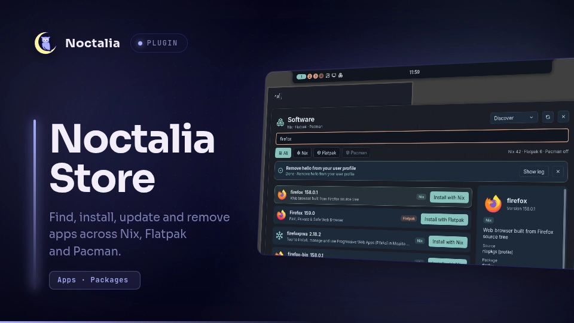

# Noctalia Store

Find, install, update and remove applications from Nix, Flatpak and Pacman.

## Plugin

| Field | Value |
| --- | --- |
| ID | `swashx-dev/store` |
| Entries | widget: `software-button`; panel: `browser`; shortcut: `software` |

## Requirements

Requires Noctalia plugin API 45 or newer. The standalone repository edition remains compatible with API 24.

Install `noctalia-software` on `PATH`.
The backend is maintained in [Noctalia-Store](https://github.com/SwashX-dev/Noctalia-Store) and is distributed separately as a Nix package (version 1.0.1).
Install its package and, where required, its NixOS module using that repository's README.
The community plugin calls the installed backend; it never downloads or executes helper code from the network.
The backend package also includes a standalone plugin. Enable only one frontend, not both the community ID and `local/software-installer`.

## Usage

Install this plugin from the community source and enable `swashx-dev/store` in Settings → Plugins.
Open its panel with:

```sh
noctalia msg panel-toggle swashx-dev/store:browser
```

Add bar widget `swashx-dev/store:software-button` or control-center shortcut `software` to open the `browser` panel.
Search every available source or filter by Nix, Flatpak and Pacman. Discover, Installed, Updates and Activity views show source-specific actions.
Inspect a result, select the package source and confirm the requested install, update or removal.
Ctrl+F focuses search, Ctrl+1 through Ctrl+4 select sources, Ctrl+Return confirms, Ctrl+L shows the transaction log and Ctrl+R reloads sources.

## Notes

The backend requires Python and uses the host's installed `nix`, `flatpak` and/or `pacman` commands; unavailable sources remain disabled with an explanation.
It reads package indexes and installed-package databases and writes cache data under `~/.cache/noctalia-software-installer` and operation state, locks and logs under `~/.local/state/noctalia-software-installer`.
Search and confirmed package operations can contact the configured Nix, Flatpak or Pacman repositories. Search terms may be sent to those sources.
Install, remove and upgrade operations run the selected package manager. Root operations use PolicyKit (`pkexec`) and the separately installed helper; the NixOS helper updates only its configured managed-package JSON list and builds the system before activation. Pacman database refresh is part of an explicitly confirmed full upgrade.
System logs may be written under `/var/lib/noctalia-software-installer` by the helper. Notifications use `notify-send`. No package is installed or removed merely by opening the panel.



The screenshot inside the card shows the earlier UI branding. The current panel uses the name Noctalia Store.
