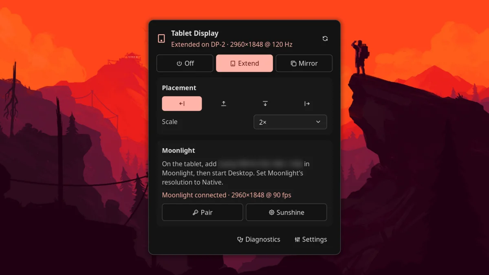

# Tablet Display

Use an Android tablet or an iPad as a second screen, **extended** or
**mirrored**, streamed by [Sunshine](https://github.com/LizardByte/Sunshine) to
[Moonlight](https://moonlight-stream.org). Game-streaming tech gives hardware
encoding, up to 120 fps and low delay, without Miracast's 1080p limit.

- **Extend** adds a display for the tablet. Move windows and workspaces onto it
  like any monitor, and place it left, right, above or below your screen.
- **Mirror** shows the monitor you're using on the tablet.
- The display matches your tablet's resolution, from a device preset or
  automatically from what Moonlight asks for.



Tested with a Samsung Galaxy Tab S9 Ultra and a Framework Laptop 16 (Radeon
780M) on niri 26.04, Hyprland 0.57, sway 1.12 and mango 0.18.5, with Sunshine
2026.1109 and Noctalia 5.4.1. iPads, other tablets and other GPUs should work
but haven't been tested; reports are welcome.

## Plugin

| Field | Value |
| --- | --- |
| ID | `iwasironman/tablet-display` |
| Entries | Bar widget: `status`; panel: `panel`; shortcut: `toggle`; service: `service` |

## Requirements

- `sunshine`: from your distribution (`sudo pacman -S sunshine` on Arch and
  CachyOS) or [LizardByte's releases](https://github.com/LizardByte/Sunshine/releases).
- `jq` and `python3` on `PATH`. `python3` generates the display's EDID.
- `pkexec` (polkit), only on compositors that need the port method below.
- `nmcli` (NetworkManager), only for USB mode: it keeps your internet off the
  USB cable (see [USB mode](#usb-mode)).
- Moonlight on the tablet, from the
  [Play Store](https://play.google.com/store/apps/details?id=com.limelight) or the
  [App Store](https://apps.apple.com/app/moonlight-game-streaming/id1000551566).
- The computer and tablet on the same network (5 or 6 GHz Wi-Fi, or wired for
  the computer), or connected by a USB cable (see [USB mode](#usb-mode)). With
  a firewall, open Sunshine's ports: TCP 47984, 47989, 47990, 48010 and UDP
  47998–48000.
- A supported compositor. How **Extend** adds a display depends on it:

| Compositor | Method | Setup |
| --- | --- | --- |
| Hyprland | Virtual output (`hyprctl output create headless`) | None |
| mango | Virtual output (`mmsg dispatch create_virtual_output`) | None |
| sway | Virtual output (`swaymsg create_output`) | None |
| niri | **Unused display port**: niri has no virtual outputs in a release yet | Install the port helper once |

The port method borrows an unused DP or HDMI connector: a small root helper
loads a generated EDID (the display's description) onto it and marks it
connected, so the compositor sees a real monitor. It works on AMD and Intel
graphics, not under Secure Boot kernel lockdown (`cat /sys/kernel/security/lockdown`
must show `[none]`), and not with the NVIDIA driver. Nothing is permanent: a
reboot undoes it. **Mirror** works on every compositor without the helper.

## Usage

### Set up Sunshine (once)

1. **Start Sunshine once**, so you can reach its settings page:
   ```sh
   systemctl --user start app-dev.lizardbyte.app.Sunshine
   ```
   The unit name depends on how Sunshine was packaged;
   `systemctl --user list-unit-files | grep -i sunshine` shows yours. Turning on
   **Extend** in the panel also starts it.
2. **Create Sunshine's login.** Open <https://localhost:47990>, or press
   **Sunshine** in the panel. Your browser will warn about the certificate:
   Sunshine uses a self-signed one, so continue to the page. The first visit
   asks you to choose a username and password; you need them to pair Moonlight.
3. **Leave capture settings to the plugin.** While the tablet display is on,
   the plugin sets Sunshine's output, capture method, audio and session hooks
   itself. Other Sunshine settings, such as encoder and bitrate, are yours to
   change in the web UI.
4. **Don't enable Sunshine at login.** The plugin starts Sunshine when you turn
   the display on and stops it when you turn it off, so nothing can be
   streamed while it's off.
5. **If touch or the keyboard doesn't work later,** log out and back in once.
   Sunshine's package installs a udev rule that gives your session access to
   `/dev/uinput`, and it applies at the next login.

### Add the widget and tile

Add the **Tablet Display** bar widget (`iwasironman/tablet-display:status`) in
**Settings → Bar → Bar Widgets**, and optionally the **Tablet** shortcut
(`iwasironman/tablet-display:toggle`) to the control center's Home tab in
**Settings → Control Center**. You can
also open the panel directly:

```sh
noctalia msg panel-toggle iwasironman/tablet-display:panel
```

### Use it

1. Pick your tablet under **Settings → Plugins → Tablet Display** (or leave
   *Auto*).
2. Open the panel by clicking the bar widget, and choose **Extend** or
   **Mirror**. On niri the panel first offers **Install helper**, which runs
   `sudo helper/install.sh` in a terminal (see [Notes](#notes)).
3. **Pair, the first time:** in Moonlight on the tablet, add this computer by
   the address the panel shows. Moonlight displays a PIN. Press **Pair** in the
   panel, sign in with Sunshine's username and password, and enter the PIN.
4. In Moonlight, set the resolution to **Native** and start **Desktop**.
5. Use the arrows under **Placement** to put the tablet left, above, below or
   right of your screen, and **Scale** to size its contents.
6. Choose **Off** when you're done. Sunshine stops.

Right-clicking the bar widget, or clicking the control-center tile, turns
Extend on and off.

### USB mode

A USB cable gives a steadier frame rate and lower delay than Wi-Fi. Sunshine and
Moonlight work the same way; only the address Moonlight connects to changes.

1. Connect the tablet with a USB cable and turn on **USB tethering** on the
   tablet (on Samsung: **Settings → Connections → Mobile Hotspot and Tethering
   → USB tethering**). Leave its Wi-Fi on; Android may grey out the switch
   without a connection to share. On an iPad this is Personal Hotspot over
   USB, which needs a cellular model; this has not been tested.
2. The panel's **Moonlight** card shows **Over USB: add `<address>` in
   Moonlight**. Add that address in Moonlight; it is recognised as the same,
   already-paired computer.
3. With a firewall, allow Sunshine on the cable's network interface.
   **Diagnostics** prints the exact commands, for example with ufw:
   ```sh
   sudo ufw allow in on enp199s0f4u1 proto tcp to any port 47984,47989,47990,48010
   sudo ufw allow in on enp199s0f4u1 proto udp to any port 47998:48000
   ```
   The interface name comes from the physical USB port, so the same port keeps
   the same name.

With tethering on, the tablet also offers the computer an internet connection,
and NetworkManager prefers it over Wi-Fi. The plugin takes the default route off
the USB link (see the `usb_keep_internet` setting), so your internet stays on
Wi-Fi or Ethernet. **Diagnostics** opens a terminal with a report for bug
reports.

## Settings

Under **Settings → Plugins → Tablet Display**. Advanced settings are behind
**Show advanced**.

| Setting | Type | Default | Description |
| --- | --- | --- | --- |
| `device` | `select` | `auto` | The tablet, which sets the display's resolution and physical size. Presets: Galaxy Tab S9 Ultra, S9+, S9, iPad Pro 13" and 11" (M4). *Auto* uses the resolution Moonlight asks for (set Moonlight to Native). Takes effect the next time the display is turned on. |
| `custom_resolution` | `string` | `2560x1600` | For *Custom*, and for *Auto* before Moonlight first connects: `WIDTHxHEIGHT` in landscape. |
| `custom_diagonal` | `double` | `0` | Screen diagonal in inches, used to pick the automatic scale. `0` means unknown. |
| `audio` | `bool` | `false` | Play the computer's sound on the tablet while streaming. |
| `usb_keep_internet` | `bool` | `true` | In USB mode, keep the computer's internet traffic off the USB cable. Applies `nmcli device modify <iface> ipv4.never-default yes ipv6.never-default yes` to the current connection only (nothing is saved), and only when another internet connection exists. |
| `keep_sunshine` | `bool` | `false` | Advanced. Leave Sunshine running after **Off**, as it was before. Sunshine then follows your own Sunshine settings, which may stream your main screen. |
| `refresh_rates` | `string` | `60,90,120` | Advanced. Refresh rates the display offers, comma-separated; it uses the fastest. 2960×1848 at 120 Hz needs about 17 Gbit/s, which the GPU's port must carry. |
| `method` | `select` | `auto` | Advanced. *Virtual output*, *Unused display port*, or *Automatic* (virtual where the compositor supports it, otherwise the port). |
| `port` | `string` | `auto` | Advanced. The connector the port method borrows, such as `card2-DP-3`. *Auto* tries free connectors on the GPU that drives the built-in screen first. |

## IPC

The service accepts these events:

```sh
noctalia msg plugin iwasironman/tablet-display:service all extend
noctalia msg plugin iwasironman/tablet-display:service all mirror
noctalia msg plugin iwasironman/tablet-display:service all off
noctalia msg plugin iwasironman/tablet-display:service all toggle    # extend <-> off
```

The control script works from a shell too:

```sh
CTL=<plugin dir>/bin/tablet-display-ctl
$CTL extend | mirror [monitor] | off
$CTL set position left|right|above|below
$CTL set scale auto|1|1.5|2|...
$CTL state | jq .
$CTL doctor
$CTL uninstall      # turn off, restore sunshine.conf, delete state
```

## Notes

- **What it runs.** The Luau entries only run `bin/tablet-display-ctl`
  (bash), which calls `jq`, `python3 bin/make-edid.py`, the compositor's own
  tool (`niri msg`, `hyprctl`, `swaymsg`, `mmsg`, `wlr-randr`),
  `systemctl --user` to start and stop Sunshine, `pkexec` for the port helper,
  `nmcli` for USB mode, `ip` to find the USB link, and `xdg-open` for
  Sunshine's web page. The plugin makes no network
  requests itself; Sunshine does the streaming.
- **What it writes.**
  - `~/.config/sunshine/sunshine.conf`: only a marked block while the display
    is on. Your own lines for the same keys are commented out and restored on
    **Off**.
  - `~/.local/state/noctalia-tablet-display/`: settings, the generated EDID,
    and the hook Sunshine calls when Moonlight connects.
  - `$XDG_RUNTIME_DIR/noctalia-tablet-display/`: session state and a log.
  - USB mode: the active NetworkManager connection of the tablet's USB link,
    at runtime only (`never-default`); saved profiles are not changed.
  - Sunshine's systemd user environment (`WAYLAND_DISPLAY` and the
    compositor's socket), so it captures the session that turned the display
    on.
- **The port helper** (niri, or the port method elsewhere) is the only part
  that runs as root. **Install helper** runs `sudo helper/install.sh`, which
  installs `/usr/local/libexec/noctalia-tablet-display/port-helper` and a
  polkit policy letting the active local session run it without a password.
  It accepts an EDID only on stdin and only if its checksums pass, touches only
  external connectors, turns on only a disconnected one, and turns off only one
  it turned on. It writes the connector's debugfs `edid_override` and sysfs
  `status`, and sends a hotplug event. Remove it with
  `sudo helper/install.sh --remove`.
- **Sunshine is stopped before the display is removed.** If the display it
  streams disappears, Sunshine falls back to streaming another monitor, such
  as your laptop screen.
- **120 Hz at full resolution** needs a lot of bandwidth. If the frame rate
  wanders, stream at 90 fps or pick a lower resolution in Moonlight.
- **Touch and placement.** Sunshine maps touch onto a desktop it assumes
  starts at 0,0, and refuses a display at a negative position. So the plugin
  always lays the monitors out from 0,0: for **Left** and **Above** it moves
  your other monitors right or down instead of using negative coordinates, and
  **Off** moves them back (niri, sway, mango). Sunshine works out where touch
  goes when Moonlight connects, so after changing **Placement** during a stream,
  reconnect Moonlight for direct touch to follow; the panel reminds you.
  Moonlight's trackpad mode isn't affected. On Hyprland, **Left** and
  **Above** still use `auto-left`/`auto-up`; if touch is off there, use
  **Right** or **Below**.
- **Touch on niri:** niri maps touch to a monitor only from its config. For
  Moonlight's direct-touch mode add `input { touch { map-to-output "DP-3" } }`
  (your display's name) to `config.kdl`. Moonlight's trackpad mode works
  without it. Hyprland maps it automatically.
- **mango** can only remove all virtual outputs at once, and re-arranges
  monitors when one changes; the plugin pins your other monitors in place.
- **Status messages** from the control script (errors, hints) are in English.

Sunshine and Moonlight are separate projects under their own licenses; this
plugin only configures and drives them. MIT licensed.
