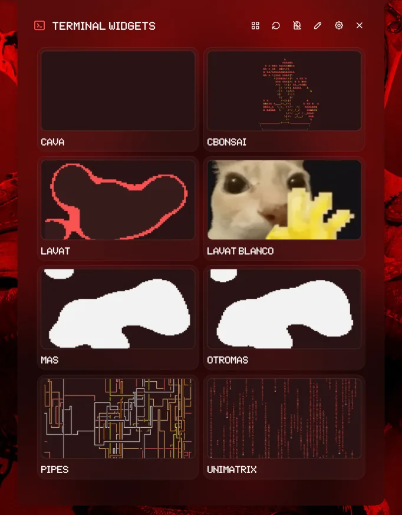

# Terminal Widgets

A launcher for terminal apps that live in floating windows. Every command gets its own
card, its own size and anchor, and the whole set can be re-arranged with one click.



## Install

Add this repository as a plugin source and enable the plugin:

```sh
noctalia msg plugins source add dev path https://github.com/F4M1N3C/noctalia-plugins
noctalia msg plugins enable faminec/terminal-widgets
```

Then add the **launcher** widget from Noctalia's widget picker.

## Plugin

| Field | Value |
| --- | --- |
| ID | `faminec/terminal-widgets` |
| Entries | Bar widget: `launcher`; panel: `panel` |

## Requirements

The plugin works on **Hyprland 0.56 or newer only**: the window management uses the
Hyprland Lua API (`hl.dsp.exec_cmd`) to float and place every window, and there is no
Niri or Sway backend.

The following executables must be installed and available on `PATH`:

| Executable | Package | What it is used for |
| --- | --- | --- |
| `kitty` | `kitty` | The terminal the plugin launches (any other terminal can be set instead). |
| `hyprctl` | `hyprland` | Lists, moves, resizes, focuses and closes the windows. |
| `grim` | `grim` | Takes the preview screenshot of an open window. Only needed for the card previews; without it the cards fall back to a static or mock preview. |
| `python3` | `python` | Crops those screenshots and extracts the frames of an animated preview. Also only needed for the card previews. |

`python3` needs Pillow (`python-pillow`) for that work. The plugin never installs
anything: every dependency has to be there before the plugin is enabled.

### The bundled cards

A fresh install starts with six cards, one per default command. Each card runs its own
program, so the programs are optional in the sense that the plugin works without them —
but clicking a card whose program is missing just opens a terminal that reports that the
command is not found.

| Card | Command | Package |
| --- | --- | --- |
| `cava` | `cava` | `cava` |
| `cbonsai` | `cbonsai -l -i` | `cbonsai` |
| `unimatrix` | `unimatrix -s 96 -l o` | `unimatrix` (`unimatrix-git` in the AUR) |
| `pipes` | `pipes.sh` | `pipes.sh` |
| `btop` | `btop` | `btop` |
| `lavat` | `lavat -k green -c black` | `lavat` |

Two names differ from the command they run: `hyprctl` comes from the `hyprland`
package, and the `pipes` card runs `pipes.sh`.

## Usage

Add the `launcher` widget from Noctalia's widget picker. Clicking it opens the deck: one
card per command, with a live preview of the window when it is already open. Clicking a
card launches the command in a floating terminal window.

The panel can also be opened directly:

```sh
noctalia msg panel-toggle faminec/terminal-widgets:panel
```

### Opening and re-arranging everything

The **grid button** in the panel header opens every configured command at once. When all
of them are already open, the same button rotates them: each window takes the slot of
the next one, so the set can be re-arranged with a single click. The rotation direction
is configurable (clockwise, counterclockwise, opposite, pairs or shuffle) and it can
also swap the sizes between the windows.

Each terminal is started with its own class (`noctalia-term-<name>`) and a Hyprland
execution rule:

```lua
hl.dsp.exec_cmd("<terminal> ...", { float = true, move = { x, y }, size = { w, h } })
```

If a command is already open, the plugin focuses it and re-applies its geometry instead
of opening a second window. When two windows would land on the same area, the plugin
moves the new one to the closest free slot.

### Editing the widget list

The **pencil button** in the panel header switches to edit mode. Editing an existing
widget replaces its card with the editor, so the fields appear where that widget is;
the "add widget" editor is the first card. The editor has save, cancel and delete
buttons, plus a button to clear a custom thumbnail.

The list is stored in the plugin's own data directory
(`noctalia.pluginDataDir()/store.json`), which is the only source of truth. The
built-in defaults are merged on load so a fresh install has widgets:

```
defaults (lib/defaults.luau)  ⊕  store (panel)  −  removed (deleted from the panel)
```

Adding widgets from the settings page is no longer possible: Noctalia's plugin
settings only configure appearance and behaviour. The built-in widgets can be
deleted as well: a deleted name is remembered as a tombstone in the store. New
widgets start with an empty thumbnail, so they show the auto-captured preview (or
the mock card), never an unrelated image.

## Settings

Configure the plugin in **Settings → Plugins → Terminal Widgets** (the gear button in the panel
opens the same page).

| Setting | Type | Default | Description |
| --- | --- | --- | --- |
| `margin` | `int` | `16` | Margin in pixels from the monitor edges for anchored layouts. |
| `output` | `string` | empty | Monitor connector the windows open on (for example `DP-1`). Empty = focused monitor. |
| `reuse_existing` | `bool` | `true` | Focus the existing window instead of opening another one. |
| `terminal` | `string` | `kitty` | Terminal command used to launch the apps. |
| `glyph` | `glyph` | `terminal-2` | Bar icon. |
| `close_on_launch` | `bool` | `false` | Close the panel as soon as a command is launched. |
| `preview_interval` | `int` | `3000` | Milliseconds between live preview refreshes (1000 to 60000). Only used by the `auto`, `live` and `gif` preview modes. |
| `rotation` | `select` | `clockwise` | How the windows are rotated: `clockwise`, `counterclockwise`, `opposite`, `pairs` or `shuffle`. |
| `rotation_sizes` | `bool` | `true` | Swap the sizes between the windows when rotating. |
| `columns` | `int` | `2` | Columns of the card grid (1 to 3). |
| `card_preview` | `select` | `auto` | Card preview: `auto`, `screenshot`, `live` (auto-refreshing screenshots), `gif` or `mock`. |
| `fallback_mode` | `select` | `random` | How a widget without a layout is placed: `random` picks a free spot, `custom` uses the X/Y/width/height below. |
| `fallback_random_resize` | `bool` | `false` | In `random` mode, also pick a random size when a widget is moved to another free spot. When off, the widget keeps its current size. |
| `width` | `int` | `900` | Fallback width for commands without a `layouts` entry (`custom` mode only). |
| `height` | `int` | `830` | Fallback height for commands without a `layouts` entry (`custom` mode only). |
| `x` | `int` | `120` | Fallback X position (monitor coordinates, `custom` mode only). |
| `y` | `int` | `140` | Fallback Y position (monitor coordinates, `custom` mode only). |

### Where a window ends up

- A widget **with a layout** opens exactly where its layout says, at the size its layout
  says. Clicking it again while it is open moves it to another free spot and keeps its
  current size.
- A widget **without a layout** opens in a free spot, using the fallback size.
- With `fallback_mode` set to `custom`, widgets without a layout open at the fallback
  X/Y/width/height instead.
- With `fallback_random_resize` on, moving an open widget also gives it a new random
  size; with it off, the size the user set by hand is kept.

### Layout format

Each widget stores its layout in `store.json` (edit it from the panel). The format is:

```toml
cava      = "bottom-center, 1610x584"
cbonsai   = "top-center, 801x582"
unimatrix = "right-center, 869x1424"
pipes     = "bottom-right, 900x520"
btop      = "top-left, 928x800"
lavat     = "bottom-left, 802x582"
```

Anchors: `top-left`, `top-center`, `top-right`, `left-center`, `center`,
`right-center`, `bottom-left`, `bottom-center`, `bottom-right`. Short aliases such as
`top`, `bottom`, `left`, `right` and `middle` are accepted too.

The size is optional (`width`/`height` are used when it is missing) and so is the
offset:

```toml
# Bottom center, shifted 40 px right and 10 px up.
cava = "bottom-center, 1610x584, 40, -10"

# Absolute monitor coordinates.
lavat = "custom, 802x582, 1753, 258"

# The same, written as key = value.
btop = "x=8 y=8 w=928 h=800"
```

## IPC

```sh
noctalia msg panel-toggle faminec/terminal-widgets:panel
noctalia msg plugin faminec/terminal-widgets:panel all launch <command>
noctalia msg plugin faminec/terminal-widgets:panel all open-all
noctalia msg plugin faminec/terminal-widgets:panel all rotate
noctalia msg plugin faminec/terminal-widgets:panel all close-all
noctalia msg plugin faminec/terminal-widgets:panel all add "name|command|layout"
noctalia msg plugin faminec/terminal-widgets:panel all remove <name>
noctalia msg plugin faminec/terminal-widgets:panel all refresh
```

The `add` payload is split on `|`, so the command itself cannot contain one.

The panel entry is only reachable over IPC while the panel is open; the other session's
runtime is created on demand.

## Changelog

### 2.2.1

- The panel no longer asks for animation frames when there is nothing to animate: a
  deleted card, or a card with a single capture, used to keep the frame ticks on for
  good and re-read its frames from the disk every 250 ms.
- The README lists the programs the bundled cards run, and says what happens when one
  of them is not installed.

### 2.2.0

- The panel is attached to the bar by default and sized to show four rows of cards with
  no scrollbar.
- A widget with a layout now opens exactly at the position and size its layout defines.
  Clicking an already open widget moves it to another free spot and keeps its current
  size; the size the user set by hand is remembered.
- `preview_interval` now counts milliseconds and actually refreshes the visible previews.
- Animated (GIF) thumbnails are supported.
- Cards no longer overflow the panel when the grid is set to one column.
- The plugin id is now `faminec/terminal-widgets`.

### 2.1.0

- `close_on_launch` now defaults to `false` (panel stays open after launching).
- Card previews can be `live` (refreshed every `preview_interval` milliseconds) and the
  closed-card preview animates with the last captured frames.
- Window captures use Hyprland's `stableId` + `grim -T`, so the preview shows only
  that widget window even if the Noctalia panel, another window or a bar is on top.
- `opposite` rotation now pairs windows by their real geometry, so it works for
  any layout (including four windows clustered in one corner).
- Rotation is atomic: rapid presses are ignored while a rotation is running, so
  two widgets can never end up in the same slot.
- "Open all" launches every missing window in a single batch instead of one by
  one.
- Right-clicking an open card closes its window.
- Cards keep a uniform size even in a partial last row.
- The panel is the only source of truth for widgets: commands, layouts and
  custom thumbnails live in the plugin's `store.json`. The Settings page no
  longer rewrites them.
- The widget editor opens inside the card being edited (or as the first card
  when adding one), instead of at the end of the list.
- Editing a widget's size or position re-applies its geometry instead of
  closing the window.

## Tests

Two checks live with the plugin:

```sh
lua5.4 test-panel.lua                       # unit tests of the lib/ modules (no desktop needed)
lua5.4 test-panel.lua /path/to/other/copy   # run them against another copy (e.g. the installed one)
./test-smoke.sh                              # live check: open all → rotate → close all, and the log must be clean
```

`test-panel.lua` loads the modules with a simulated Noctalia API and checks the
widget-list merge, the tombstones, the manifest parser, the layout parser, the
occupied-area calculation, the thumbnail cleanup and every rotation permutation.
It also loads `panel.luau` with a simulated UI to check that the cards, the
grid, the edit mode and every IPC handler work (this is what catches the
"attempt to call a nil value" from a `local` used before its declaration).
It exits with a non-zero code if a case fails.

`test-smoke.sh` needs Hyprland and Noctalia with the plugin enabled. It works
out how many widgets should be open (manifest defaults ⊕ panel store, minus
the removed ones), opens them all and waits until **exactly** that many windows
exist (a fixed sleep is not enough: `open-all` launches them one by one). It
then rotates and checks that the positions are a permutation of the previous
ones (every window still there, at least one moved), closes everything and
waits for zero. Before each IPC it looks up the real active panel in
`noctalia msg status` (another plugin can steal the focus) and retries the
event if it is lost. Finally it closes the panel, confirms the close in the
host state and in the log, and only then reads every new log line written since
the first step (the closing included), reports how many lines of the host it
checked (and how many belong to the plugin, which is the stable figure) and
fails on **any** `[WRN]` or `[ERR]`, whether it names the plugin or not. The
host rotates `noctalia.log` and buffers the script-runtime lines, so the smoke
follows the log with `tail -F` into a private copy and forces a flush with a
no-op `log-level-set` before reviewing it. If a step fails early, the new log
lines are still reviewed before exiting.

## Notes

### What it touches

- **Network:** none. The plugin makes no network requests.
- **Files written:** only inside the plugin's own data directory
  (`noctalia.pluginDataDir()`): `store.json` (the widget list, their layouts and their
  custom thumbnails) and `thumbs/` (the captured previews and the frames extracted from
  an animated one). Nothing is written anywhere else.
- **Processes spawned:** `kitty` (the terminal set in `terminal`), `hyprctl` (to list,
  move, resize, focus and close windows), `grim` (to capture a window for its card
  preview) and `python3` (with Pillow: to crop the captures and to extract the frames of
  an animated preview). `grim` and `python3` are only used for the previews; without them
  the cards fall back to a static or mock preview and everything else keeps working.
  Every card also runs its own command inside `kitty`: on a fresh install, the six
  bundled programs listed in *The bundled cards* above.

### The thumbnail

`thumbnail.webp` was exported with the
[official thumbnail generator](https://assets.noctalia.dev/plugins/thumbnail-generator.html) from
`screenshots/panel.webp`, with the title `Terminal Widgets`, the tag `Hyprland 0.56+ · Widget`,
the description `Hyprland 0.56+ only. Terminal apps in floating windows, with previews and
rotation` and the `iris` accent. The label is in the thumbnail on purpose: the plugin only
works on Hyprland 0.56+, and that has to be visible before installing it.

### Implementation notes

- The plugin parses `plugin.toml` once and keeps it in memory (the parser is
  relatively expensive and each callback only gets 25 ms of CPU). After editing
  the manifest, reload the script (touch `panel.luau`). Noctalia only watches
  the `.luau` files: after a code change, reload the script (touch
  `panel.luau`), which `test-smoke.sh` does itself.
- The geometry uses the Hyprland 0.56 Lua API (`hl.dsp.exec_cmd`), so no
  `windowrules.lua` change is needed.
- The size is re-applied shortly after the window is created, because the
  `persistent_size` rule in `windowrules.lua` restores the remembered size of the class
  and can override the requested one.
- `kitty` is started with `-o confirm_os_window_close=0` so closing the window does not
  show a confirmation dialog.
- The list of widgets lives in the plugin's `store.json`: the manifest defaults are
  merged with what is edited in the panel, and the panel can also remove the
  defaults. Noctalia's plugin settings are not used as a second list, so the two
  views cannot drift apart.
- The card previews capture the window's toplevel with `grim -T <stableId>`. That
  grabs only that window, even when the Noctalia panel or another window is above
  it, and it does not change the window order. The capture is resized with Pillow.
  If a client has no `stableId`, the old `alterzorder` fallback is used.
- Clicking a card twice in a row does not open two windows: a short debounce (and the
  `reuse_existing` behaviour) keeps a single window per command.
- A widget without a command stays in the list (so it is visible and can be fixed)
  and complains with a notification when it is launched.
- The plugin spawns `kitty`, `hyprctl` and (for the previews) `grim`; it makes no network
  requests.
