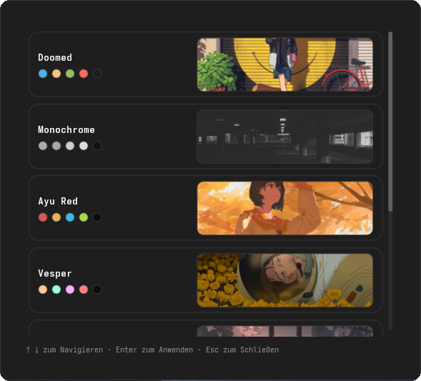
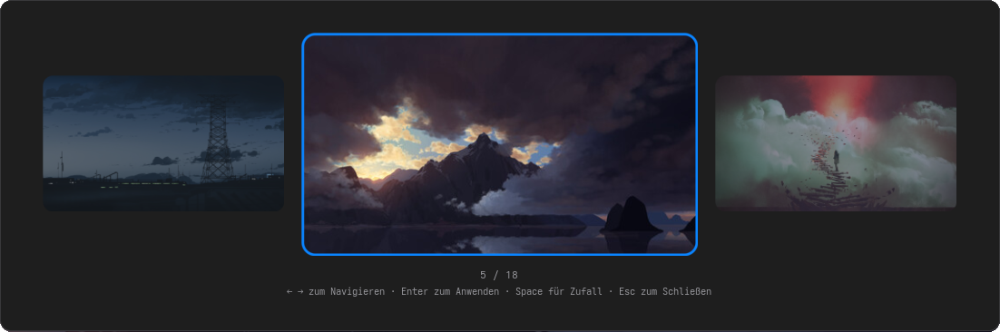
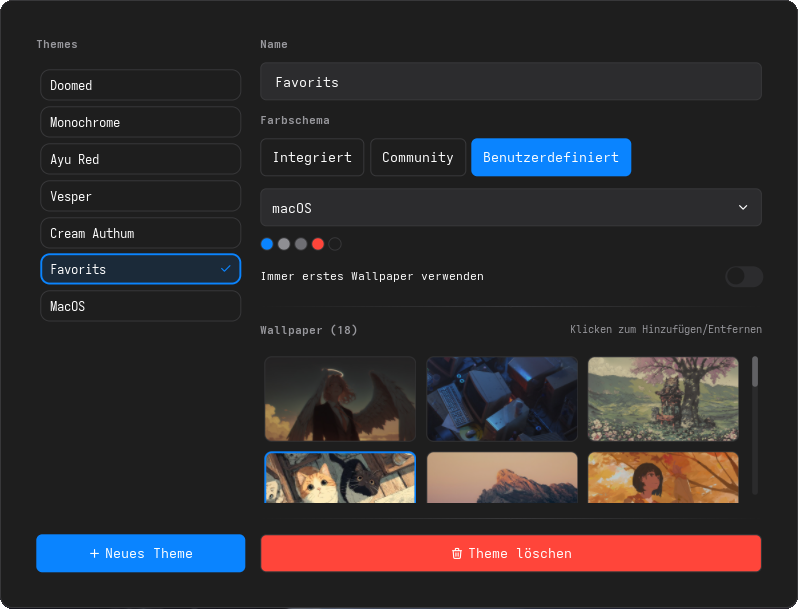

# Theme Picker

A Noctalia plugin for picking and managing color theme + wallpaper category combinations. Each theme bundles a color scheme (builtin, community, or custom) with a curated set of wallpapers, so switching a theme applies both at once.

<div align="center">
<pre>
<a href="#plugin">Plugin</a> · <a href="#panels">Panels</a> · <a href="#bar-widgets">Bar Widgets</a> · <a href="#settings">Settings</a> · <a href="#screenshots">Screenshots</a>
</pre>
</div>

## Plugin

| Field | Value |
| --- | --- |
| ID | `SirQuacksALot/theme-picker` |
| Entries | Panels: `picker`, `wallpapers`, `manager` · Bar widgets: `widget-picker`, `widget-wallpapers`, `widget-manager` |

## Panels

- **Theme Picker** (`picker`) — a vertical list of themes. Each row shows the theme's color scheme as color dots on the left and the first wallpaper of its category as a preview on the right. Click a row to apply the whole combo (color scheme + wallpaper).
- **Wallpapers** (`wallpapers`) — a horizontal carousel scoped to the active theme's wallpapers (same behaviour as `wallpaper-widget`). Browse with arrow keys, apply with Enter, pick a random one with Space.
- **Manager** (`manager`) — create, edit and delete themes: name, color scheme (source + scheme), wallpaper set, and an "always use first wallpaper" toggle.

Open via a bar widget, a keybind, or:

```sh
noctalia msg panel-toggle SirQuacksALot/theme-picker:picker
```

## Bar widgets

- `SirQuacksALot/theme-picker:widget-picker` — opens the Theme Picker
- `SirQuacksALot/theme-picker:widget-wallpapers` — opens the Wallpapers panel
- `SirQuacksALot/theme-picker:widget-manager` — opens the Manager

## Settings

| Setting | Type | Default | Description |
| --- | --- | --- | --- |
| `notify_on_change` | bool | `true` | Send a desktop notification when a theme or wallpaper is applied. |
| `close_on_apply` | bool | `false` | Close the Wallpapers panel after applying a wallpaper. |
| `show_title_picker` | bool | `true` | Show the title bar in the Theme Picker. |
| `show_title_wallpapers` | bool | `true` | Show the title bar in the Wallpapers panel. |
| `show_title_manager` | bool | `true` | Show the title bar in the Manager. |
| `show_nav_picker` | bool | `true` | Show cross-panel navigation buttons in the Theme Picker. |
| `show_nav_wallpapers` | bool | `true` | Show cross-panel navigation buttons in the Wallpapers panel. |
| `show_nav_manager` | bool | `true` | Show cross-panel navigation buttons in the Manager. |

## Screenshots

### Theme Picker


### Wallpapers


### Manager


## License

MIT
