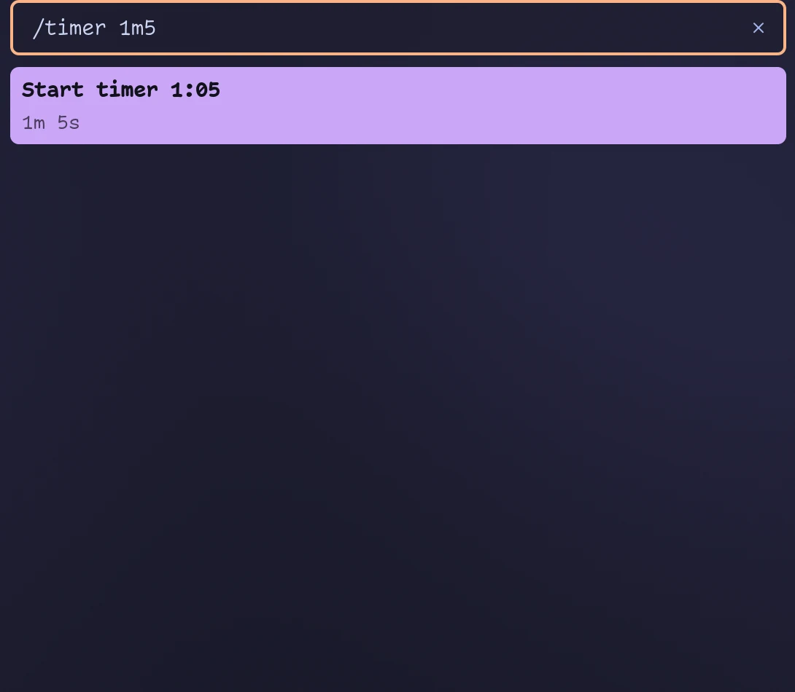

# Timed

Timed starts countdown timers from the Noctalia launcher and posts a notification
when each one finishes. The notification stays on screen until you dismiss it, so
a finished timer does not slip past you.



## Plugin

| Field | Value |
| --- | --- |
| ID | `dontblameme/timed` |
| Entries | Launcher provider: `launcher`; service: `service` |
| Launcher Prefix | `/timer` |

## Requirements

`notify-send` from `libnotify` sends completion notifications that stay until
dismissed. Without it, Timed falls back to Noctalia's own notification, which
uses the shell's default timeout.

The plugin requires a Noctalia release with plugin API 48 or newer.

## Usage

Open the launcher and type `/timer` followed by a duration.

| Launcher input | Result |
| --- | --- |
| `/timer 1h5` | Starts a 1 hour 5 minute timer |
| `/timer 1m5` | Starts a 1 minute 5 second timer |
| `/timer 3h20m10s` | Starts a 3 hour 20 minute 10 second timer |
| `/timer 1s4h` | Starts a 4 hour 1 second timer |
| `/timer 4s10h3m` | Starts a 10 hour 3 minute 4 second timer |
| `/timer 1y` | Starts a 1 year timer (365 days) |
| `/timer 5` | Starts a 5 minute timer |
| `/timer 3h2s something I want` | Starts a timer and uses the message in the notification |
| `/timer` | Lists running timers, soonest first |
| `/timer stop` | Stops all running timers |

Selecting a timer stops it. Each row reads `Stop Timer (message)`, or `Stop
Timer` when the timer has no message, and shows where it ends and how long is
left, such as `Ends at 23:46 - 1h 1m 1s`.

Durations may contain `y`, `d`, `h`, `m`, and `s` in any order, and units may
repeat. A bare number means minutes. A bare number after a unit takes the next
smaller unit, so `1h5` means 1 hour 5 minutes and `1s4h5` means 4 hours 5
minutes 1 second. The maximum is 100 years.

The duration is the first word, and everything after it is the optional message,
so `/timer 3h2s something I want` notifies you with `something I want`. When the
whole input is a valid duration, including spaced forms such as `1h 5m`, it is
used as the duration. Because of that, a message that looks like a duration,
such as `30`, extends the timer instead. Start such a message with a word.

## IPC

The service accepts commands, which is handy for keybinds and for testing:

```sh
noctalia msg plugin dontblameme/timed:service all start 1m5
noctalia msg plugin dontblameme/timed:service all start "3h2s something I want"
noctalia msg plugin dontblameme/timed:service all list
noctalia msg plugin dontblameme/timed:service all stop-all
```

`start` takes the same duration syntax and optional message as the launcher.

## Notes

Timers are saved to the plugin data directory, so they survive a Noctalia
restart and a reboot. Remaining time is computed from each stored end time. A
timer that ends while Noctalia is not running notifies when the shell starts
again.

Completion notifications are sent through `notify-send` with an expiry time of
0, so they remain until dismissed. They use the plugin's `tie.png` icon.

The service sets its update interval to the next timer expiry, capped at once a
day. A timer due in a year wakes the plugin once a day until it is close, and
the timer list is published only when it changes. Running timers cost nothing
between those checks.
